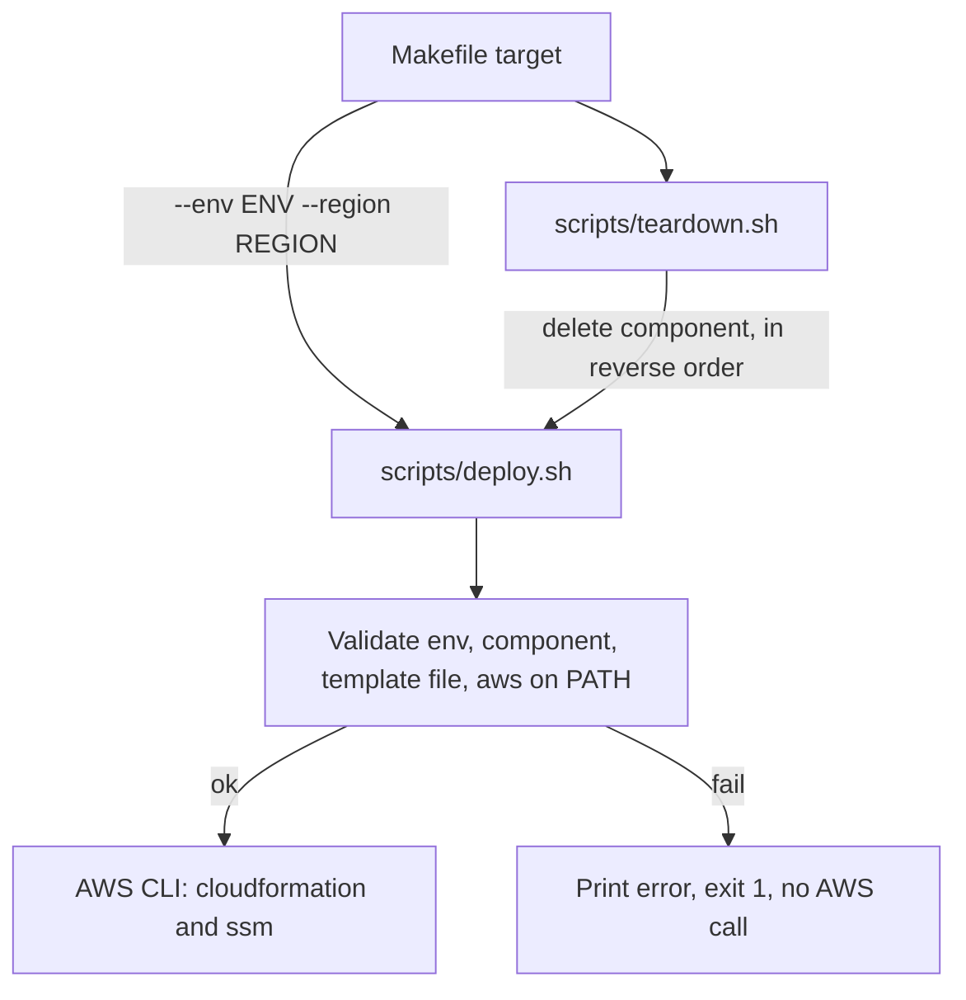
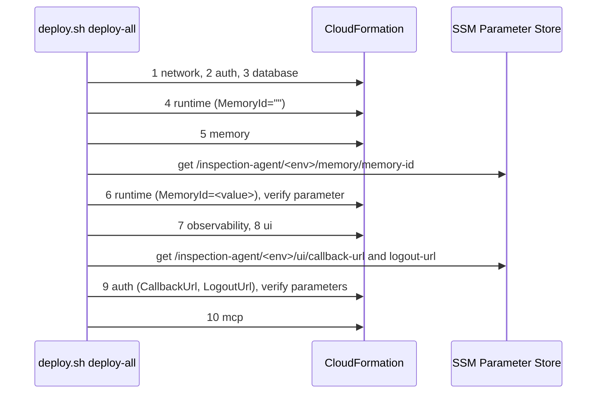
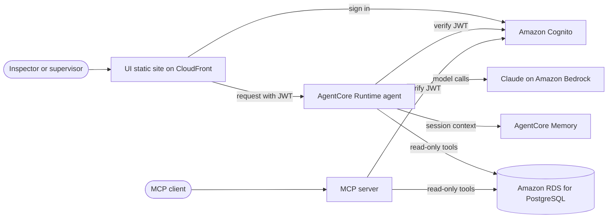

# Design Document

## Overview

GitHub issue: #1

This design bootstraps the inspection-agent repository: the folder layout, area READMEs, three Kiro steering files, two convention documents, the deploy and teardown entry point, a lint-only CI workflow, a ruff and cfn-lint configuration, and `.gitignore` additions. It creates no AWS resources, no application code, no CloudFormation templates, and no data.

Key decisions:

| Decision | Choice | Rationale |
|---|---|---|
| Layout folder names | Keep all 8 names as requested | No rename is needed, so Requirements 1.10 and 1.11 do not trigger. |
| Entry point | Root `Makefile` that delegates to `scripts/deploy.sh` and `scripts/teardown.sh` | Make gives a short, discoverable interface (`make deploy`, `make help`, `make -n`). Bash handles validation, error handling, and AWS CLI calls, which Make does poorly. Deploy and teardown are Operational_Scripts, so they belong in scripts/. |
| Template path | `infra/<component>.yaml` | One flat file per Component; simple to glob, lint, and map to a Stack_Name. |
| Stack deploy command | `aws cloudformation deploy --no-fail-on-empty-changeset` | Creates or updates in one call, waits for completion, and exits 0 when there are no changes. |
| Cross-stack values | SSM parameters only (approved in requirements) | Exports block in-place updates (runtime MemoryId, auth CloudFront URLs), risk an auth/ui import cycle, and are harder for scripts to read. |
| Ruff config | `ruff.toml` at the root | Keeps lint config separate from any future `pyproject.toml` packaging decisions. Only one ruff config may exist (Requirement 9.6). |
| cfn-lint config | `.cfnlintrc.yaml` at the root, `regions: [us-west-2]` | The one-template command stays `cfn-lint infra/<component>.yaml` and lints against the target region. |
| `.env.example` | Not created in this spec | No script in this spec needs a Secret. The `.gitignore` rules for `.env.example` are still added so a later spec can add the file. |

Note on Demo_Questions: per Requirement 2.10, this design does not reproduce their wording. The wording lives only in `.kiro/steering/product.md`; the IDs and expected answers live in `data/STORIES.md` (created by a later data spec).

## Architecture

### Repository tree after this spec

```text
inspection-agent/
├── .github/
│   └── workflows/
│       └── lint.yml                  # CI: cfn-lint + ruff, no tests
├── .kiro/
│   ├── specs/
│   │   └── 01-repo-bootstrap/        # .config.kiro, requirements.md, design.md, tasks.md
│   └── steering/
│       ├── product.md                # inclusion: always
│       ├── tech.md                   # inclusion: always
│       └── structure.md              # inclusion: always
├── data/README.md
├── docs/
│   ├── README.md
│   ├── cloudformation-conventions.md
│   └── kiro-workflow.md
├── infra/README.md
├── scripts/
│   ├── README.md
│   ├── deploy.sh                     # deploy-all, deploy <c>, delete <c>
│   └── teardown.sh                   # deletes all stacks in Teardown_Sequence
├── src/
│   ├── inspection_agent/README.md
│   ├── inspection_core/README.md
│   └── inspection_mcp/README.md
├── ui/README.md
├── .cfnlintrc.yaml
├── .gitignore                        # existing lines kept; entries appended
├── LICENSE
├── Makefile
├── README.md                         # rewritten Root_README
└── ruff.toml
```

No `.py` files and no files under infra/ or data/ other than their READMEs exist after this spec (Requirement 1.12). Git does not track empty folders, so each Area_README is what makes its folder exist in Git.

### Entry point call flow



### Full deploy sequence



## Components and Interfaces

### 1. Makefile (Entry_Point)

The Makefile is the only documented interface. It holds no logic beyond argument passing, and stays compatible with GNU Make 3.81 (the macOS default).

| Target | Delegates to | Purpose |
|---|---|---|
| `make help` (default) | — | Print targets, inputs, and defaults. |
| `make deploy` | `scripts/deploy.sh deploy-all` | Run the 10-step Deploy_Sequence. |
| `make deploy-<component>` | `scripts/deploy.sh deploy <component>` | Create or update one stack. |
| `make delete-<component>` | `scripts/deploy.sh delete <component>` | Delete one stack. |
| `make teardown` | `scripts/teardown.sh` | Delete all 8 stacks in Teardown_Sequence order. |
| `make lint` | `cfn-lint` and `ruff check` | Run the same checks as CI locally. This is a lint step, not a test. |

Inputs: `ENV ?= demo` and `REGION ?= us-west-2`, passed as `--env "$(ENV)" --region "$(REGION)"`. Make imports shell environment variables, so a stray `ENV` in the shell overrides the default; the script's Env_Rule check then rejects invalid values with a clear message. `deploy-%` and `delete-%` are pattern rules, so `make deploy-foo` reaches the script, which rejects the name (Requirement 6.13).

### 2. scripts/deploy.sh

Bash, `#!/usr/bin/env bash`, `set -euo pipefail`. It stays compatible with bash 3.2 (the macOS default): no associative arrays, no `mapfile`, no `${var,,}`. Shared helpers live inside this file because scripts/ holds Operational_Scripts only; no sourced library file is added (and `lib/` is ignored by the existing `.gitignore`).

Usage:

```text
scripts/deploy.sh [--env <env>] [--region <region>] deploy-all
scripts/deploy.sh [--env <env>] [--region <region>] deploy <component>
scripts/deploy.sh [--env <env>] [--region <region>] delete <component>
```

Constants:

```bash
COMPONENTS="network auth database runtime memory observability ui mcp"
ENV_PATTERN='^[a-z][a-z0-9]{0,9}$'
DEFAULT_ENV=demo
DEFAULT_REGION=us-west-2
```

Validation order (all before any AWS CLI call):

1. Parse arguments. Unknown flags or commands print usage and exit 2.
2. Env check: `[[ "$ENV" =~ $ENV_PATTERN ]]`. On failure print `Invalid Env '<value>': must be 1-10 characters, start with a lowercase letter, and contain only lowercase letters and digits (pattern ^[a-z][a-z0-9]{0,9}$).` and exit 1 (Requirement 6.11).
3. Component check (for `deploy` and `delete`): name must be in `COMPONENTS`. On failure print `Unknown component '<name>'. Valid components: network auth database runtime memory observability ui mcp` and exit 1 (Requirement 6.13).
4. Template check (for `deploy`, and for all 8 Components up front in `deploy-all`): `infra/<component>.yaml` must exist. On failure print `Template not found: infra/<component>.yaml` and exit 1 (Requirement 6.14). Checking all templates before step 1 avoids a half-finished deploy.
5. `command -v aws` must succeed, otherwise print `AWS CLI not found on PATH` and exit 1.

Every AWS CLI call passes `--region "$REGION"` (Requirement 6.12). Every value is double-quoted.

Helper functions:

| Function | Behavior |
|---|---|
| `stack_name <c>` | Echo `inspection-agent-$ENV-<c>`. |
| `stack_status <c>` | `aws cloudformation describe-stacks --stack-name ... --query 'Stacks[0].StackStatus' --output text`. If stderr contains `does not exist`, echo `ABSENT`; any other error is fatal. |
| `deploy_stack <c> [Key=Value ...]` | Runs the deploy command below, then requires `stack_status` to be `CREATE_COMPLETE` or `UPDATE_COMPLETE`; otherwise fails (Requirement 6.15). |
| `delete_stack <c>` | If `ABSENT`, print `Stack <name> does not exist; skipping.` and return 0. Otherwise `aws cloudformation delete-stack` then `aws cloudformation wait stack-delete-complete`; a waiter failure is fatal (Requirements 6.3, 6.9). |
| `read_ssm <path>` | `aws ssm get-parameter --name <path> --query Parameter.Value --output text`. On `ParameterNotFound` print `Missing SSM parameter: <path>` and exit 1 before any stack update (Requirement 6.8). |
| `require_param <c> <Key> <expected>` | Reads `Stacks[0].Parameters[?ParameterKey=='<Key>'].ParameterValue` and fails unless it equals `<expected>` (Requirements 6.6, 6.7). |
| `fail <step> <stack> <msg>` | Print `ERROR in step <step> (<stack>): <msg>` to stderr and exit 1. An `ERR` trap calls it with the current step, so any failed AWS CLI call stops the run (Requirement 6.15). |

Deploy command per Component:

```bash
aws cloudformation deploy \
  --region "$REGION" \
  --stack-name "$(stack_name "$c")" \
  --template-file "infra/$c.yaml" \
  --parameter-overrides "Env=$ENV" "$@" \
  --capabilities CAPABILITY_NAMED_IAM \
  --tags "Project=inspection-agent" "Env=$ENV" \
  --no-fail-on-empty-changeset
```

- `deploy` creates the stack if absent or updates it via a change set, and waits for completion.
- With `--no-fail-on-empty-changeset`, an unchanged stack prints the CLI's "No changes to deploy" message and exits 0 (Requirement 6.2).
- On updates, parameters not listed in `--parameter-overrides` keep their existing values ([Stack Overflow summary of the CLI docs](https://stackoverflow.com/questions/76984135/aws-cloudformation-deploy-and-parameter-overrides-syntax)). Step 9 relies on this: it passes only `CallbackUrl` and `LogoutUrl`, and auth keeps its other values.
- Empty MemoryId (Requirement 6.5): step 4 passes the single argument `"MemoryId="`. The CLI splits on the first `=`, so the value is the empty string. The runtime template (later spec) must declare `MemoryId` as `Type: String`, `Default: ""`, with an AllowedPattern that accepts the empty string.
- A stack left in `ROLLBACK_COMPLETE` (failed create) cannot be updated. The script detects this status before deploying and fails with `Stack <name> is in ROLLBACK_COMPLETE; run make delete-<c> first.`
- Templates larger than 51,200 bytes need `--s3-bucket`. This is out of scope here; the later package spec extends the deploy command if a template needs it.

`deploy-all` steps (each prints `==> Step N/10: <Stack_Name>` first, Requirement 6.4):

| Step | Action |
|---|---|
| 1 | `deploy_stack network` |
| 2 | `deploy_stack auth` |
| 3 | `deploy_stack database` |
| 4 | `deploy_stack runtime "MemoryId="` |
| 5 | `deploy_stack memory` |
| 6 | `id=$(read_ssm /inspection-agent/$ENV/memory/memory-id)`; `deploy_stack runtime "MemoryId=$id"`; `require_param runtime MemoryId "$id"` |
| 7 | `deploy_stack observability` |
| 8 | `deploy_stack ui` |
| 9 | `cb=$(read_ssm /inspection-agent/$ENV/ui/callback-url)`; `lo=$(read_ssm /inspection-agent/$ENV/ui/logout-url)`; `deploy_stack auth "CallbackUrl=$cb" "LogoutUrl=$lo"`; `require_param` for both |
| 10 | `deploy_stack mcp` |

Both SSM reads in step 9 happen before the auth update, so a missing parameter stops the run without touching the stack.

### 3. scripts/teardown.sh

Same shell rules and flags (`--env`, `--region`). It validates Env, then loops over `mcp ui observability memory runtime database auth network`, prints `==> Teardown: <Stack_Name>`, and calls `scripts/deploy.sh --env "$ENV" --region "$REGION" delete <c>`. `set -e` stops the loop on the first failure; absent stacks are skipped by `delete_stack` (Requirement 6.9).

### 4. Cross-stack contracts for later specs

These names are fixed here so the entry point and later templates agree.

| Producer | SSM_Key | Consumer parameter |
|---|---|---|
| memory | `/inspection-agent/<env>/memory/memory-id` | runtime `MemoryId` |
| ui | `/inspection-agent/<env>/ui/callback-url` | auth `CallbackUrl` |
| ui | `/inspection-agent/<env>/ui/logout-url` | auth `LogoutUrl` |

Other cross-stack keys are defined by the spec that adds the producing Component, using the same SSM_Key form.

### 5. Steering files

All three start with:

```markdown
---
inclusion: always
---
```

`.kiro/steering/product.md` outline:

1. Purpose: one paragraph stating inspection-agent is a demo of an AI agent that answers questions about manufacturing inspection data (first section, Requirement 2.1).
2. Personas: three list items: line A inspector (`line-a`), line B inspector (`line-b`), quality supervisor (`supervisors`).
3. Demo questions: numbered list 1 to 5, copied verbatim from Requirement 2.3. A sentence states this file is the only source of the questions and that `data/STORIES.md` holds the IDs and expected answers, referring to each question by number.
4. Data: all data is synthetic; no real company, customer, or personal data.
5. Language: all code, comments, docs, and UI text are in English.
6. Non-negotiable rules: permissions enforced in code at the tool layer from the verified user identity, never only by prompt instructions; agent is read-only, no tool creates, updates, or deletes data; no free-form SQL tool; the model never supplies the user identity as a tool argument.

`.kiro/steering/tech.md` outline:

1. Stack: Strands Agents, Amazon Bedrock AgentCore Runtime, Claude models on Amazon Bedrock, PostgreSQL on Amazon RDS, Amazon Cognito (for sign-in), AWS CloudFormation (for all infrastructure).
2. Targets: region `us-west-2`, Python `3.12`.
3. Data store: Amazon RDS for PostgreSQL is the only data store; DynamoDB is not used.
4. IaC rules: YAML-only CloudFormation; no AWS CDK; no Terraform; full rules in `docs/cloudformation-conventions.md`.
5. Naming: stacks `inspection-agent-<env>-<component>`; parameter `Env` defaults to `demo`; cross-stack values as SSM parameters under `/inspection-agent/<env>/<component>/<key>`.
6. Security baseline: five separate statements (a) to (e) from Requirement 3.6.
7. Testing policy: the five rules from Requirement 3.7, copied as written.
8. Tooling: cfn-lint and ruff are the only quality checks; CI runs lint only.

`.kiro/steering/structure.md` outline:

1. Layout: one entry per Layout folder (8 entries) with path and content description. States that no folder was renamed.
2. infra/: exactly one template per Component, 8 in total. Naming rule `infra/<component>.yaml`, followed by the 8 file names (`infra/network.yaml` … `infra/mcp.yaml`).
3. Naming rules: `inspection-agent-<env>-<component>` with example `inspection-agent-demo-runtime`; `/inspection-agent/<env>/<component>/<key>` with example `/inspection-agent/demo/memory/memory-id`.
4. Placeholders: `<env>` (Env_Rule, default `demo`, see `docs/cloudformation-conventions.md`); `<component>` (8 names only); `<NN>` (two digits, `01`–`99`); `<slug>` and `<key>` (lowercase letters, digits, hyphens).
5. Specs: `.kiro/specs/<NN>-<slug>/`, example `.kiro/specs/01-repo-bootstrap/`; details in `docs/kiro-workflow.md`.
6. scripts/: Operational_Scripts only, listing all 10; application code and library modules belong under src/.
7. Repository gotchas: the only ruff config is `ruff.toml` (do not add `[tool.ruff]` to a `pyproject.toml`); build output goes to `build/` (ignored); the inherited `.gitignore` ignores folders named `lib/`, `var/`, `env/`, `target/`, and `downloads/`, so do not use those folder names for tracked code.

### 6. docs/cloudformation-conventions.md

Numbered rules, each with a short compliant YAML snippet (Requirement 5.11):

| Rule | Content | Snippet shows |
|---|---|---|
| 1 | YAML only, `.yaml` extension; no JSON templates, CDK, or Terraform | `AWSTemplateFormatVersion: "2010-09-09"` header |
| 2 | Every parameter has a Description and a constraint | Parameter with `AllowedPattern` and one with `AWS::SSM::Parameter::Value<String>` |
| 3 | Outputs for every consumed identifier, name, or ARN, each with Description | `Outputs:` block |
| 4 | Tags `Project: inspection-agent` and `Env: !Ref Env` on every taggable resource | `Tags:` list |
| 5 | IAM least privilege; no `*` or `service:*` actions; `*` Resource only with a comment directly above | Policy statement, and a commented `Resource: "*"` case |
| 6 | No literal account IDs, region names, or `arn:` strings; use `!Sub` with `AWS::Partition`, `AWS::Region`, `AWS::AccountId` | `!Sub arn:${AWS::Partition}:...` |
| 7 | cfn-lint passes with zero errors and zero warnings; command `cfn-lint infra/<component>.yaml` (region comes from `.cfnlintrc.yaml`) | `.cfnlintrc.yaml` content |
| 8 | Stack_Name `inspection-agent-<env>-<component>` | Comment showing the deploy name |
| 9 | Env parameter: String, Default `demo`, AllowedPattern `^[a-z][a-z0-9]{0,9}$` | `Env` parameter block |
| 10 | Cross-stack values via SSM_Keys only; no `Export` or `Fn::ImportValue` | `AWS::SSM::Parameter` producer and `{{resolve:ssm:...}}` or SSM parameter-type consumer |

cfn-lint exit codes are bit flags (2 = error, 4 = warning, 8 = informational), so a warning also yields a non-zero exit, which matches the zero-warning rule.

### 7. docs/kiro-workflow.md

Sections:

1. Issue to spec mapping: one GitHub issue ↔ one folder `.kiro/specs/<NN>-<slug>/`.
2. `<NN>`: issue sequence number, two digits, zero-padded, `01`–`99`.
3. `<slug>`: 1–40 characters, `a`–`z`, `0`–`9`, `-`; no leading, trailing, or doubled `-`. Example folder `01-repo-bootstrap`.
4. Issue reference in the spec: the first line of the design.md Overview reads `GitHub issue: #<issue-number>` (this spec: `GitHub issue: #1`).
5. Commits: every message contains `#<issue-number>`; example `Add steering files and conventions docs (#1)`.
6. Pull requests: title or description contains `#<issue-number>`; example title `Repo bootstrap (#1)` with `Closes #1` in the description.
7. Task lists: no automated test tasks; each is replaced by a manual verification step naming the action and the observable pass result, with an example.
8. Testing policy reference: `.kiro/steering/tech.md`.

### 8. Root README.md

The existing two-line README is replaced. Outline, in order:

1. Title and purpose (≤ 5 sentences): what inspection-agent does and that it is a demo for developers and solution builders evaluating an inspection-data agent on AWS.
2. Architecture: Mermaid diagram (draft below).
3. Demo: link to [product steering](.kiro/steering/product.md) for the demo questions and to [data/STORIES.md](data/STORIES.md) for the synthetic stories. No question text.
4. Synthetic data statement: all data in the repository and the demo is synthetic and contains no real persons, customers, or inspection records.
5. Prerequisites: AWS CLI v2 with configured credentials; Python 3.12; an AWS account with access to us-west-2; Amazon Bedrock model access for Claude models in us-west-2; GNU Make and bash.
6. Inputs: `ENV` (default `demo`, Env_Rule) and `REGION` (default `us-west-2`), for example `make deploy ENV=dev1 REGION=us-west-2`.
7. Deploy: numbered list of 10 steps, each naming component and command (`make deploy-network`, …). Steps 4, 6, and 9 explain the empty MemoryId, the MemoryId update from step 5, and the auth update with the CloudFront callback and logout URLs from step 8. A note says `make deploy` runs all 10.
8. Per-component commands: `make deploy-<component>` and `make delete-<component>` for each of the 8 Components.
9. Teardown: numbered list of 8 steps (mcp, ui, observability, memory, runtime, database, auth, network) with `make delete-<component>`, plus `make teardown` for all.
10. Repository layout and links to `docs/cloudformation-conventions.md` and `docs/kiro-workflow.md`.
11. License.

Account-specific values appear only as placeholders such as `<ACCOUNT_ID>`.

Mermaid draft:



Node labels avoid parentheses inside square brackets, which break Mermaid parsing.

### 9. CI workflow `.github/workflows/lint.yml`

```yaml
name: lint
on:
  pull_request:
    types: [opened, reopened, synchronize]
permissions:
  contents: read
jobs:
  lint:
    runs-on: ubuntu-latest
    steps:
      - uses: actions/checkout@v4
      - uses: actions/setup-python@v5
        with:
          python-version: "3.12"
      - name: Install linters
        run: python -m pip install "cfn-lint==<pinned>" "ruff==<pinned>"
      - name: cfn-lint
        shell: bash
        run: |
          shopt -s nullglob globstar
          files=(infra/**/*.yaml infra/**/*.yml infra/**/*.json)
          if [ ${#files[@]} -eq 0 ]; then
            echo "No templates under infra/; nothing to lint."
            exit 0
          fi
          cfn-lint "${files[@]}"
      - name: ruff
        run: ruff check --output-format=github .
```

- No `branches` filter, so it runs for pull requests to any branch (Requirements 9.1, 9.2).
- `nullglob` makes the array empty when infra/ is missing or has no templates, so the step passes (Requirement 9.5). `globstar` makes `**` match subdirectories, including zero levels.
- `ruff check .` with no Python files prints a "No Python files found" warning and exits 0 (Requirement 9.7). `--output-format=github` annotates offending files on the pull request.
- cfn-lint prints each offending file path; non-zero exit fails the job (Requirement 9.8).
- No `secrets.*` references, no AWS credential steps, no test step (Requirements 9.3, 9.4).
- `<pinned>` is replaced with the latest release of each tool at implementation time.

### 10. Lint configuration files

`ruff.toml`:

```toml
target-version = "py312"
line-length = 100

[lint]
select = ["E", "F", "W", "I", "B", "UP"]
```

`.cfnlintrc.yaml`:

```yaml
regions:
  - us-west-2
```

### 11. .gitignore additions

Appended at the end; existing lines stay unchanged (Requirement 10.5). The existing file already covers `build/`, `dist/`, `*.egg-info/`, `__pycache__/`, `*.py[codz]`, `.venv`, `venv/`, `.pytest_cache/`, `.mypy_cache/`, `.ruff_cache/`, `.env`, and `*.log`.

```gitignore
# --- inspection-agent additions ---
# Node
node_modules/
npm-debug.log*
yarn-error.log*

# Environment files (keep the template tracked)
.env.*
!.env.example

# AWS packaging output
packaged*.yaml
```

`node_modules/` without a leading slash matches at the root and in any subdirectory. `.env.*` matches `.env.local`, `.env.dev`, and `.env.prod` at any depth, and `!.env.example` re-includes the template. `package.json` and `package-lock.json` match no rule. Operational_Scripts write build output under `build/`, which is already ignored (Requirement 10.4).

### 12. Area READMEs

Each is English, ≤ 50 lines, with a one-line purpose, a "Contents" list, and a pointer to `.kiro/steering/structure.md`.

| Folder | Required content |
|---|---|
| infra/ | CloudFormation templates, one per Component; lists network, auth, database, runtime, memory, observability, ui, mcp; file rule `infra/<component>.yaml`; link to conventions doc. |
| src/inspection_core/ | Shared Python package for database access, authorization, and tool functions. |
| src/inspection_agent/ | Strands agent and the AgentCore entrypoint. |
| src/inspection_mcp/ | MCP server; added by a later spec. |
| data/ | Database schema, data generator, generated seed files, and the Stories_File at `data/STORIES.md`; all data is synthetic. |
| ui/ | Static site. |
| scripts/ | Operational_Scripts only; lists deploy, package, seed, create demo users, invoke, smoke test, demo reset, demo warmup, memory inspect, teardown. |
| docs/ | Project documentation; lists the two convention docs. |

## Data Models

This spec has no application data. The only structured data is configuration:

| Item | Shape |
|---|---|
| Component | One of `network`, `auth`, `database`, `runtime`, `memory`, `observability`, `ui`, `mcp` |
| Env | String matching `^[a-z][a-z0-9]{0,9}$`, default `demo` |
| Stack_Name | `inspection-agent-<env>-<component>` |
| Template path | `infra/<component>.yaml` |
| SSM_Key | `/inspection-agent/<env>/<component>/<key>`, `<key>` in lowercase letters, digits, hyphens |
| Spec folder | `.kiro/specs/<NN>-<slug>/` |
| Stack tags | `Project=inspection-agent`, `Env=<env>` |

## Correctness Properties

This spec produces documentation, configuration, a CI workflow, and shell scripts that wrap the AWS CLI, and the project forbids automated tests, so no generated-input testing applies. Each statement below is verified by hand with the stated check.

### Property 1: Layout is complete and empty of code

For all 8 Layout folders, `git ls-files <folder>/README.md` lists exactly one file, each is ≤ 50 lines (`wc -l`), and `git ls-files '*.py' 'infra/*' 'data/*'` lists only the infra and data READMEs.

**Validates: Requirements 1.1, 1.2, 1.3, 1.4, 1.5, 1.6, 1.7, 1.8, 1.9, 1.12**

### Property 2: Demo question wording has one home

For each of the five questions in `.kiro/steering/product.md`, `git grep -i "<wording>"` matches only that file and `.kiro/specs/01-repo-bootstrap/requirements.md`. Every other file that mentions the questions links `.kiro/steering/product.md` and `data/STORIES.md`.

**Validates: Requirements 2.3, 2.4, 2.10, 2.11, 7.9, 7.10**

### Property 3: Steering files load in every session

For all three steering files, the front matter is `inclusion: always` (read the first three lines), and each contains the statements listed in its outline.

**Validates: Requirements 2.1, 2.2, 2.5, 2.6, 2.7, 2.8, 2.9, 2.12, 3.1, 3.2, 3.3, 3.4, 3.5, 3.6, 3.7, 3.9, 3.10, 3.11, 4.1, 4.2, 4.3, 4.4, 4.5, 4.6, 4.7, 4.8**

### Property 4: No test artifacts exist

For all tracked paths, `git ls-files | grep -E '(^|/)(tests?/|conftest\.py$|pytest\.ini$|test_[^/]*\.py$|[^/]*_test\.py$)'` prints nothing, and `.github/workflows/lint.yml` has only the cfn-lint and ruff check steps.

**Validates: Requirements 3.8, 9.4**

### Property 5: Invalid input never reaches AWS

For any Env not matching `^[a-z][a-z0-9]{0,9}$` (for example `Demo`, `1demo`, `demo-1`, `abcdefghijk`, or empty), any unknown component, and any missing template, `scripts/deploy.sh` exits non-zero with the specified message before any AWS CLI call. Check by hand with AWS credentials unset: `make deploy ENV=Demo`, `make deploy-foo`, and `make deploy-network` while `infra/network.yaml` is absent each print the validation message, not an AWS credentials error.

**Validates: Requirements 6.10, 6.11, 6.13, 6.14**

### Property 6: Deploy order and parameters are fixed

For the full deploy, `make -n deploy` shows the single delegation to `scripts/deploy.sh deploy-all`, and reading `deploy-all` shows steps 1–10 in Deploy_Sequence order, each preceded by `==> Step N/10: <Stack_Name>`, with `"MemoryId="` at step 4, SSM reads of `/inspection-agent/<env>/memory/memory-id` at step 6 and `/inspection-agent/<env>/ui/callback-url` and `logout-url` at step 9, each followed by `require_param`.

**Validates: Requirements 6.1, 6.4, 6.5, 6.6, 6.7, 6.8, 6.12, 6.15**

### Property 7: Re-deploy and delete are idempotent

For any Component, running `make deploy-<c>` twice in a row leaves the second run printing "No changes to deploy" and exiting 0, and running `make delete-<c>` on an absent stack prints the skip message and exits 0. Teardown visits stacks in Teardown_Sequence order (read `scripts/teardown.sh`). Verified once AWS templates exist in later specs.

**Validates: Requirements 6.2, 6.3, 6.9**

### Property 8: CI passes on an empty repository and has no secrets

For the bootstrap commit, the lint workflow run on the pull request is green; `grep -n 'secrets\.' .github/workflows/lint.yml` and `grep -n 'aws-actions\|AWS_' .github/workflows/lint.yml` print nothing; `ruff.toml` is the only ruff config (`git ls-files | grep -E 'ruff\.toml|pyproject\.toml'`).

**Validates: Requirements 9.1, 9.2, 9.3, 9.5, 9.6, 9.7, 9.8**

### Property 9: Ignore rules match the required paths

For each path in Requirements 10.2, 10.3, and 10.5, `git check-ignore -v <path>` prints a matching rule; for `package.json`, `package-lock.json`, and `.env.example`, it prints nothing or the `!.env.example` rule; `git diff <base> -- .gitignore` shows only added lines.

**Validates: Requirements 10.2, 10.3, 10.5, 10.8**

### Property 10: No Secrets in the repository

For all tracked files and history, reading `git ls-files` and `git log -p --all` finds no account IDs, access keys, passwords, tokens, or private key blocks; README uses `<ACCOUNT_ID>`-style placeholders.

**Validates: Requirements 3.10, 7.11, 10.1, 10.6**

## Error Handling

| Condition | Behavior | Requirement |
|---|---|---|
| Invalid Env | Message states the Env_Rule; exit 1; no AWS call | 6.11 |
| Unknown component | Message lists the 8 valid names; exit 1; no AWS call | 6.13 |
| Missing template | Message names `infra/<c>.yaml`; exit 1; no AWS call for it (all templates checked up front in `deploy-all`) | 6.14 |
| `aws` not installed | Message `AWS CLI not found on PATH`; exit 1 | 6.1 (README prerequisite: 6.16) |
| AWS CLI non-zero exit | `ERR` trap prints step and Stack_Name; exit 1; later steps not run | 6.15 |
| Stack status not `CREATE_COMPLETE` / `UPDATE_COMPLETE` after deploy | Fail with step, Stack_Name, and status | 6.15 |
| Stack in `ROLLBACK_COMPLETE` before deploy | Fail with instruction to delete first | 6.15 |
| Missing SSM parameter in step 6 or 9 | Message names the path; exit 1; target stack not updated | 6.8 |
| Parameter mismatch after step 6 or 9 | Fail naming the parameter, expected, and actual value | 6.6, 6.7 |
| Stack absent on delete or teardown | Print skip message; exit 0 or continue | 6.3, 6.9 |
| `wait stack-delete-complete` fails (for example `DELETE_FAILED`) | Fail with step and Stack_Name; teardown stops | 6.15 |
| CI: no templates | cfn-lint step prints a skip message and passes | 9.5 |
| CI: lint findings | Step fails; log and annotations name each file | 9.8 |
| Operational_Script missing a Secret (later specs) | Check all required variables first; print the variable name only; exit non-zero before external changes | 10.7 |

No error message prints a parameter value that could be a Secret; the MemoryId and CloudFront URLs are not Secrets.

## Testing Strategy

The project forbids automated tests (`.kiro/steering/tech.md`). There are no test files, fixtures, test frameworks, property-based tests, or CI test steps. Verification is manual and runs once per task, with results recorded in the task notes.

Manual checks, in the order the tasks produce the files:

1. Layout and READMEs: `git ls-files`, `wc -l */README.md src/*/README.md`, and reading each README (Property 1).
2. Steering files: read front matter and each section against the outlines; run the `git grep -i` check for each demo question (Properties 2, 3).
3. Convention docs: read each numbered rule and snippet in `docs/cloudformation-conventions.md`; read `docs/kiro-workflow.md` against Requirement 8 criteria 1–8.
4. Entry point, without AWS access:
   - `make help` lists targets and defaults.
   - `make -n deploy`, `make -n deploy-network`, `make -n teardown` show the expected delegation and default `--env demo --region us-west-2`.
   - `make deploy ENV=Demo`, `make deploy ENV=abcdefghijk`, `make deploy-foo`, and `make deploy-network` (no template yet) each exit non-zero with the specified message (Property 5).
   - `bash -n scripts/deploy.sh scripts/teardown.sh` reports no syntax errors; if available, `shellcheck scripts/*.sh` reports no findings.
   - Run once under `/bin/bash` 3.2 on macOS to confirm compatibility.
5. Entry point with AWS (deferred to the first spec that adds templates): deploy one Component twice (no-change exit 0), delete an absent stack (skip, exit 0), and confirm `describe-stacks` parameters after steps 4, 6, and 9 (Properties 6, 7).
6. Lint: `make lint` passes locally; open the bootstrap pull request and confirm the lint workflow is green with infra/ holding only its README and no `.py` files. Optionally push a throwaway branch with an invalid `infra/x.yaml` to see the cfn-lint step fail and name the file, then delete the branch (Property 8).
7. `.gitignore`: run `git check-ignore -v` for every path listed in Requirements 10.2, 10.3, and 10.5, and confirm `git diff` on `.gitignore` shows additions only (Property 9).
8. Secrets: read `git ls-files` and `git log -p --all` output before opening the pull request (Property 10).
