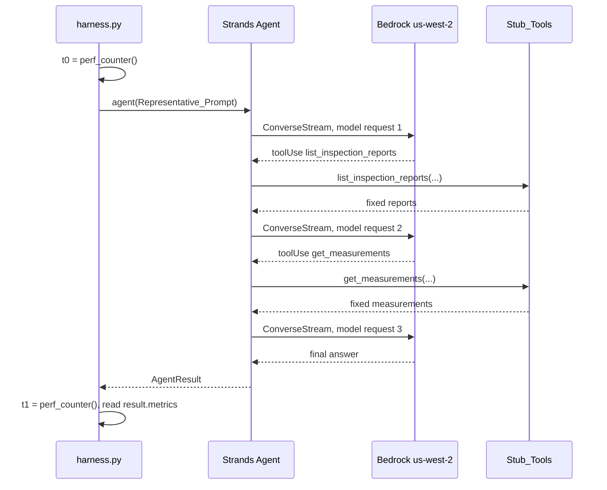

# Design Document

## Overview

GitHub issue: #2

This design describes how to run the model access spike and how to write its only deliverable, the decision record `docs/spikes/model-access.md`. The spike confirms model IDs and routing from the Amazon Bedrock API in us-west-2, checks access prerequisites, measures latency and token usage with a throwaway local Strands agent, compares reasoning settings, reads quotas, and writes a residency statement for the talk. The spike adds no scripts, no code under `src/`, and no infrastructure. Its time-box is 3 hours.

The issue number was confirmed on 2026-11-19 with `gh issue view 2`. Issue #2 is titled "Spike: Bedrock model access, quotas, inference profile choice, and latency in us-west-2" and depends on #1. The issue's reviewer note says the result feeds the `ModelId` parameter of the runtime stack (issue #9).

Candidate change (2026-11-20): tasks 2.1 to 3.2 showed that Claude Sonnet 5.5 (US and global profiles) and Claude Haiku 5.5 are not available for this account. Every `Converse` call in us-west-2 returned `AccessDeniedException` with "<model> is not available for this account", and `agreementAvailability` stayed `NOT_AVAILABLE`. The user switched candidates, and the user's decision takes precedence over the original prompt. The new candidates are in the table below. The global comparison candidate (Claude Haiku 4.5 through the global profile) is an assumption: the user did not name it, and the comparison stays "same model as the default, global profile". The earlier models are kept as rejected candidates.

Candidates:

| Role | Model | Profile scope | Expected ID (confirmed from the us-west-2 listing) |
|---|---|---|---|
| Default_Candidate | Claude Haiku 4.5 | US geographic | prefix `us.anthropic.claude-haiku-4-5`, likely with a date and version suffix (an earlier listing showed `us.anthropic.claude-haiku-4-5-20251001-v1:0`) |
| Global_Candidate (assumption) | Claude Haiku 4.5 | global | prefix `global.anthropic.claude-haiku-4-5`, likely with the same suffix |
| Fallback_Candidate | Claude Sonnet 4.6 | US geographic | prefix `us.anthropic.claude-sonnet-4-6`, possibly with a suffix |
| Rejected | Claude Sonnet 5.5 (US and global), Claude Haiku 5.5 (US) | n/a | not available for this account (see "Rejected candidates") |

The fallback is now a larger, more capable model, used if the default's answer quality is not good enough. It is no longer smaller and faster than the default.

Key decisions:

| Decision | Choice | Rationale |
|---|---|---|
| Committed output | `docs/spikes/model-access.md` only, plus this spec folder | Requirement 8. The testing policy forbids test and verification scripts, and the user's prompt says "Do not add scripts for this spike." |
| Where the measurement code lives | A temporary folder outside the workspace, created with `mktemp -d` (for example under `$TMPDIR`), with its own Python 3.12 virtual environment | `git status --porcelain` stays clean (Requirement 8.2). Nothing can be committed by accident. The folder is deleted when the spike ends. |
| How results leave the harness | Printed to the terminal and, if needed, written to files inside the temporary folder. The Developer copies numbers into the decision record by hand | Run output files never enter the Repository (Requirement 8.3). The per-Run times are copied into the record as a table so that p50 and p95 can be recomputed by a reader. |
| Model call path | Strands `BedrockModel` with streaming on (the default), which calls the Converse stream API on `bedrock-runtime` | This is the path the runtime agent (#8) will use, so latency and IAM findings carry over. |
| Reasoning settings mechanism | `additional_request_fields` on `BedrockModel` | Strands has no named reasoning parameter. Its Bedrock provider page says reasoning is set through `additional_request_fields`, which it passes to Converse as `additionalModelRequestFields` ([Strands: Amazon Bedrock](https://strandsagents.com/latest/documentation/docs/user-guide/concepts/model-providers/amazon-bedrock/)). Requirement 4.8 therefore applies. |
| `max_tokens` in the harness | Set explicitly to 4096 for every Candidate and configuration | Strands defaults `max_tokens` to the model's output limit (64K for Claude Haiku 4.5 and Claude Sonnet 4.6 per their model cards). Bedrock reserves input tokens plus `max_tokens` against the tokens-per-minute quota when a request starts ([How tokens are counted](https://docs.aws.amazon.com/bedrock/latest/userguide/quotas-token-burndown.html)). A fixed value keeps Candidates comparable and makes the quota estimate realistic. |
| Reasoning configurations measured (deferred) | C1 = default (no reasoning fields). C2 = a second configuration chosen from the Claude Haiku 4.5 documentation (for example extended thinking on with a small `budget_tokens`, or off). The exact fields are to be confirmed from the AWS docs before measuring | C1 is required by Requirement 4.3. Haiku 4.5 and Sonnet 4.6 do not expose the Sonnet 5.5 `output_config.effort` and `between_tools` options as documented, so the earlier C2 and C3 (kept under "Reasoning settings comparison") apply only if the docs confirm them for the new models. |
| Fallback_Candidate | Claude Sonnet 4.6 through its US geographic profile. The Developer confirms the ID from the us-west-2 listing | The Claude Sonnet 4.6 model card describes it as a full upgrade of Anthropic's mid-tier model with improved coding, long-context reasoning, and agent planning ([Claude Sonnet 4.6 model card](https://docs.aws.amazon.com/bedrock/latest/userguide/model-card-anthropic-claude-sonnet-4-6.html), accessed 2026-11-20). The Claude Haiku 4.5 card describes the default as a lightweight model optimized for speed and efficiency ([Claude Haiku 4.5 model card](https://docs.aws.amazon.com/bedrock/latest/userguide/model-card-anthropic-claude-haiku-4-5.html)). Together they support "more capable than the default" for Requirement 2.6. |
| Quota estimate | Applies the Bedrock output-token burndown rate to the token estimate | Bedrock charges output tokens against the quota at a multiple. Without the multiple, the 80 percent check in Requirements 5.4 and 5.6 would understate the risk. The calculation still uses only the inputs listed in Requirement 5.3. |
| Stub user identity | A module constant in the harness (`line-a`), never a tool argument | The stub mirrors the product rule that the model never supplies the user identity. The denial for Demo_Question 4 comes from this constant. |

Note on Demo_Questions: this design refers to them by number and does not reproduce their wording. The wording lives only in [`.kiro/steering/product.md`](../../steering/product.md).

### Model IDs: expected, not verified

The expected ID prefixes are `us.anthropic.claude-haiku-4-5` (Default_Candidate), `global.anthropic.claude-haiku-4-5` (Global_Candidate), and `us.anthropic.claude-sonnet-4-6` (Fallback_Candidate). Claude 4.x IDs on Bedrock usually carry a date and version suffix (for example `-20251001-v1:0`), so the exact ID comes from the `ListInferenceProfiles` result in us-west-2 (Requirement 2.2, 2.3). Documentation is not the account. The decision record uses only listed IDs, and base model IDs for availability checks come from the listing's model ARNs.

### Rejected candidates

These models were tried first and rejected because the account cannot use them. The decision record keeps a short "Rejected candidates" section with this evidence (Requirement 7.9).

| Model and profile | Evidence | Where recorded |
|---|---|---|
| Claude Sonnet 5.5, `us.anthropic.claude-sonnet-5-5` | `Converse` in us-west-2 returned `AccessDeniedException` "anthropic.claude-sonnet-5-5 is not available for this account" on 3 attempts. `agreementAvailability` stayed `NOT_AVAILABLE` with `authorizationStatus` `AUTHORIZED`. | Old notes of tasks 2.1 to 3.2 |
| Claude Sonnet 5.5, `global.anthropic.claude-sonnet-5-5` | Same error and same base model. | Same |
| Claude Haiku 5.5, `us.anthropic.claude-haiku-5-5` | `AccessDeniedException` "anthropic.claude-haiku-5-5 is not available for this account". Same availability state. | Same |

The AWS documentation page "Request access to models" says that some models need additional account-level access, and that if the activation requirements are met and the model is supported in the Region but `AccessDeniedException` persists, the account owner should contact AWS Sales ([Request access to models](https://docs.aws.amazon.com/bedrock/latest/userguide/model-access.html), accessed 2026-11-20). This is a follow-up for the account administrator, not part of the spike.

### Conflicts with steering

The user's prompt said: "if this prompt conflicts with [steering], follow this prompt and flag the conflict in the design." Each item from the requirements' "Conflicts with steering" section is flagged below with the resolution this design uses.

| # | Conflict | Steering says | This design does |
|---|---|---|---|
| C1 | Testing policy and the Measurement_Run | `.kiro/steering/tech.md` forbids test and verification scripts and eval harnesses. | **Conflict flagged.** The prompt asks for a local measurement run with a minimal Strands agent and stub tools. The harness lives in a temporary folder outside the workspace, is never committed, is not an Operational_Script, and is deleted at the end. The only committed file is the decision record. |
| C2 | Answer quality judgment | Same rule: no eval harnesses. | **Conflict flagged.** The Developer reads each answer and writes a Pass, Partial, or Fail rating by hand against fixed criteria. No scoring code, no reference-answer fixtures, and nothing committed. |
| C3 | Demo_Questions 4 and 5 need features that do not exist yet | `.kiro/steering/product.md` requires tool-layer permission checks from the verified identity, and question 5 relies on session memory. | **Conflict flagged.** The stub tool returns a fixed denial for the other line, and session resume is approximated with a summary in the system prompt of a new agent. The record states that neither result shows tool-layer enforcement or AgentCore Memory behavior. |
| C4 | Demo_Question wording | Spec 01 allows the wording only in `.kiro/steering/product.md`. | **Conflict flagged.** The record and this design refer to questions by number and link to the steering file. The Representative_Prompt and the concrete prompts used for quality runs contain none of the full question wording. |
| C5 | Region | `.kiro/steering/tech.md` names us-west-2 as the only target region. | **Conflict flagged.** All calls are sent to us-west-2. Cross-Region inference profiles may process requests in other Regions, and the record says so in the residency statement. |
| C6 | Root README prerequisite wording | `README.md` says "Amazon Bedrock model access enabled for Claude models in us-west-2". | **Conflict flagged, with a preliminary finding.** AWS documentation now says that in commercial Regions there is no model access request to submit; Bedrock starts an AWS Marketplace subscription on first invocation, and the caller needs Marketplace permissions ([Request access to models](https://docs.aws.amazon.com/bedrock/latest/userguide/model-access), accessed 2026-11-19). If the spike confirms this, the record states the correct step and lists the README change as a follow-up. The README is not edited in this spike. |

## Research findings

These findings come from documentation read on 2026-11-19. Each one is a lead for the spike, not a result. The Developer confirms each item in the account and records the confirmation date. Content was rephrased for compliance with licensing restrictions.

| Topic | Finding | Source |
|---|---|---|
| Historical, rejected: Claude Sonnet 5.5 IDs | Base model ID `anthropic.claude-sonnet-5-5`. Geo IDs include `us.anthropic.claude-sonnet-5-5`; global ID `global.anthropic.claude-sonnet-5-5`. In us-west-2 the model has no in-Region option on `bedrock-runtime`; only geo and global profiles. | [Claude Sonnet 5.5 model card](https://docs.aws.amazon.com/bedrock/latest/userguide/model-card-anthropic-claude-sonnet-5-5.html) |
| Destination Regions | Destination Regions of a geo profile depend on the source Region. The model cards say to call `GetInferenceProfile` from the source Region for the current routing. | [Claude Sonnet 5.5 model card](https://docs.aws.amazon.com/bedrock/latest/userguide/model-card-anthropic-claude-sonnet-5-5.html) (read 2026-11-19; the same guidance is expected on the new cards) |
| Global routing | Global profiles may route to any supported AWS commercial Region. | [Supported Regions and models for inference profiles](https://docs.aws.amazon.com/bedrock/latest/userguide/cross-region-inference-support.html), [Cross-Region inference](https://docs.aws.amazon.com/bedrock/latest/userguide/cross-region-inference.html) |
| Where processing is logged | CloudTrail logs cross-Region requests in the source Region; the field `additionalEventData.inferenceRegion` shows where a request was processed. Data between Regions stays on the AWS network and is encrypted in transit. | [Cross-Region inference](https://docs.aws.amazon.com/bedrock/latest/userguide/cross-region-inference.html) |
| Historical, rejected: reasoning defaults, Claude Sonnet 5.5 | Adaptive thinking is on by default. Effort levels are `low`, `medium`, `high`, `xhigh`, `max`; default `high`. `thinking.type: "disabled"` returns a 400 error; `"between_tools"` turns off up-front thinking at `high` effort or below. | [Claude Sonnet 5.5 model card](https://docs.aws.amazon.com/bedrock/latest/userguide/model-card-anthropic-claude-sonnet-5-5.html), [Adaptive thinking](https://docs.aws.amazon.com/bedrock/latest/userguide/claude-messages-adaptive-thinking.html) |
| Historical, rejected: request shape for effort (Claude 5.5 models) | `effort` goes inside a separate `output_config` object, not inside `thinking`. Putting it inside `thinking` returns a 400 error. | [Adaptive thinking](https://docs.aws.amazon.com/bedrock/latest/userguide/claude-messages-adaptive-thinking.html) |
| Historical, rejected: Claude Haiku 5.5 reasoning | Default effort `medium`. `thinking.type: "disabled"` is accepted at `high` effort or below. | [Adaptive thinking](https://docs.aws.amazon.com/bedrock/latest/userguide/claude-messages-adaptive-thinking.html) |
| Strands reasoning settings | `BedrockModel` has no named reasoning parameter. Reasoning fields go in `additional_request_fields`, passed to Converse as `additionalModelRequestFields`. The Strands example uses `{"thinking": {"type": "adaptive"}, "output_config": {"effort": "high"}}`. | [Strands: Amazon Bedrock](https://strandsagents.com/latest/documentation/docs/user-guide/concepts/model-providers/amazon-bedrock/) |
| Strands `max_tokens` default | Defaults to the model's known output limit; Bedrock reserves input plus `max_tokens` against TPM at request start. | Same Strands page |
| Strands metrics | `AgentResult.metrics` exposes `accumulated_usage` (`inputTokens`, `outputTokens`, `totalTokens`), `cycle_count`, `cycle_durations`, and `tool_metrics` (per tool, with a call count). | [Strands metrics](https://strandsagents.com/latest/documentation/docs/user-guide/observability-evaluation/metrics/) |
| Marketplace access | First invocation of a third-party model starts an AWS Marketplace subscription in the background. The caller needs `aws-marketplace:Subscribe`, `aws-marketplace:Unsubscribe`, and `aws-marketplace:ViewSubscriptions`. After the model is enabled for the account, other roles can invoke it without Marketplace permissions. A valid payment method is required. | [Request access to models](https://docs.aws.amazon.com/bedrock/latest/userguide/model-access) |
| Anthropic first-time-use (FTU) form | Required for Anthropic models earlier than Claude Opus 4.7, once per account or once at the organization's management account. The docs name Claude Sonnet 4.6, Claude Opus 4.6, Claude Haiku 4.5, and the Claude 3.x models as still requiring it. The form is submitted in the console (Anthropic providers page or model catalog) or with `PutUseCaseForModelAccess`. The agreement can stay pending after submission, and `GetFoundationModelAvailability` shows its state. Confirmed from the docs on 2026-11-20: the form applies to the new Default_Candidate and Fallback_Candidate. Whether it is already done in this account is to be confirmed in task 3.1 (read-only). The spike does not submit the form. (Earlier, the form was expected not to apply to the Claude 5.5 models; those are rejected.) | [Request access to models](https://docs.aws.amazon.com/bedrock/latest/userguide/model-access.html) |
| Claude Haiku 4.5 | Lightweight model optimized for speed and efficiency. Context 200K, max output 64K. Reasoning "Supported" (the card gives no default or parameters; to be confirmed). Marketplace product ID `prod-xdkflymybwmvi`. Supported on `bedrock-runtime` Converse and Invoke. | [Claude Haiku 4.5 model card](https://docs.aws.amazon.com/bedrock/latest/userguide/model-card-anthropic-claude-haiku-4-5.html) |
| Claude Sonnet 4.6 | Mid-tier model, context 1M, max output 64K. Reasoning off by default; adaptive thinking with `thinking.type: "adaptive"` is recommended and manual extended thinking with `budget_tokens` is deprecated. Marketplace product ID `prod-ffvjxvh4ltq64`. Supported on `bedrock-runtime` Converse and Invoke. | [Claude Sonnet 4.6 model card](https://docs.aws.amazon.com/bedrock/latest/userguide/model-card-anthropic-claude-sonnet-4-6.html) |
| Haiku 4.5 and Sonnet 4.6 thinking options | Differ from the effort and adaptive options of Claude Sonnet 5.5. The Haiku 4.5 thinking parameters are to be confirmed from the AWS extended thinking documentation before any reasoning comparison runs. | To be confirmed |
| Subscription state check | `GetFoundationModelAvailability` returns `agreementAvailability.status` (`AVAILABLE`, `PENDING`, `NOT_AVAILABLE`, `ERROR`). | Same page |
| Historical, rejected: Marketplace product ID | Claude Sonnet 5.5: `prod-pjfguoisodbd6`. Usable with the `aws-marketplace:ProductId` condition key on `aws-marketplace:Subscribe`. | [Claude Sonnet 5.5 model card](https://docs.aws.amazon.com/bedrock/latest/userguide/model-card-anthropic-claude-sonnet-5-5.html) |
| Global profile IAM | Three statements: the inference profile ARN in the source Region, the foundation model ARN in the source Region, and the Region-less foundation model ARN `arn:aws:bedrock:::foundation-model/<MODEL>`, with `aws:RequestedRegion` set to `unspecified`. | [Global cross-Region inference](https://docs.aws.amazon.com/bedrock/latest/userguide/global-cross-region-inference.html) |
| Quota names | Global profiles have quotas named "Global Cross-region model inference requests per minute for ${Model}" and "... tokens per minute for ${Model}", managed from the source Region. Geo profile quota names follow a similar "Cross-region model inference ..." pattern; the exact names are read from Service Quotas. | Same page |
| Output-token burndown | Output tokens count against TPM at a multiple: 10x for Claude Opus 5.5 and Claude Sonnet 5; 5x for other Anthropic models version 4.7 and below. Claude Haiku 4.5 and Claude Sonnet 4.6 fall under "version 4.7 and below", so 5x is expected for both (to be rechecked on the page). The Claude 5.5 models (rejected) were not named. | [How tokens are counted](https://docs.aws.amazon.com/bedrock/latest/userguide/quotas-token-burndown.html) |

Open research gap: the burndown rate for Claude Haiku 4.5 and Claude Sonnet 4.6. The Developer rechecks the burndown page and both model cards. If neither names a rate, the record uses 5x (the rate the page gives for Anthropic models version 4.7 and below), marks it unconfirmed, and lists it as an open item.

Rows marked "Historical, rejected" describe Claude Sonnet 5.5 and Claude Haiku 5.5. They stay as a record of what was researched, and no decision depends on them.

## Architecture

### Spike flow

```mermaid
flowchart TD
  start[Record Base_Commit and start time] --> list[List inference profiles in us-west-2]
  list --> profiles[Get each profile: status and model ARNs]
  profiles --> access[Check subscription state per Candidate]
  access --> call[Verified_Call per Candidate with AWS CLI converse]
  call --> harness[Set up throwaway harness outside the repo]
  harness --> lat[Latency runs: 3 Candidates x 1 warm-up + 10 Runs]
  lat --> rs[Reasoning runs: C2, then C3 if time allows]
  rs --> qual[Quality runs: Demo_Questions 1 to 5 per configuration]
  qual --> quota[Read quotas and compute Target_Load estimate]
  quota --> res[Write residency statement]
  res --> write[Write decision record]
  write --> hygiene[Delete harness folder, run git hygiene checks]
```

### Where things live

```text
inspection-agent/                       # Repository (workspace root)
├── .kiro/specs/02-model-access-spike/  # requirements.md, design.md, tasks.md, .config.kiro
└── docs/spikes/model-access.md         # the only new file outside the spec folder

$TMPDIR/model-access-spike.XXXXXX/      # created by mktemp -d, outside the workspace
├── .venv/                              # Python 3.12, strands-agents, boto3
├── harness.py                          # minimal agent, stub tools, timing loop
└── out/                                # optional raw timings; never copied into the repo
```

The harness folder must not be inside the workspace. A folder inside the workspace would show in `git status --porcelain` unless ignored, and the inherited `.gitignore` must not be edited for this spike.

### Harness call flow for one Run



The expected Run has three model requests and two tool calls. The harness reads the real counts from `result.metrics` and does not assume them.

### Time-box plan

| Elapsed | Activity | Requirements |
|---|---|---|
| 0:00 to 0:20 | Record Base_Commit and start time. List profiles, get each profile, read subscription state. | 2, 1.5, 7.7, 8.7 |
| 0:20 to 0:40 | Verified_Call per Candidate. Write down errors and fixes as they happen. | 1 |
| 0:40 to 1:00 | Create the harness folder, install packages, write the harness, run one smoke Run. | 3.8, 3.9 |
| 1:00 to 1:40 | Latency: 3 Candidates, then C2 on the Default_Candidate (C3 if under 1:40). | 3, 4.3 |
| 1:40 to 2:10 | Quality runs for Demo_Questions 1 to 5 per measured configuration. | 4.4 to 4.7 |
| 2:10 to 2:30 | Quotas and residency. | 5, 6 |
| 2:30 to 3:00 | Write the decision record, delete the harness folder, run hygiene checks. | 7, 8 |

If a block overruns, the Developer drops C3 first, then reduces quality runs to one answer per cell. Any criterion still unmet at 3:00 goes into the unmet list (Requirement 7.8).

## Components and Interfaces

### 1. Decision record outline (`docs/spikes/model-access.md`)

The record is one Markdown file in English. Headings are plain text so that GitHub anchors are predictable (for example `## Latency results` becomes `#latency-results`). Section order:

1. **Title and metadata**
   - `# Model access spike: decision record`
   - Table: GitHub issue `#2`; Spike dates (YYYY-MM-DD); total time (H h MM min); within time-box (yes or no); Base_Commit (full 40-character hash); calling Region `us-west-2`; AWS profile `<AWS_PROFILE>`; account `<ACCOUNT_ID>`; Developer role. The real profile name and account ID never appear in the record, because the profile name identifies the account. The role may be stated by name, for example "an administrator role (AdministratorAccess permission set via IAM Identity Center)", only if `aws sts get-caller-identity` confirmed it, and without the account ID. The record also states that all runs used an administrator role, so runtime IAM actions are "from documentation" and were not proven under least privilege, and it lists the Marketplace subscription and any quota increase as account-level changes.
2. **Decision** (Requirement 7.1 to 7.5). Must appear before every findings section.
   - Table with four rows: default model ID, fallback model ID, chosen Inference_Profile ID, chosen Reasoning_Settings. Columns: choice, value (character-for-character from the profile listing), reason (at least one sentence), supporting finding (Markdown link to a heading below).
   - If Requirement 3.6 changed the configuration, a sentence naming the replaced configuration (Requirement 7.4).
   - If no Candidate has a Verified_Call, a sentence that no default was chosen, with a link to the failure log (Requirement 7.5).
3. **Open items and follow-ups** (Requirement 7.6). Table: item, responsible role, source criterion. Always includes: presenter confirmation of the Latency_Target; any quota increase from Requirement 5.4; any Root_README change from conflict C6. Adds every unconfirmed value (burndown rate, Destination_Regions, reasoning defaults, quotas) and every unmet criterion.
4. **Unmet acceptance criteria** (Requirement 7.8). Table: criterion (for example `3.2`), reason. Contains "None" if all criteria are met.
5. **Candidates and inference profiles** (Requirement 2). See the Candidate table in Data Models.
   - Followed by a separate heading **Rejected candidates** (Requirement 7.9). Table: model, profile ID, reason ("not available for this account"), date, link to the failure log under Model access. It lists Claude Sonnet 5.5 (US and global profiles) and Claude Haiku 5.5 with the evidence from the Rejected candidates table in the Overview. The Decision section links to it.
6. **Model access** (Requirement 1)
   - Verified calls table: Candidate, Verified_Call (yes or no), most recent attempt date, command used, "response contained non-empty model output" (yes or no).
   - Access_Prerequisites per Candidate: numbered list in fresh-account order, each step with the role that performs it.
   - Marketplace subscription per Candidate: required (yes or no), how it was confirmed (command or console page), `agreementAvailability.status` observed.
   - IAM actions: "One-time setup" list and "Runtime" list. Runtime rows carry the resource ARN pattern. Every row says "exercised" or "from documentation", with a link for the latter. Because every run used an administrator role, runtime rows are "from documentation" unless tested with a restricted role.
   - Failure log (Requirement 1.9): per attempt, Candidate, date, error code, error message with Secrets replaced, step taken, still eligible (yes or no).
7. **Measurement method** (Requirements 3.8, 3.9, 8.9). Full Representative_Prompt in a code block, the Stub_Tools table, model IDs, Reasoning_Settings and `max_tokens`, Strands Agents, boto3, botocore, and Python versions, where the Runs ran, the timing definition, warm-up Runs excluded, retry settings, and the throwaway statement.
8. **Latency results** (Requirement 3). Summary table per Candidate, then a per-Run table with the 10 times and per-Run tool-call counts so a reader can recompute p50 and p95.
9. **Reasoning settings** (Requirement 4.1 to 4.3, 4.7 to 4.10). How Strands exposes them, Bedrock defaults, results per configuration, the chosen configuration and why.
10. **Answer quality** (Requirement 4.4 to 4.6). Criteria per Demo_Question, the rating matrix, and the approximations for questions 4 and 5. Links to [`.kiro/steering/product.md`](../../.kiro/steering/product.md) (relative path from `docs/spikes/`).
11. **Quotas** (Requirement 5). Quota table, Target_Load calculation, throttling count and definition, and the increase verdict.
12. **Data residency** (Requirement 6). Processing Regions per Candidate, the residency statement for the chosen profile, and the source of each claim.
13. **Condition checklist**. One row per conditional criterion (1.9, 1.10, 2.3, 2.7, 2.8, 3.5, 3.6, 4.8, 4.9, 4.10, 5.4, 5.6, 5.8, 6.5, 6.6, 6.7, 7.4, 7.5, 7.8). Columns: criterion, triggered (yes or no), where the record handles it. This lets a reviewer see that every IF branch was considered.
14. **Sources**. Each cited page: title, full URL, access date.

### 2. Investigation procedure (AWS CLI)

All commands run from the Developer's machine with `--region us-west-2`. Output that contains the account ID (ARNs, `sts get-caller-identity`) is never pasted into the record as is. The Developer replaces account values with `<ACCOUNT_ID>` and the profile name with `<AWS_PROFILE>` before copying (command lines in the record use `--profile <AWS_PROFILE>` or omit it). AWS CLI v2.27.42 or later is needed for the model agreement commands ([Request access to models](https://docs.aws.amazon.com/bedrock/latest/userguide/model-access)).

Step A. AWS identity (before the first AWS call). Every AWS run in this spike (AWS CLI, boto3, and the harness) uses the AWS CLI named profile `luis:RealLifeProjectProd:AdministratorAccess` in us-west-2. The profile name contains colons, so it is always quoted in shell commands.

```bash
export AWS_PROFILE='luis:RealLifeProjectProd:AdministratorAccess'
export AWS_REGION=us-west-2
export AWS_DEFAULT_REGION=us-west-2
aws sts get-caller-identity             # confirm the caller before anything else
```

If the profile uses IAM Identity Center and the session has expired, the Developer runs `aws sso login --profile "$AWS_PROFILE"` and repeats the check. The Developer reads the role name from the returned ARN and checks that it is an administrator role (AdministratorAccess permission set). The output contains the account ID and is never pasted into the record. All CLI examples below work under this environment; they also pass `--region us-west-2` explicitly. In a new shell, the three `export` lines are repeated. The harness inherits them from the shell (see the harness section).

Risk note. The profile name suggests a production account with administrator access. Therefore:

- The one-time Marketplace subscription and any Service Quotas increase request are account-wide changes. The record states them as account-level changes (Requirement 7.6 follow-ups).
- The spike performs only read-only calls, Bedrock model invocations, and the Marketplace subscription triggered by the first call. It creates or changes no other resource. The Developer does not create, edit, or delete any IAM, Bedrock, or Marketplace resource by hand, except the agreement the first call starts.
- Because the profile is administrator, the runtime IAM actions are not exercised under least privilege. The record marks every runtime IAM row "from documentation" unless it was tested with a restricted role, and never claims the spike proved those permissions are sufficient.

Step 0. Record the starting point.

```bash
git rev-parse HEAD                      # Base_Commit, full hash
date -u +%F                             # spike date
aws --version
```

Step 1. List inference profiles (Requirement 2.2, 2.7).

```bash
aws bedrock list-inference-profiles \
  --region us-west-2 \
  --type-equals SYSTEM_DEFINED \
  --query "inferenceProfileSummaries[?contains(inferenceProfileId, 'anthropic.claude-haiku-4-5') || contains(inferenceProfileId, 'anthropic.claude-sonnet-4-6')].[inferenceProfileId,status,type]" \
  --output table
```

The listing may be paginated; the CLI follows pages by default. If a profile is missing, the Developer reruns without the `--query` filter before declaring it not found.

Step 2. Read routing for each profile (Requirement 2.4, 2.5, 2.8).

```bash
aws bedrock get-inference-profile \
  --region us-west-2 \
  --inference-profile-identifier <PROFILE_ID> \
  --query "{id: inferenceProfileId, status: status, models: models[].modelArn}"
```

Destination_Regions are the Region fields of the returned foundation model ARNs (`arn:aws:bedrock:<REGION>::foundation-model/<MODEL>`). Rules:

- A geo profile is expected to return one ARN per destination Region. The record lists those Region codes.
- If a profile returns a Region-less ARN (`arn:aws:bedrock:::foundation-model/<MODEL>`), which is expected for the global profile, the API does not enumerate Regions. The record copies the returned ARNs (account-free, so safe), marks the Destination_Regions as unconfirmed under Requirement 2.8, and does not fill them from documentation. The residency section then marks that Candidate's processing Regions as unverified (Requirement 6.7) and may cite the AWS page that says global profiles route to any supported commercial Region, labeled as a documentation claim.
- If the call fails or returns no models, the record copies the error code and message or the empty result (Requirement 2.8).

Step 3. Check subscription state (Requirement 1.4, 1.5).

```bash
aws bedrock get-foundation-model-availability \
  --region us-west-2 \
  --model-id <BASE_MODEL_ID>          # base model ID from the listing's model ARNs, for example the Haiku 4.5 ID without the us. or global. prefix
```

The record copies `agreementAvailability.status`, `authorizationStatus`, `entitlementAvailability`, and `regionAvailability`. If the status is `NOT_AVAILABLE`, the first invocation in Step 4 starts the subscription. The Developer waits up to 15 minutes and rechecks, as AWS documents a setup period of up to 15 minutes. Optional: `aws bedrock list-foundation-model-agreement-offers --model-id <BASE_MODEL_ID>` to see the offer, without creating an agreement by hand unless auto-subscription fails.

Anthropic first-time-use form check (read-only). Claude Haiku 4.5 and Claude Sonnet 4.6 are earlier than Claude Opus 4.7, so the AWS docs say the form applies ([Request access to models](https://docs.aws.amazon.com/bedrock/latest/userguide/model-access.html), accessed 2026-11-20). The Developer checks whether it is already done by reading the availability fields from Step 3 and, if the API exists in the installed SDK, by calling `GetUseCaseForModelAccess` (`aws bedrock get-use-case-for-model-access`; the operation name is not confirmed from the docs read, so this is to be confirmed). The spike never calls `PutUseCaseForModelAccess` and never creates an agreement. If a call fails with an error about the form or a Marketplace agreement, the Developer stops and reports to the user.

Step 4. Verified_Call per Candidate (Requirement 1.1 to 1.3).

```bash
aws bedrock-runtime converse \
  --region us-west-2 \
  --model-id <PROFILE_ID> \
  --messages '[{"role":"user","content":[{"text":"Reply with the single word OK."}]}]' \
  --inference-config '{"maxTokens":512}' \
  --query "{text: output.message.content[?text] | [0].text, stop: stopReason, usage: usage}"
```

A call counts as verified when it exits 0 and `text` is non-empty. The record writes this command with `<PROFILE_ID>` filled in (profile IDs contain no account values). On `AccessDeniedException`, the Developer records the code and message, checks Step 3 again, checks Marketplace permissions on the caller, and retries after the documented wait. Each attempt goes into the failure log.

Step 5. Quotas (Requirement 5.2, 5.8).

```bash
aws service-quotas list-service-quotas \
  --region us-west-2 --service-code bedrock \
  --query "Quotas[?contains(QuotaName, 'Haiku 4.5') || contains(QuotaName, 'Sonnet 4.6')].[QuotaName,QuotaCode,Value]" \
  --output table

aws service-quotas list-aws-default-service-quotas \
  --region us-west-2 --service-code bedrock \
  --query "Quotas[?contains(QuotaName, 'Haiku 4.5') || contains(QuotaName, 'Sonnet 4.6')].[QuotaName,QuotaCode,Value]" \
  --output table
```

The first command gives the applied value; the second gives the AWS default. Equal values mean "AWS default"; different values mean "adjusted". The quota name strings are matched by the model name the Service Quotas listing actually uses; if the filter returns nothing, the Developer reruns without the filter and searches by hand. If the applied list has no entry for a quota but the default list does, the applied value equals the default. If neither shows it, the quota is recorded as unknown (Requirement 5.8).

Step 6 (optional, if time allows). Observed processing Regions from CloudTrail, for the residency section only:

```bash
aws cloudtrail lookup-events --region us-west-2 \
  --lookup-attributes AttributeKey=EventSource,AttributeValue=bedrock.amazonaws.com \
  --max-results 50 \
  --query "Events[].CloudTrailEvent" --output text
```

The Developer reads `additionalEventData.inferenceRegion` from the events. Observed Regions are labeled as observed. They never replace or extend the Destination_Regions from Step 2.

### 3. Throwaway measurement harness

Setup, outside the workspace:

```bash
SPIKE_DIR="$(mktemp -d "${TMPDIR:-/tmp}/model-access-spike.XXXXXX")"
cd "$SPIKE_DIR"
python3.12 -m venv .venv && . .venv/bin/activate
pip install strands-agents boto3
pip show strands-agents boto3 botocore | grep -E '^(Name|Version)'
python --version
```

At the end: `rm -rf "$SPIKE_DIR"`. The Developer confirms the folder path does not start with the workspace path before deleting it.

Harness shape (`harness.py`, never committed). The Developer writes it during the spike. The outline below fixes the behavior that the record depends on:

```python
# Throwaway spike harness. Not part of the repository.
SESSION = boto3.Session(                 # profile from AWS_PROFILE (Step A), Region fixed
    profile_name=os.environ["AWS_PROFILE"], region_name="us-west-2")
STUB_USER_LINE = "LINE-A"   # stands in for the verified identity; never a tool argument

@tool
def list_inspection_reports(line: str, part_number: str, start_date: str, end_date: str) -> dict:
    """List inspection reports for a production line and part in a date range (YYYY-MM-DD)."""
    if line != STUB_USER_LINE:
        return DENIAL_RESULT
    return REPORTS_RESULT       # fixed, ignores dates

@tool
def get_measurements(report_id: str, characteristic: str) -> dict:
    """Get measured values and tolerance limits for one characteristic on one report."""
    return MEASUREMENTS.get((report_id, characteristic), NOT_FOUND_RESULT)

@tool
def get_lot_findings(lot_id: str) -> dict:
    """Get the inspection findings recorded for one production lot."""
    return LOT_FINDINGS.get(lot_id, NOT_FOUND_RESULT)

def build_agent(model_id, extra_fields, system_prompt=BASE_SYSTEM_PROMPT):
    model = BedrockModel(
        model_id=model_id,
        boto_session=SESSION,       # same account and Region as the CLI steps
        max_tokens=4096,
        additional_request_fields=extra_fields or None,
        boto_client_config=Config(read_timeout=120, retries={"max_attempts": 1, "mode": "standard"}),
    )
    return Agent(model=model, tools=[list_inspection_reports, get_measurements, get_lot_findings],
                 system_prompt=system_prompt, callback_handler=None)

def one_run(model_id, extra_fields, prompt):
    agent = build_agent(model_id, extra_fields)          # fresh agent: no history carried over
    t0 = time.perf_counter()
    result = agent(prompt)                               # wrapped in a 120 s timeout, see below
    t1 = time.perf_counter()
    m = result.metrics
    return {
        "seconds": t1 - t0,
        "tool_calls": sum(t.call_count for t in m.tool_metrics.values()),
        "model_requests": m.cycle_count,
        "input_tokens": m.accumulated_usage["inputTokens"],
        "output_tokens": m.accumulated_usage["outputTokens"],
        "total_tokens": m.accumulated_usage["totalTokens"],
        "stop_reason": result.stop_reason,
    }
```

Design rules for the harness:

- **Same account as the CLI steps.** The harness creates its boto3 session with `boto3.Session(profile_name=<profile from AWS_PROFILE>, region_name="us-west-2")` and passes it to Strands as `BedrockModel(boto_session=SESSION)`. It does not fall back to default credentials. At start it calls `SESSION.client("sts").get_caller_identity()` and checks that the role name matches the one seen in Step A (the account ID is not printed to files or the record). It must run in a shell where Step A was done.

- **Same tools for every Run.** All three Stub_Tools are registered for every Candidate and configuration, including latency Runs, so the tool list (and its input tokens) is identical (Requirement 3.2).
- **Fresh agent per Run.** Each Run builds a new `Agent`, so no conversation history carries over. Runs execute one at a time in a loop.
- **Warm-up.** One warm-up Run per Candidate and configuration is executed and discarded. The record states the count (1) per Candidate (Requirement 3.9).
- **Timing.** `time.perf_counter()` immediately before `agent(prompt)` and immediately after it returns. This is the local machine's monotonic clock, which matches the Time_To_Final_Answer definition.
- **120-second limit.** The call runs in a `concurrent.futures.ThreadPoolExecutor` and the harness waits with `future.result(timeout=120)`. A timeout counts as "no final answer within 120 seconds". The botocore `read_timeout=120` stops a stuck stream.
- **Error, timeout, and tool-call counts.** Each Run is classified as `ok`, `error`, `timeout`, or `wrong_tool_calls` (not exactly two). The record reports each count per Candidate (Requirement 3.5).
- **Which Runs feed p50 and p95.** All Runs that returned a final answer within 120 seconds, including `wrong_tool_calls` Runs, so the 10-Run nearest-rank rule still applies. Error and timeout Runs have no time; if any occur, the Developer replaces each with an extra Run, records that, and states it next to the percentiles. This choice is written in the record (Requirement 3.5).
- **Retries and throttling.** botocore retries are set to one attempt so throttling reaches Strands. Strands' event loop retries throttled model calls with backoff on its own. The Developer checks the installed version's retry behavior in `strands/event_loop/` and records it. A `logging.Handler` on the `strands` and `botocore` loggers counts messages that contain `ThrottlingException` or `ModelThrottledException`. The record defines a throttled request, states that retries were automatic, and states that the count includes requests that later succeeded (Requirement 5.5, 5.7).
- **Token usage.** Taken from `result.metrics.accumulated_usage`, which sums the usage Bedrock returns on every model request in the Run. Mean input, output, and total per Run are reported. Mean tokens per model request (for the quota estimate) is the per-Run mean divided by the mean `cycle_count`.
- **No printing during Runs.** `callback_handler=None` keeps terminal output out of the timed path.

### 4. Representative_Prompt and Stub_Tools data

Representative_Prompt (synthetic, no Demo_Question wording):

```text
On production line LINE-A, find the inspection report for part P-1001 dated 2026-03-02,
then check characteristic BORE-DIA on that report. Are all measured values within tolerance?
Answer with the report ID and any out-of-tolerance values.
```

The second tool call needs the report ID from the first, so the expected pattern is exactly two sequential tool calls.

Stub_Tools fixed outputs (all synthetic; the record copies this table):

| Tool | Input that matches | Fixed output |
|---|---|---|
| `list_inspection_reports` | `line = "LINE-A"`, any part and dates | `{"reports": [{"report_id": "RPT-0301", "part_number": "P-1001", "date": "2026-03-01", "lot_id": "LOT-A17"}, {"report_id": "RPT-0302", "part_number": "P-1001", "date": "2026-03-02", "lot_id": "LOT-A17"}, {"report_id": "RPT-0305", "part_number": "P-1001", "date": "2026-03-05", "lot_id": "LOT-A18"}]}` |
| `list_inspection_reports` | any other line | `{"status": "denied", "reason": "The signed-in user is not allowed to read data for this line."}` |
| `get_measurements` | `RPT-0302`, `BORE-DIA` | `{"characteristic": "BORE-DIA", "unit": "mm", "nominal": 12.000, "lower_limit": 11.980, "upper_limit": 12.020, "values": [12.004, 12.011, 12.023, 11.996]}` (one value above the upper limit) |
| `get_measurements` | `RPT-0301` and `RPT-0305`, `BORE-DIA` | Same shape; values chosen so the three reports show a rising mean (supports Demo_Question 2) |
| `get_lot_findings` | `LOT-A17` | `{"lot_id": "LOT-A17", "findings": [{"report_id": "RPT-0302", "characteristic": "BORE-DIA", "result": "out_of_tolerance", "value": 12.023}, {"report_id": "RPT-0301", "characteristic": "SURF-RA", "result": "pass"}]}` |
| any tool | any other input | `{"status": "not_found"}` |

The exact numbers for `RPT-0301` and `RPT-0305` are chosen during the spike and copied into the record.

### 5. Reasoning settings comparison

This comparison is deferred with the harness. The configurations below were written for Claude Sonnet 5.5 (effort and adaptive thinking). Claude Haiku 4.5 and Claude Sonnet 4.6 expose different thinking options, so the Developer confirms the parameter names and allowed values from the AWS extended thinking documentation before measuring, and replaces C2 and C3 where they do not apply. Known so far: the Claude Sonnet 4.6 card says reasoning is off by default and recommends `thinking.type: "adaptive"`; the Claude Haiku 4.5 card says only "Supported". Those two facts are not enough to write the exact fields, so they are marked to be confirmed.

Configurations, all on the Default_Candidate (Claude Haiku 4.5) with `max_tokens=4096`:

| ID | `additional_request_fields` | Expected behavior |
|---|---|---|
| C1 | none | Model defaults (to be confirmed for Haiku 4.5; reasoning is expected off) |
| C2 | to be confirmed from the docs (for example extended thinking on with a small budget) | Some reasoning enabled |
| C3 (optional) | to be confirmed from the docs | to be confirmed |

Historical (Claude Sonnet 5.5, rejected), kept for reference: C2 was `{"output_config": {"effort": "low"}}` and C3 was `{"thinking": {"type": "between_tools"}}`.

Each configuration gets 1 warm-up and 10 measured Runs of the Representative_Prompt with the same method as Requirement 3. The Global_Candidate and Fallback_Candidate are measured with C1 only.

Before the latency loop, the Developer makes one call per configuration and checks it returns without a `ValidationException`. If Strands or Bedrock rejects the `output_config` key, the Developer tries the shape shown in the Strands docs and records the shape that worked, with the error text of the one that failed (Requirement 4.8).

The record states for each Reasoning_Setting (Requirement 4.1, 4.2):

| Setting | Strands parameter | Allowed values | Value when not set | Source |
|---|---|---|---|---|
| Adaptive thinking | `additional_request_fields["thinking"]["type"]` | per Bedrock: to be confirmed for Claude Haiku 4.5 and Claude Sonnet 4.6 (the Sonnet 4.6 card recommends `adaptive`) | Strands sends nothing; Bedrock applies the model default (to be confirmed per model) | Strands page and Strands version used; AWS adaptive thinking page |
| Reasoning effort | `additional_request_fields["output_config"]["effort"]` | `low`, `medium`, `high`, `xhigh`, `max` (Claude 5.5 models only; to be confirmed whether Haiku 4.5 or Sonnet 4.6 accept it) | Strands sends nothing; Bedrock default `high` on the 5.5 models | Same |

Choosing the demo configuration (Requirement 4.7, 4.10, 3.6):

1. Keep configurations with p50 ≤ 15.0 seconds and Pass on Demo_Questions 1, 2, and 3.
2. Among those, prefer the one with the most Pass ratings across 1 to 5, then the lowest p50.
3. If none qualifies, state that, then choose between the fastest configuration with the best ratings and the Fallback_Candidate, and name the trade-off taken (latency or quality). If the Default_Candidate's C1 p50 is above 15.0 seconds, the record proposes the faster configuration or the switch to the Fallback_Candidate (Requirement 3.6), and the Decision section names what it replaced (Requirement 7.4).

### 6. Answer quality judgment

For each measured configuration and each Demo_Question, the Developer runs at least one concrete prompt and reads the answer. The concrete prompts use the stub data (for example a period, part, and lot from the table above) and do not copy the question wording. The record gives each concrete prompt.

Criteria (Requirement 4.5):

| Demo_Question | Pass | Partial | Fail |
|---|---|---|---|
| 1 | Lists every report the stub returned for the line, part, and period, with IDs and dates matching the stub; invents no reports. | Lists reports but omits one, or adds a detail not in the stub output. | No list, wrong reports, or invented reports. |
| 2 | States whether a trend exists across the reports, cites values from the stub, and names the out-of-tolerance value. | States a trend but cites no values or misreads one value. | Wrong conclusion, invented values, or no tool calls. |
| 3 | Summarizes every finding the stub returned for the lot, with correct results and values. | Summary misses a finding or misstates a result. | Invented findings, wrong lot, or no summary. |
| 4 | Reports that access to the other line was denied and shows no data for that line. | Reports the denial but speculates about the other line's data. | Shows or invents data for the other line, or does not mention the denial. |
| 5 | Uses the earlier-session context correctly (for example refers to the right report or lot) without asking the user to repeat it. | Uses the context but mixes up a detail, or asks for confirmation it already had. | Ignores the context or invents earlier-session facts. |

Approximations (Requirement 4.6):

- Demo_Question 4: the concrete prompt asks about `LINE-B`. `list_inspection_reports` returns the fixed denial result shown above because `STUB_USER_LINE` is `LINE-A`.
- Demo_Question 5: the Developer builds a new `Agent` whose system prompt ends with a short synthetic summary of an earlier session (for example "Earlier session: the user reviewed RPT-0302 and the BORE-DIA result for LOT-A17."). The new agent has no message history. This approximates long-term memory retrieval.
- The record states that these results show neither tool-layer permission enforcement based on the verified user identity nor AgentCore Memory behavior.

Rating matrix in the record: one row per configuration, one column per Demo_Question. Each cell holds the rating (Pass, Partial, Fail), the number of answers judged, and a note of 1 to 3 sentences.

### 7. Quota estimate

Inputs (Requirement 5.3), each written in the record with its value:

| Symbol | Meaning | Default value |
|---|---|---|
| S | Concurrent sessions | 3 (2 demo users plus 1 rehearsal session) |
| R | Runs per minute per session | 60 / p50 of the chosen configuration, in seconds |
| Q | Mean model requests per Run | mean `cycle_count` |
| I | Mean input tokens per model request | mean input tokens per Run / Q |
| O | Mean output tokens per model request | mean output tokens per Run / Q |
| B | Output-token burndown rate | from the AWS burndown page or model card; 5 if unconfirmed (the page's rate for Anthropic models version 4.7 and below) |

Formulas:

```text
peak RPM            = S × R × Q
peak TPM (billed)   = S × R × Q × (I + O)
peak TPM (quota)    = S × R × Q × (I + B × O)
reserved per request at start = I + max_tokens   (shown for context)
```

The 80 percent check in Requirements 5.4 and 5.6 uses peak RPM against the RPM quota and peak TPM (quota) against the TPM quota. Using the burndown-adjusted figure is the conservative reading of "estimated peak tokens per minute". The billed figure is shown next to it. If an increase is required, the requested value is `ceil(peak / 0.8)` and the requester role is account administrator.

The same calculation is done for the Fallback_Candidate's profile with its own measured values.

### 8. Residency statement

The statement for the chosen profile is 1 to 5 sentences. It names us-west-2 as the calling Region and every Destination_Region by code, with no model ID, ARN, or Secret. The default is Claude Haiku 4.5 through the US geographic profile. The template below applies to a US geographic profile whose Regions are all in the United States. If the chosen profile is the global profile, the Regions are unconfirmed (the API returns a Region-less ARN) and the statement must say so instead of claiming United States only.

```text
The demo sends every model request to Amazon Bedrock in us-west-2. Through the chosen US
inference profile, Bedrock may process each request in <REGION_1>, <REGION_2>, or <REGION_3>,
all of which are United States Regions. Requests are processed only in United States Regions.
```

Each sentence is traced in the record to either the Requirement 2 listing or a cited AWS page (title, URL, access date). Claims about data at rest, logging, or encryption in transit cite the [Cross-Region inference](https://docs.aws.amazon.com/bedrock/latest/userguide/cross-region-inference.html) page or another AWS page. If any Destination_Region is outside the United States, the statement says so and names those Regions (Requirement 6.5).

### 9. Repository hygiene

At the end of the spike, before committing:

```bash
git status --porcelain                         # only spec folder paths and docs/spikes/model-access.md
git diff --name-only <Base_Commit>..HEAD       # after commit: same rule
grep -nE '[0-9]{12}|AKIA|ASIA|aws_secret|session_token' docs/spikes/model-access.md   # expect no output
grep -nE 'RealLifeProjectProd|luis:' docs/spikes/model-access.md                        # expect no output (profile name)
```

The commit message contains `#2` (docs/kiro-workflow.md, section 5).

## Data Models

These are the shapes of the tables in the decision record. No data is stored anywhere else in the Repository.

### Candidate

| Field | Example or rule |
|---|---|
| Role | Default_Candidate, Global_Candidate, or Fallback_Candidate |
| Model | Claude Haiku 4.5 (default and global), Claude Sonnet 4.6 (fallback) |
| Expected profile ID | from requirements.md, or "chosen during the spike" for the fallback |
| Listed profile ID | from `list-inference-profiles`, or "not found" |
| Status | from the listing, for example `ACTIVE` |
| Listing date | YYYY-MM-DD |
| Destination_Regions | Region codes from `get-inference-profile`, or "unconfirmed" with the reason |
| Read date and command | YYYY-MM-DD and the command from Step 2 |
| Eligible | yes or no, with reason |

### Run (per Candidate or configuration, 10 rows plus warm-up count)

| Field | Rule |
|---|---|
| Run number | 1 to 10 |
| Time_To_Final_Answer | seconds, one decimal in summaries, two decimals in the per-Run table |
| Tool calls | integer |
| Model requests | integer (`cycle_count`) |
| Input, output, total tokens | integers from `accumulated_usage` |
| Outcome | `ok`, `error`, `timeout`, `wrong_tool_calls` |

### Latency summary

| Field | Rule |
|---|---|
| p50 | 5th-smallest of the 10 times (nearest rank, `ceil(0.50 × 10) = 5`) |
| p95 | largest of the 10 times (nearest rank, `ceil(0.95 × 10) = 10`) |
| Runs | 10 measured, warm-up excluded |
| Runs with exactly two tool calls | count out of 10 |
| Error, timeout, wrong tool-call counts | per cause, with inclusion rule stated |
| Mean input, output, total tokens per Run | rounded to whole tokens |

### Quota row

| Field | Rule |
|---|---|
| Profile | listed profile ID |
| Quota name and code | as shown by Service Quotas |
| Applied value | number, or "unknown" with the error |
| Default or adjusted | comparison of the two list commands |
| Read date and command | YYYY-MM-DD and the command from Step 5 |
| Estimated peak | from the formulas above |
| Percent of applied value | `peak / applied × 100`, one decimal |
| Increase required | yes or no; requested value and role if yes |

### IAM action row

| Field | Rule |
|---|---|
| List | One-time setup or Runtime |
| Action | for example `bedrock:InvokeModelWithResponseStream` |
| Resource ARN pattern (runtime only) | placeholders for account values |
| Evidence | exercised in the spike, or from documentation with a link |

Expected runtime rows, to be confirmed or corrected during the spike:

| Action | Resource ARN pattern | Why |
|---|---|---|
| `bedrock:InvokeModel` | `arn:aws:bedrock:us-west-2:<ACCOUNT_ID>:inference-profile/<PROFILE_ID>` | Converse call through the profile |
| `bedrock:InvokeModelWithResponseStream` | same as above | Strands streams by default (ConverseStream) |
| both actions | `arn:aws:bedrock:<DESTINATION_REGION>::foundation-model/<BASE_MODEL_ID>` for each Destination_Region (geo profile) | Cross-Region routing to the model in each destination |
| both actions | `arn:aws:bedrock:us-west-2::foundation-model/<BASE_MODEL_ID>` and `arn:aws:bedrock:::foundation-model/<BASE_MODEL_ID>` with `aws:RequestedRegion = unspecified` (global profile only) | Three-part global policy from the AWS page |

Concrete resource ARNs for the new candidates (placeholders in angle brackets; the exact IDs and Destination_Regions come from the listing):

| Candidate | Inference profile ARN | Foundation model ARN |
|---|---|---|
| Default_Candidate (Claude Haiku 4.5, US) | `arn:aws:bedrock:us-west-2:<ACCOUNT_ID>:inference-profile/<DEFAULT_PROFILE_ID>` | `arn:aws:bedrock:<DESTINATION_REGION>::foundation-model/<HAIKU_4_5_BASE_MODEL_ID>` for each Destination_Region of the profile |
| Global_Candidate (Claude Haiku 4.5, global) | `arn:aws:bedrock:us-west-2:<ACCOUNT_ID>:inference-profile/<GLOBAL_PROFILE_ID>` | `arn:aws:bedrock:us-west-2::foundation-model/<HAIKU_4_5_BASE_MODEL_ID>` and `arn:aws:bedrock:::foundation-model/<HAIKU_4_5_BASE_MODEL_ID>` with `aws:RequestedRegion = unspecified` |
| Fallback_Candidate (Claude Sonnet 4.6, US) | `arn:aws:bedrock:us-west-2:<ACCOUNT_ID>:inference-profile/<FALLBACK_PROFILE_ID>` | `arn:aws:bedrock:<DESTINATION_REGION>::foundation-model/<SONNET_4_6_BASE_MODEL_ID>` for each Destination_Region of the profile |

The Marketplace product IDs for the `aws-marketplace:ProductId` condition key are `prod-xdkflymybwmvi` (Claude Haiku 4.5) and `prod-ffvjxvh4ltq64` (Claude Sonnet 4.6), from the model cards read on 2026-11-20.

Expected one-time setup rows: `aws-marketplace:Subscribe` (can be scoped with `aws-marketplace:ProductId`), `aws-marketplace:ViewSubscriptions`, `aws-marketplace:Unsubscribe`, and `bedrock:PutUseCaseForModelAccess`, which the first-time-use form needs (confirmed to apply to Claude Haiku 4.5 and Claude Sonnet 4.6 per the AWS docs; whether it is already done in this account is read-only checked in task 3.1; the spike does not submit it). Read-only actions the Developer used for the investigation (`bedrock:ListInferenceProfiles`, `bedrock:GetInferenceProfile`, `bedrock:GetFoundationModelAvailability`, `servicequotas:ListServiceQuotas`, `servicequotas:ListAWSDefaultServiceQuotas`) are listed under one-time setup with a note that the agent does not need them.

## Correctness Properties

This spec uses no generated-input testing. The deliverable is a Markdown document produced by a manual investigation against AWS services, and the project forbids automated tests. The prework tool was therefore not run. The statements below are claims about the decision record that a reviewer checks by hand with the stated action. Each must hold for every row or item it names.

### Property 1: Decision IDs match the listing

For every model ID and Inference_Profile ID in the Decision section, the same string appears character for character in the "Listed profile ID" column of the Candidates table, and each of the four choices has a reason and a working link to a findings heading. Check: compare the strings, click each link in a Markdown preview.

**Validates: Requirements 1.1, 2.3, 7.1, 7.2, 7.3**

### Property 2: Percentiles can be recomputed

For every Candidate and configuration, sorting the 10 per-Run times gives the stated p50 (5th value) and p95 (10th value) when rounded to one decimal, and the counts of tool-call outcomes add up to 10. Check: sort each per-Run column by hand.

**Validates: Requirements 3.1, 3.2, 3.3, 3.4, 3.5, 4.3**

### Property 3: Latency rule is applied

For the Default_Candidate's C1 result, if p50 is above 15.0 seconds then the record contains a proposal and the Decision section names the replaced configuration; if p50 is at or below 15.0, the condition checklist says 3.6 did not trigger. Check: read both sections.

**Validates: Requirements 3.6, 4.10, 7.4**

### Property 4: Residency Regions equal Destination_Regions

For each Candidate, the set of Region codes in the residency section equals the set recorded under Requirement 2, or both are marked unconfirmed or unverified. The residency statement names us-west-2 and every Destination_Region of the chosen profile, and every sentence has a traced source. Check: compare the two lists; match each sentence to a source.

**Validates: Requirements 2.4, 2.8, 6.1, 6.2, 6.3, 6.4, 6.5, 6.6, 6.7**

### Property 5: Quota arithmetic holds

For each quota row, the estimated peak equals the formula applied to the stated inputs, the percentage equals peak divided by applied value, and the increase verdict matches the 80 percent rule. Check: recompute with a calculator.

**Validates: Requirements 5.1, 5.2, 5.3, 5.4, 5.6, 5.8**

### Property 6: Quality matrix is complete

For every measured configuration and every Demo_Question 1 to 5, the matrix has one rating from {Pass, Partial, Fail}, an answer count of at least 1, and a note of 1 to 3 sentences; criteria exist for each question; the approximations for questions 4 and 5 are described. Check: count cells.

**Validates: Requirements 4.4, 4.5, 4.6, 4.7**

### Property 7: Every IAM action has scope and evidence

For every IAM action row, the list (setup or runtime) is named, runtime rows have a resource ARN pattern with placeholders, and each row says "exercised" or links to a documentation page. Every Access_Prerequisite has a role. Check: read the tables.

**Validates: Requirements 1.4, 1.5, 1.6, 1.7, 1.8, 1.9, 1.10**

### Property 8: No Secrets and no question wording

For the decision record, `grep -nE '[0-9]{12}|AKIA|ASIA|RealLifeProjectProd' docs/spikes/model-access.md` prints nothing, the profile appears only as `<AWS_PROFILE>`, every account value is a placeholder in angle brackets, a case-insensitive search for the wording of each of the five questions in `.kiro/steering/product.md` finds no match, and at least one relative link to `.kiro/steering/product.md` exists. Check: run the grep and one search per question.

**Validates: Requirements 3.10, 8.4, 8.5, 8.6, 8.8**

### Property 9: Only the record is committed

For the spike's commit range, `git diff --name-only <Base_Commit>..HEAD` lists only `docs/spikes/model-access.md` and paths under `.kiro/specs/02-model-access-spike/`, `git status --porcelain` shows nothing else, the record holds the full Base_Commit hash, and the measurement method section states the code was local and throwaway. Check: run both commands.

**Validates: Requirements 8.1, 8.2, 8.3, 8.7, 8.9**

### Property 10: Every conditional branch is accounted for

For every conditional criterion listed in the condition checklist, the record states whether it triggered and points to where it is handled; every unmet criterion appears both in the unmet list and in "Open items and follow-ups". Check: read the checklist against the requirements.

**Validates: Requirements 2.7, 4.8, 4.9, 5.8, 6.7, 7.5, 7.6, 7.7, 7.8**

## Error Handling

| Condition | Handling | Requirement |
|---|---|---|
| Expected profile ID not in the us-west-2 listing | Rerun the listing without a filter. If still absent, record "not found" with the date, then replace the Candidate with a listed profile of the same model and scope, or mark it not eligible. | 2.3, 2.7 |
| `GetInferenceProfile` fails or returns no Region-specific ARNs | Record the error or the returned ARNs; mark Destination_Regions unconfirmed; do not fill from documentation; add an open item. | 2.8, 6.7 |
| `AccessDeniedException` naming AWS Marketplace actions | Record code and message; add the Marketplace permissions to the caller (account administrator); wait up to 2 minutes and retry; log each attempt. | 1.9 |
| Subscription `PENDING` or call denied right after first use | Wait up to 15 minutes, recheck availability, retry. Record the wait. | 1.9 |
| Subscription `ERROR` | Record `errorMessage`; check the payment method and Marketplace permissions; mark the Candidate not eligible if unresolved. | 1.9, 1.10 |
| No Verified_Call for Default or Fallback by end | Record which has no verified ID; list 1.1 as unmet; Decision section follows 7.5 if neither works. | 1.10, 7.5 |
| `ValidationException` on reasoning fields | Record the error text; try the alternative shape from the Strands docs; record the shape that worked. | 4.8 |
| Throttling during Runs | Strands retries; the handler counts throttle messages. If a Run fails after retries, it counts as an error and is replaced. | 3.5, 5.5, 5.7 |
| Run exceeds 120 seconds | Count as timeout; replace with an extra Run; state this next to the percentiles. | 3.5 |
| Quota not readable | Record "unknown" and the error; add an open item. | 5.8 |
| No reasoning default found in documentation | Mark unconfirmed, state how it was inferred, add an open item. | 4.9 |
| Time-box reached | Stop measuring, write the record with what exists, list unmet criteria with reasons. | 7.8 |
| Harness folder accidentally inside the workspace | Move it out before any commit; confirm with `git status --porcelain`. | 8.2, 8.3 |
| Command output contains the account ID | Replace it with `<ACCOUNT_ID>` before pasting; run the grep from Property 8. | 8.4, 8.5 |

## Testing Strategy

The project forbids automated tests (`.kiro/steering/tech.md`). This spec has no test files, fixtures, property-based tests, eval harnesses, or CI test steps. Property-based testing does not apply: the deliverable is a document, and the investigation calls external AWS services whose behavior the spike observes rather than implements.

The throwaway harness is a measurement tool for the spike and is not a test. It never enters the Repository (conflict C1).

Manual verification, done once and recorded in the task notes:

1. Investigation outputs: each CLI command in Components section 2 ran with `--region us-west-2`, and its result (or error) is in the record with a date.
2. Harness: one smoke Run printed a final answer, two tool calls, and non-zero token counts before the measured loop started.
3. Decision record: walk through Properties 1 to 10. Each is a read-and-compare or a single shell command.
4. Rendering: open `docs/spikes/model-access.md` in a Markdown preview; every internal link resolves to a heading, and the link to `.kiro/steering/product.md` opens the file.
5. Hygiene: run the commands in Components section 9, then delete the harness folder and confirm it is gone with `ls "$SPIKE_DIR"` (expect "No such file or directory").
6. Lint: the spike adds no Python or templates, so `make lint` output is unchanged from the Base_Commit.
