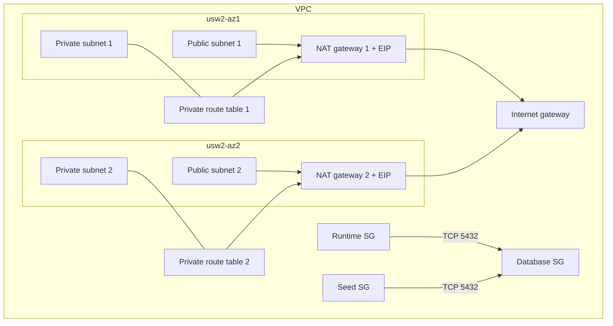

# Design Document

## Overview

GitHub issue: #3

This design describes `infra/network.yaml`, the only deliverable of this spec. The template deploys as the stack `inspection-agent-<env>-network`. It creates the private VPC used by the AgentCore Runtime (VPC mode) and by the RDS for PostgreSQL instance, four security groups (one only when VPC endpoints are on), optional NAT egress, optional VPC endpoints, optional flow logs, and the SSM parameters that later stacks read. It creates no RDS instance, no runtime, and no runtime IAM role.

The issue number was confirmed on 2026-11-20 with `gh issue view 3`. Issue #3 is titled "Network and shared base stack (infra/network.yaml)", has the labels `core` and `infra`, belongs to milestone M0 Skeleton, and depends on #1. No placeholder is needed. The issue's reviewer note says the NAT gateway costs money while it exists and the teardown must remove it (see "Teardown and deletion order" under Error Handling).

Everything below that depends on AWS facts was verified on **2026-11-20** (see "Verification record"). Three results change the template compared with what the requirements assume:

1. Since 2026-05-05 AgentCore Runtime no longer adds a service-managed S3 gateway for newly created VPC-mode runtimes. The VPC itself must provide S3 access. A VPC with neither NAT nor VPC endpoints cannot start a runtime. See "Both UseNatGateway and UseVpcEndpoints false".
2. The S3 gateway endpoint needs a prefix-list egress rule on the Runtime_Security_Group, and its endpoint policy must allow the AgentCore service principal, not only principals of the account. Requirements 3.5, 6.3, and 6.5 do not cover this. See "Gaps and conflicts".
3. Security groups created by CloudFormation keep the default allow-all egress rule unless an egress rule is given inline. The Database_Security_Group and Seed_Security_Group each need an inline loopback placeholder rule to reach "zero egress".

Key decisions:

| Decision | Choice | Rationale |
|---|---|---|
| AZ selection | Fixed AZ IDs `usw2-az1`, `usw2-az2`, `usw2-az3` in a `Mappings` block. New parameter `AzCount` (`2` or `3`, default `2`) picks how many are used. Subnets use the `AvailabilityZoneId` property | Requirement 1.8 asks for selection by AZ ID. Fixed IDs keep `private-subnet-ids` ordered ascending by AZ ID (Requirement 4.3) without sorting logic. Alternative rejected: AZ ID parameters. CloudFormation cannot check distinctness or order of string parameters, and any other value is unsupported anyway. `AzCount` is not in the requirements. It is the minimum needed to realize "N is 2 or 3" |
| Default `AzCount` | `2` | AgentCore recommends at least two AZs. RDS needs a subnet group in two AZs. Each extra AZ adds one NAT gateway and one set of endpoint ENIs (about 36.50 USD per month each, see cost table) |
| NAT layout | One NAT gateway and one Elastic IP per AZ, one private route table per AZ | Requirements 2.3 and 2.4. Keeps traffic in its AZ. The new Regional NAT gateway (one gateway for all AZs) is not used because Requirement 2.3 asks for one per Public_Subnet |
| Default for `UseNatGateway` / `UseVpcEndpoints` | `true` / `false` | As required. NAT is the simplest path for every service the runtime may call |
| Egress path for the S3 gateway endpoint | Gateway endpoint plus an egress rule from the Runtime_Security_Group to the AWS-managed S3 prefix list. The list ID is a parameter `S3PrefixListId` (default `pl-68a54001`) | CloudFormation has no attribute that returns an AWS-managed prefix list ID. The default was read from the verification account on 2026-11-20, and the list is AWS-owned |
| Default egress removal | Inline `SecurityGroupEgress` on every security group, including a loopback placeholder where no real inline rule exists | The AWS documentation says the default allow-all egress rule is removed only when one or more egress rules are specified inline ([Remove the default rule](https://docs.aws.amazon.com/AWSCloudFormation/latest/TemplateReference/aws-resource-ec2-securitygroup.html)) |
| SG-to-SG rules | Standalone `AWS::EC2::SecurityGroupIngress` / `AWS::EC2::SecurityGroupEgress` resources | Requirement 3.12. Avoids the circular dependency between the runtime, database, and seed groups |
| Flow log encryption | CloudWatch Logs default encryption, no customer-managed KMS key | See "Per-resource encryption" |
| Cross-stack values | SSM parameters only, no `Export` | Requirement 4.7 and Rule 10 |
| Property-based testing | Not applicable | The deliverable is a CloudFormation template. See Testing Strategy |

Note on Demo_Questions: this design does not mention them. This stack does not touch them.

## Verification record

All checks ran on 2026-11-20 (within 30 days of design approval, Requirement 8.1). Documentation pages carry no revision date, so the access date is the date of record. Content was rephrased for compliance with licensing restrictions.

### Supported Availability Zones (Requirements 8.1, 8.2)

| Item | Result | Source |
|---|---|---|
| Supported_AZ IDs for AgentCore Runtime VPC mode in us-west-2 | `usw2-az1`, `usw2-az2`, `usw2-az3` | [Configure AgentCore Runtime and tools for VPC, "Supported Availability Zones"](https://docs.aws.amazon.com/bedrock-agentcore/latest/devguide/agentcore-vpc.html) |
| Difference from the list in the requirements | None. Nothing added, nothing removed. The table marks `use1-az6` with an asterisk (platform version V2 only); no us-west-2 ID is marked | Same |
| Behavior with an unsupported AZ | The documentation says configuration fails during resource creation | Same |
| Gateway targets | A different AZ list applies to AgentCore Gateway managed VPC resources. Not used here | Same |

How AZ names map to AZ IDs: `us-west-2a`, `us-west-2b`, and so on are per-account aliases. The same name can be a different physical AZ in another account ([AZ IDs for your resources](https://docs.aws.amazon.com/ram/latest/userguide/working-with-az-ids.html)). The AZ ID is the same everywhere. The template uses `AvailabilityZoneId`, so the deploying account's mapping never matters for the template. In the account used for this verification, `aws ec2 describe-availability-zones --region us-west-2` returned:

| AZ name | AZ ID | Supported by AgentCore VPC mode |
|---|---|---|
| us-west-2a | usw2-az2 | yes |
| us-west-2b | usw2-az1 | yes |
| us-west-2c | usw2-az3 | yes |
| us-west-2d | usw2-az4 | no |

This mapping is an example for this account only. An operator who needs the mapping runs the same command, and can read a deployed subnet's ID with `aws ec2 describe-subnets --subnet-ids <id> --query 'Subnets[0].AvailabilityZoneId'`. A tool or console that shows only `us-west-2d` can therefore lead to a subnet in an unsupported AZ if the subnet is created outside this template.

### AgentCore Runtime VPC networking constraints (Requirement 8.7)

| Constraint | Value | Source |
|---|---|---|
| Subnets per runtime | Minimum 1, maximum 16 | [VpcConfig API reference](https://docs.aws.amazon.com/bedrock-agentcore-control/latest/APIReference/API_VpcConfig.html), [AWS::BedrockAgentCore::Runtime VpcConfig](https://docs.aws.amazon.com/AWSCloudFormation/latest/TemplateReference/aws-properties-bedrockagentcore-runtime-vpcconfig.html) |
| Security groups per runtime | Minimum 1, maximum 16 | Same |
| Recommended subnet layout | At least two private subnets in different supported AZs | [Best practices](https://docs.aws.amazon.com/bedrock-agentcore/latest/devguide/agentcore-vpc.html) |
| What AgentCore creates | Elastic network interfaces in the given subnets through the service-linked role `AWSServiceRoleForBedrockAgentCoreNetwork`. ENIs are shared by runtimes with the same subnet and security group set, and can stay up to 8 hours after the runtime is deleted | Same page |
| Public subnets | Do not give the runtime internet access. Internet access needs private subnets with a route to a NAT gateway | Same page |
| Required security group rules | Runtime group: outbound to the targets it needs; inbound not required. Target group: inbound from the runtime group. The example uses an RDS database | Same page, "Security group considerations" |
| VPC DNS | Both DNS support and DNS hostnames must be enabled (the page states this for file system DNS resolution and lists it under DNS failures) | Same page |
| Endpoints when the VPC has no internet | Required: `logs`, S3 gateway; for container agents also `ecr.dkr` and `ecr.api`. Strongly recommended even with NAT | Same page, "VPC endpoint configuration" |
| S3 behavior change | From 2026-05-05 new VPC-mode runtimes no longer include a service-managed S3 gateway. All network access, including S3, follows the VPC configuration. The field `requireServiceS3Endpoint` cannot be set at create time | [VpcConfig API reference](https://docs.aws.amazon.com/bedrock-agentcore-control/latest/APIReference/API_VpcConfig.html) |
| Code deploy S3 access | Direct code deploy stores artifacts in a service-owned bucket named `acr-code-*-<region>-an`. The documented endpoint policy allows `s3:GetObject` there for the principal service `bedrock-agentcore.amazonaws.com` | [VPC endpoint configuration](https://docs.aws.amazon.com/bedrock-agentcore/latest/devguide/agentcore-vpc.html) |

Issue #9 says the runtime uses a code package, so the container-only endpoints (`ecr.dkr`, `ecr.api`) are not created. If #9 switches to a container image, this template needs those two endpoints and the ECR layer bucket in the S3 endpoint policy.

### Services the runtime must reach and endpoint availability (Requirements 8.3, 8.4, 8.5)

Availability was read from the EC2 API in us-west-2 on 2026-11-20 with `aws ec2 describe-vpc-endpoint-services --region us-west-2 --service-names <names>` (read-only). Every service below was returned, with `VpcEndpointPolicySupported = true`. The service reports its AZs by the verifying account's AZ names. For all six services these names cover `us-west-2a`, `us-west-2b`, and `us-west-2c`, which are `usw2-az2`, `usw2-az1`, and `usw2-az3` in that account. All three Supported_AZs are therefore covered. `bedrock-agentcore` is the only service that does not also list `us-west-2d` (`usw2-az4`), which matches the AgentCore AZ list.

| # | Service the runtime must reach | Endpoint service name in us-west-2 | Available | Type | Private DNS name | Source |
|---|---|---|---|---|---|---|
| 1 | Amazon Bedrock runtime (`Converse`, `InvokeModel`) | `com.amazonaws.us-west-2.bedrock-runtime` | yes | Interface | `bedrock-runtime.us-west-2.amazonaws.com` | [Bedrock interface endpoints](https://docs.aws.amazon.com/bedrock/latest/userguide/vpc-interface-endpoints.html), EC2 API check |
| 2 | AgentCore Memory data plane | `com.amazonaws.us-west-2.bedrock-agentcore` (one data plane endpoint serves Runtime, Memory, built-in tools, Identity) | yes | Interface | `bedrock-agentcore.us-west-2.amazonaws.com` | [AgentCore interface endpoints](https://docs.aws.amazon.com/bedrock-agentcore/latest/devguide/vpc-interface-endpoints.html), EC2 API check |
| 3 | AWS Secrets Manager | `com.amazonaws.us-west-2.secretsmanager` | yes | Interface | `secretsmanager.us-west-2.amazonaws.com` | [Secrets Manager VPC endpoint](https://docs.aws.amazon.com/secretsmanager/latest/userguide/vpc-endpoint-overview.html), EC2 API check |
| 4 | Amazon CloudWatch Logs | `com.amazonaws.us-west-2.logs` | yes | Interface | `logs.us-west-2.amazonaws.com` (also the OTLP logs URL host, plus `logs.us-west-2.api.aws` and the two `streaming-logs` names) | [CloudWatch Logs and interface endpoints](https://docs.aws.amazon.com/AmazonCloudWatch/latest/logs/cloudwatch-logs-and-interface-VPC.html), AgentCore VPC page, EC2 API check |
| 5 | Tracing (AWS X-Ray, OTLP traces endpoint) | `com.amazonaws.us-west-2.xray` | yes | Interface | `xray.us-west-2.amazonaws.com` (also `xray.us-west-2.api.aws`) | [X-Ray with VPC endpoints](https://docs.aws.amazon.com/xray/latest/devguide/xray-security-vpc-endpoint.html), [CloudWatch OTLP endpoints](https://docs.aws.amazon.com/AmazonCloudWatch/latest/monitoring/CloudWatch-OTLPEndpoint.html), EC2 API check |
| 6 | Amazon S3 (agent startup downloads; any account bucket) | `com.amazonaws.us-west-2.s3` | yes | Gateway (an Interface variant also exists) | none (route table entry with a prefix list) | [AgentCore VPC page](https://docs.aws.amazon.com/bedrock-agentcore/latest/devguide/agentcore-vpc.html), [S3 gateway endpoints](https://docs.aws.amazon.com/vpc/latest/privatelink/vpc-endpoints-s3.html), EC2 API check |

No service is marked "reachable only through NAT_Gateway" (Requirement 8.5), because all six have an endpoint. Two findings need a caveat:

- **Tracing.** The OTLP traces URL is `https://xray.us-west-2.amazonaws.com/v1/traces`. The `xray` endpoint lists exactly that host as a private DNS name, so the URL resolves to the endpoint. No page states "OTLP traces over PrivateLink" in one sentence, so this is an inference from the DNS names. For agents created on or after 2026-07-20, unified telemetry sends spans to the agent's log group, so the `logs` endpoint carries them. Older agents (split telemetry) send spans through the X-Ray path to `aws/spans` ([Telemetry setup and delivery](https://docs.aws.amazon.com/bedrock-agentcore/latest/devguide/supported-frameworks-telemetry.html)). Both endpoints are created, so either mode works.
- **Not covered, by decision.** `com.amazonaws.us-west-2.monitoring` (CloudWatch metrics, OTLP metrics URL) exists but is outside the six services in Requirement 8.3. It is not created. If the agent sends OTLP metrics from its own code, that traffic needs NAT. This is an open item for specs #9 and #11.

Services not named in the requirements that the runtime may still need are not verified here: STS, Cognito, and any package index. The agent reads the user identity from the verified JWT and uses the execution role credentials that AgentCore supplies, so none is expected. Spec #9 verifies this by invoking the deployed runtime with `UseNatGateway=false`.

### Other sources used

| Topic | Source |
|---|---|
| Security group default egress removal | [AWS::EC2::SecurityGroup, "Remove the default rule"](https://docs.aws.amazon.com/AWSCloudFormation/latest/TemplateReference/aws-resource-ec2-securitygroup.html) |
| Flow log IAM role | [IAM role for publishing flow logs to CloudWatch Logs](https://docs.aws.amazon.com/vpc/latest/userguide/flow-logs-iam-role.html) |
| Log group encryption | [Encrypt log data in CloudWatch Logs using AWS KMS](https://docs.aws.amazon.com/AmazonCloudWatch/latest/logs/encrypt-log-data-kms.html) |
| NAT gateway, endpoint, and public IPv4 prices | AWS Price List API, `aws pricing get-products` for `AmazonEC2` (NAT Gateway family) and `AmazonVPC`, `regionCode=us-west-2`, publication date 2026-11-20. Cross-checked with [Amazon VPC pricing](https://aws.amazon.com/vpc/pricing/) and [AWS PrivateLink pricing](https://aws.amazon.com/privatelink/pricing/) |
| Taggable resource types | CloudFormation resource reference pages for each type (a `Tags` property exists for VPC, Subnet, InternetGateway, RouteTable, EIP, NatGateway, VPCEndpoint, FlowLog, SecurityGroup, Logs LogGroup, IAM Role, SSM Parameter; it does not exist for Route, SecurityGroupIngress, SecurityGroupEgress, VPCGatewayAttachment, SubnetRouteTableAssociation) |

## Architecture

### Network layout, default parameters (`AzCount=2`, NAT on, endpoints off)

The runtime ENIs and the RDS instance live in the private subnets. The public subnets hold only the NAT gateways.

### Mode matrix

| UseNatGateway | UseVpcEndpoints | Public subnets, IGW, NAT, EIP | Private route tables | VPC endpoints | Runtime SG egress | What works |
|---|---|---|---|---|---|---|
| true | false (default) | yes | local + `0.0.0.0/0` to same-AZ NAT | none | 443 to `0.0.0.0/0`; 5432 to Database SG | Everything the runtime needs, over the internet path |
| true | true | yes | local + NAT default route + S3 prefix route | 6 | 443 to `0.0.0.0/0`; 443 to Endpoint SG; 443 to S3 prefix list; 5432 to Database SG | Same as above; the six services use the endpoints (private DNS), so their traffic skips the NAT |
| false | true | none | local + S3 prefix route | 6 | 443 to Endpoint SG; 443 to S3 prefix list; 5432 to Database SG | The six services only. No other internet or AWS service |
| false | false | none | local only | none | 5432 to Database SG only | Database access only. A runtime cannot start (see below) |

### Both UseNatGateway and UseVpcEndpoints false

The template accepts this combination (Requirement 2.12 allows both values independently). The result is a fully isolated network:

- No public subnet, internet gateway, NAT gateway, Elastic IP, or VPC endpoint exists. Private route tables hold only the local route.
- The Runtime_Security_Group has one real egress rule (TCP 5432 to the Database_Security_Group) plus the loopback placeholder. Requirement 3.6 holds: no egress to `0.0.0.0/0`.
- **An AgentCore Runtime in this VPC cannot start.** New runtimes get S3 access only from the VPC (rollout from 2026-05-05), and it can reach neither Bedrock, Memory, CloudWatch Logs, nor S3. This is a documented consequence, not a template error.
- A seed mechanism inside the VPC cannot call Secrets Manager or CloudWatch Logs either.
- The mode is useful for one case: bringing up the VPC and database, and checking the isolation properties, before runtime work starts. Its network cost is zero (VPC, subnets, route tables, and security groups are free). Flow logs still cost money when on.

The template does not block this combination, because the requirements allow it. Safeguards are documentation only: the parameter descriptions of `UseNatGateway` and `UseVpcEndpoints` say that at least one must be `true` for a runtime, and the manual verification covers the combination (V5). Adding a `Rules` assertion that rejects it is a one-line change if the reviewer prefers a hard stop, but it would contradict Requirement 2.12.

### Seed security group assumption (design note 2)

The database spec (#6) does not exist yet. This design assumes:

1. The seed/migration mechanism runs inside this VPC (for example a Lambda function or CodeBuild project with a VPC configuration) and attaches the `seed-security-group-id` SSM parameter value to its network interfaces.
2. The database stack (#6) creates the RDS instance with the `database-security-group-id` value as its VPC security group, and reads the private subnets from `private-subnet-ids` to build its subnet group.
3. The Seed_Security_Group allows only TCP 5432 to the Database_Security_Group (Requirement 3.11). A mechanism with only this group **cannot reach any AWS API**: no Secrets Manager, no CloudWatch Logs, no S3. Two ways to resolve this are open to #6:
   - (a) #6 creates its own group with egress TCP 443 (to `0.0.0.0/0` when the network has NAT) and attaches it next to the seed group. The seed group stays minimal. Recommended.
   - (b) The seed mechanism receives its credentials another way, for example environment variables resolved at deploy time with `{{resolve:secretsmanager:...}}`, and writes no logs to CloudWatch. This leaks the secret into the deployed configuration. Not recommended.
4. If the network runs with `UseNatGateway=false` and `UseVpcEndpoints=true`, the Endpoint_Security_Group accepts TCP 443 only from the Runtime_Security_Group (Requirement 2.10). A seed mechanism cannot use the endpoints. The template does not publish the endpoint group ID (Requirement 4.2 fixes the published set at five or six parameters). If #6 needs endpoint access, it must either use NAT or the requirements for this spec must add an `endpoint-security-group-id` parameter. This is an open item.

If the database spec uses a different mechanism (for example a bastion, an SSM port-forward host, or a runtime-side migration), the Seed_Security_Group stays unused and harmless, and #6 records the change.

## Components and Interfaces

### 1. Parameters

Every parameter has a Description of 1 to 200 characters and a constraint (Requirement 7.3, Rule 2). Descriptions are written at implementation time within that limit.

| Parameter | Type | Default | Constraint | Purpose and requirement |
|---|---|---|---|---|
| `Env` | String | `demo` | `AllowedPattern: ^[a-z][a-z0-9]{0,9}$` | 7.2, 7.10, Rule 9 |
| `UseNatGateway` | String | `true` | `AllowedValues: ["true", "false"]` | 2.12, 2.13 |
| `UseVpcEndpoints` | String | `false` | `AllowedValues: ["true", "false"]` | 2.12, 2.13 |
| `AzCount` | String | `2` | `AllowedValues: ["2", "3"]` | Number of AZs, 1.2. New, not in the requirements |
| `VpcCidr` | String | `10.20.0.0/16` | `AllowedPattern`: IPv4 CIDR with prefix `/16` to `/24` | 1.7 |
| `PrivateSubnet1Cidr` / `2` / `3` | String | `10.20.0.0/24`, `10.20.1.0/24`, `10.20.2.0/24` | `AllowedPattern`: IPv4 CIDR with prefix `/16` to `/28` | 1.7. `3` is used only when `AzCount` is `3` |
| `PublicSubnet1Cidr` / `2` / `3` | String | `10.20.100.0/24`, `10.20.101.0/24`, `10.20.102.0/24` | Same pattern | 1.7. Used only when `UseNatGateway` is `true` |
| `S3PrefixListId` | String | `pl-68a54001` | `AllowedPattern: ^pl-[0-9a-f]{8,17}$` | AWS-managed S3 prefix list of the Region. Used only when `UseVpcEndpoints` is `true` |
| `EnableFlowLogs` | String | `false` | `AllowedValues: ["true", "false"]` | 5.1 |
| `FlowLogRetentionDays` | Number | `7` | `AllowedValues: [1, 3, 5, 7, 14, 30, 60, 90]` | 5.2, 5.8 |

Limits of parameter validation: CloudFormation parameter constraints cannot check that a subnet CIDR lies inside `VpcCidr` or that two subnet CIDRs do not overlap (Requirement 1.7). EC2 enforces both at `CreateSubnet`. A violating value fails stack creation and rolls back with no resources left, but it fails at deploy time, not at parameter validation. The defaults satisfy both rules, and the descriptions state them. The distinctness of AZ IDs needs no check because the IDs are constants.

If fewer than two Supported_AZs exist (Requirement 1.9): the three IDs are constants, and `usw2-az1` to `usw2-az3` exist in every account in us-west-2. A missing AZ makes `CreateSubnet` fail, and CloudFormation rolls back. This cannot be triggered in this account, so it is verified by reading the template (V1) and not by a deployment.

### 2. Conditions

| Condition | Definition |
|---|---|
| `UseNat` | `UseNatGateway` equals `true` |
| `UseEndpoints` | `UseVpcEndpoints` equals `true` |
| `HasAz3` | `AzCount` equals `3` |
| `NatAz3` | `UseNat` and `HasAz3` |
| `FlowLogsOn` | `EnableFlowLogs` equals `true` |
| `NoEgressPath` | not `UseNat` and not `UseEndpoints` (selects the runtime placeholder rule) |

### 3. Resources

Logical IDs below are the plan. Items marked "3" exist only when `HasAz3` (or `NatAz3`) holds. Tags column: "T" means `Project=inspection-agent` and `Env=<Env>` (Requirement 7.4, Rule 4); "no tags" means the CloudFormation type has no `Tags` property.

| Group | Logical ID | Type | Condition | Notes | Tags |
|---|---|---|---|---|---|
| VPC | `Vpc` | `AWS::EC2::VPC` | none | `EnableDnsSupport: true`, `EnableDnsHostnames: true` (1.1) | T |
| Private subnets | `PrivateSubnet1`, `PrivateSubnet2`, `PrivateSubnet3` (3) | `AWS::EC2::Subnet` | 3: `HasAz3` | `AvailabilityZoneId` from Mappings, `MapPublicIpOnLaunch: false` (1.2, 1.6, 1.8) | T |
| Private route tables | `PrivateRouteTable1`, `2`, `3` (3) | `AWS::EC2::RouteTable` | 3: `HasAz3` | One per AZ | T |
| Route table associations | `PrivateSubnet1RouteTableAssociation` and so on | `AWS::EC2::SubnetRouteTableAssociation` | 3: `HasAz3` | | no tags |
| Internet gateway | `InternetGateway`, `InternetGatewayAttachment` | `AWS::EC2::InternetGateway`, `AWS::EC2::VPCGatewayAttachment` | `UseNat` | 2.2 | T (gateway only) |
| Public subnets | `PublicSubnet1`, `2`, `3` (3) | `AWS::EC2::Subnet` | `UseNat`; 3: `NatAz3` | Same AZ IDs as the private subnets, `MapPublicIpOnLaunch: false` (1.3, 1.4, 2.1) | T |
| Public route table | `PublicRouteTable`, `PublicDefaultRoute`, associations | `AWS::EC2::RouteTable`, `AWS::EC2::Route`, `AWS::EC2::SubnetRouteTableAssociation` | `UseNat` | One shared table; default route to the internet gateway (2.5) | T (table only) |
| NAT | `NatEip1`, `2`, `3` (3); `NatGateway1`, `2`, `3` (3) | `AWS::EC2::EIP` (`Domain: vpc`), `AWS::EC2::NatGateway` | `UseNat`; 3: `NatAz3` | EIP depends on the gateway attachment (2.3) | T |
| NAT routes | `PrivateDefaultRoute1`, `2`, `3` (3) | `AWS::EC2::Route` | `UseNat`; 3: `NatAz3` | `0.0.0.0/0` to the NAT gateway of the same AZ (2.4). No route exists when `UseNat` is false (2.7, 1.5) | no tags |
| Security groups | `RuntimeSecurityGroup`, `DatabaseSecurityGroup`, `SeedSecurityGroup` | `AWS::EC2::SecurityGroup` | none | See "Security group rules" (3.1) | T |
| Endpoint SG | `EndpointSecurityGroup` | `AWS::EC2::SecurityGroup` | `UseEndpoints` | 2.9, 2.10 | T |
| SG rules | `RuntimeToDatabaseEgress`, `SeedToDatabaseEgress`, `DatabaseFromRuntimeIngress`, `DatabaseFromSeedIngress`; with endpoints: `RuntimeToEndpointEgress`, `EndpointFromRuntimeIngress` | `AWS::EC2::SecurityGroupEgress`, `AWS::EC2::SecurityGroupIngress` | last two: `UseEndpoints` | Standalone, referenced by group ID (3.12) | no tags |
| Interface endpoints | `BedrockRuntimeEndpoint`, `AgentCoreEndpoint`, `SecretsManagerEndpoint`, `LogsEndpoint`, `XrayEndpoint` | `AWS::EC2::VPCEndpoint` (Interface) | `UseEndpoints` | `PrivateDnsEnabled: true`, all private subnets, Endpoint SG, endpoint policy (2.8, 6.5) | T |
| Gateway endpoint | `S3Endpoint` | `AWS::EC2::VPCEndpoint` (Gateway) | `UseEndpoints` | All private route tables, endpoint policy | T |
| Flow logs | `FlowLogGroup`, `FlowLogRole`, `VpcFlowLog` | `AWS::Logs::LogGroup`, `AWS::IAM::Role`, `AWS::EC2::FlowLog` | `FlowLogsOn` | See "Flow logs" | T |
| SSM | `VpcIdParameter`, `PrivateSubnetIdsParameter`, `RuntimeSecurityGroupIdParameter`, `DatabaseSecurityGroupIdParameter`, `SeedSecurityGroupIdParameter`; `PublicSubnetIdsParameter` | `AWS::SSM::Parameter` | last: `UseNat` | See "Published identifiers" | T (map form) |

Naming: the `Name` tag is `inspection-agent-${Env}-<what>`. Only `Env` and pseudo parameters are used (Requirement 7.7). Literal region names, account IDs, and `arn:` strings do not appear (Requirement 7.5). Every ARN is built with `!Sub arn:${AWS::Partition}:...`.

### 4. Security group rules

Egress is set inline, to a real rule or to a placeholder, on every group, because inline egress is what removes the default allow-all rule. Rules that refer to another security group are standalone resources (Requirement 3.12). Both cross-references point to the database group, so there is no cycle.

**Placeholder:** `IpProtocol: "-1"`, `CidrIp: 127.0.0.1/32`, description "Placeholder. Removes the default allow-all egress rule." This is the pattern in the CloudFormation documentation. It permits traffic only to the loopback address, which no VPC route carries.

| Group | Ingress | Egress |
|---|---|---|
| Runtime_Security_Group | none (3.2) | `UseNat`: inline TCP 443 to `0.0.0.0/0` (3.4). `UseEndpoints`: inline TCP 443 to the S3 prefix list (gap G1), and standalone TCP 443 to the Endpoint SG (3.5). `NoEgressPath`: inline placeholder. Always: standalone TCP 5432 to the Database SG (3.3) |
| Database_Security_Group | Exactly two standalone rules: TCP 5432 from the Runtime SG and TCP 5432 from the Seed SG (3.7, 3.8) | Inline placeholder only (3.9) |
| Seed_Security_Group | none (3.10) | Inline placeholder, plus standalone TCP 5432 to the Database SG (3.11) |
| Endpoint_Security_Group (`UseEndpoints`) | Exactly one standalone rule: TCP 443 from the Runtime SG (2.10, 2.11, 6.4) | Inline placeholder (the endpoint ENIs initiate nothing) |

Reading the deployed rules: `describe-security-groups` will show the loopback rule on the database, seed, and endpoint groups, and on the runtime group in the no-egress-path case. V4 and V9 account for it.

### 5. VPC endpoints and endpoint policies (Requirements 2.8, 6.5, 6.6)

Interface endpoints are placed in every private subnet (2 or 3 ENIs each), with the Endpoint_Security_Group and private DNS. The S3 gateway endpoint attaches to every private route table, which adds a route to the S3 prefix list.

All endpoint policy statements use explicit actions (Requirement 7.9). Principals are "any principal in this account": `Principal: "*"` with `Condition: StringEquals: aws:PrincipalAccount: ${AWS::AccountId}`. This is the usual way to say "principals of this account" in an endpoint policy.

| Endpoint | Policy actions | Policy resources | Notes |
|---|---|---|---|
| `bedrock-runtime` | `bedrock:InvokeModel`, `bedrock:InvokeModelWithResponseStream` | `foundation-model/*` in any Region (account-less ARN) and `inference-profile/*` in this Region and account | Covers `Converse` and `ConverseStream`, which use the `InvokeModel` permissions. The model ID is chosen by spec #2 and #9. A Region wildcard in the ARN is needed because inference profiles route across Regions |
| `bedrock-agentcore` | The 13 Memory data plane actions listed on the AgentCore interface endpoint page (`CreateEvent`, `GetEvent`, `ListEvents`, `DeleteEvent`, `RetrieveMemoryRecords`, `ListMemoryRecords`, `GetMemoryRecord`, `DeleteMemoryRecord`, `ListActors`, `ListSessions`, and the three `Batch*MemoryRecords` actions) | `memory/*` in this Region and account | Narrow on purpose. Other data plane calls (for example Identity token calls) would be denied. Spec #9 verifies and widens if needed. Inbound `InvokeAgentRuntime` from the UI does not use this endpoint (the browser is outside the VPC) |
| `secretsmanager` | `secretsmanager:GetSecretValue`, `secretsmanager:DescribeSecret` | `secret:inspection-agent/${Env}/*` in this Region and account | Matches the Rule 5 example in the conventions |
| `logs` | `logs:CreateLogGroup`, `logs:CreateLogStream`, `logs:PutLogEvents`, `logs:DescribeLogStreams` | `log-group:/aws/bedrock-agentcore/*` (and `:*` for streams) in this Region and account | Spec #11 may add its own log groups, which then need a policy change |
| `xray` | `xray:PutTraceSegments`, `xray:PutTelemetryRecords`, `xray:GetSamplingRules`, `xray:GetSamplingTargets`, `xray:GetSamplingStatisticSummaries` | `*` | These actions do not support resource-level scoping. A YAML comment on the line above the statement says so (Rule 5, Requirement 7.9) |
| `s3` (Gateway) | `s3:GetObject` | `arn:${AWS::Partition}:s3:::acr-code-*-${AWS::Region}-an` and `.../*` | Allows the principal service `bedrock-agentcore.amazonaws.com`, as the AgentCore documentation prescribes for direct code deploy. This is **not** limited to principals of the account (gap G2) |

Endpoints without endpoint-policy support (Requirement 6.6): none. All six services returned `VpcEndpointPolicySupported = true` on 2026-11-20, so every endpoint gets a policy and the "no policy" case does not occur.

Policy risk: endpoint policies that are too narrow fail at runtime with `AccessDenied` and only show up when spec #9 runs a real invocation. The policies above are the starting point. They are reviewed in the manual verification of #9. They cannot be proven from this stack alone.

### 6. Flow logs (Requirement 5, 6.1)

When `EnableFlowLogs` is `true`, the template creates:

- `FlowLogGroup`: name `/inspection-agent/${Env}/network/flow-logs`, `RetentionInDays: !Ref FlowLogRetentionDays`.
- `FlowLogRole`: trust policy with the single principal `vpc-flow-logs.amazonaws.com` and `sts:AssumeRole`. The trust policy adds `aws:SourceAccount` and an `ArnLike` condition on `aws:SourceArn` for `vpc-flow-log/*` in this account and Region, as the flow log documentation recommends against the confused deputy problem. The principal list stays the single service (Requirement 5.5). The role policy allows `logs:CreateLogStream` and `logs:PutLogEvents` on the log group ARN and `${arn}:*` (Requirement 5.6). The role has no wildcard resource.
- `VpcFlowLog`: `ResourceType: VPC`, `TrafficType: ALL`, `LogDestinationType: cloud-watch-logs`, the log group, and `DeliverLogsPermissionArn` set to the role.

Risk (gap G3): the flow log documentation lists five actions as the minimum (`CreateLogGroup`, `CreateLogStream`, `PutLogEvents`, `DescribeLogGroups`, `DescribeLogStreams`) on `*`. Requirement 5.6 limits the role to two actions with no wildcard resource. Whether two actions are enough when the log group already exists is not stated in the documentation. V7 tests it. If flow log creation or delivery fails for lack of permission, the fix is to amend Requirement 5.6 to add `logs:DescribeLogGroups` and `logs:DescribeLogStreams` (the first does not support resource-level scoping, so it needs a `*` resource with a comment). The template is not changed beyond that until V7 shows the failure.

### 7. Published identifiers (Requirement 4)

| SSM parameter name | Type | Value | Condition |
|---|---|---|---|
| `/inspection-agent/${Env}/network/vpc-id` | String | VPC ID | none |
| `/inspection-agent/${Env}/network/private-subnet-ids` | StringList | `!Join [",", [...]]`, ordered `usw2-az1`, `usw2-az2`, `usw2-az3`, no spaces | none |
| `/inspection-agent/${Env}/network/public-subnet-ids` | StringList | Same form for public subnets | `UseNat` |
| `/inspection-agent/${Env}/network/runtime-security-group-id` | String | Group ID | none |
| `/inspection-agent/${Env}/network/database-security-group-id` | String | Group ID | none |
| `/inspection-agent/${Env}/network/seed-security-group-id` | String | Group ID | none |

The count is 5 with `UseNatGateway=false` and 6 with `true` (4.2, 4.5). All values are identifiers (6.2). Descriptions are set. The parameters have no `DependsOn` on anything else, so a failed parameter rolls back the whole stack (4.9), and deleting the stack removes them (4.8).

Template outputs: one per parameter (`VpcId`, `PrivateSubnetIds`, `PublicSubnetIds`, `RuntimeSecurityGroupId`, `DatabaseSecurityGroupId`, `SeedSecurityGroupId`), each with a Description of 1 to 1024 characters. `PublicSubnetIds` carries the `UseNat` condition. No `Export` and no `Fn::ImportValue` (4.7).

Consumer note for later specs: a stack reads these with `AWS::SSM::Parameter::Value<AWS::EC2::VPC::Id>`, `AWS::SSM::Parameter::Value<List<AWS::EC2::Subnet::Id>>` for the StringList, and `AWS::SSM::Parameter::Value<AWS::EC2::SecurityGroup::Id>`. These parameter types satisfy the constraint rule in Rule 2.

### 8. Cost comparison: NAT gateway versus VPC endpoints (Requirement 8.6)

Prices from the AWS Price List API for us-west-2 (publication 2026-11-20). Assumptions: 730 hours per month, 5 interface endpoints (`bedrock-runtime`, `bedrock-agentcore`, `secretsmanager`, `logs`, `xray`) with one ENI per AZ, the S3 gateway endpoint (no hourly or data charge), one NAT gateway and one Elastic IP per AZ, no flow logs, no cross-AZ data transfer, and all data from the six services going to endpoints when endpoints are on.

| Price item | Rate |
|---|---|
| NAT gateway hour | 0.045 USD |
| NAT gateway data processed | 0.045 USD per GB |
| Public IPv4 address in use | 0.005 USD per hour |
| Interface endpoint, per ENI (per AZ) hour | 0.01 USD |
| Interface endpoint data processed, first 1 PB | 0.01 USD per GB |
| S3 gateway endpoint | 0 USD |

Monthly totals in USD:

| AZs (N) | GB per month | NAT only (`true` / `false`) | Endpoints only (`false` / `true`) | Both (`true` / `true`) | Neither (`false` / `false`) |
|---|---|---|---|---|---|
| 2 | 10 | 73.45 | 73.10 | 146.10 | 0.00 |
| 2 | 100 | 77.50 | 74.00 | 147.00 | 0.00 |
| 3 | 10 | 109.95 | 109.60 | 219.10 | 0.00 |
| 3 | 100 | 114.00 | 110.50 | 220.50 | 0.00 |

Arithmetic for N=2: NAT fixed = 2 × 0.045 × 730 + 2 × 0.005 × 730 = 65.70 + 7.30 = 73.00; endpoint fixed = 5 × 2 × 0.01 × 730 = 73.00. Data: NAT 0.045 per GB, endpoints 0.01 per GB. For N=3 both fixed costs are 109.50. "Both" is the sum of both fixed costs plus endpoint data, since private DNS sends the six services' traffic to the endpoints.

Reading the table:

- The fixed costs are equal (a NAT gateway plus its Elastic IP costs 0.05 USD per hour, the same as five interface endpoint ENIs). Endpoints only win by the data charge, 0.035 USD per GB, which is small at demo volumes.
- Endpoints only carry the six services. Any other destination fails. NAT carries everything.
- A cheaper endpoint layout exists: put the five interface endpoints in one subnet. That costs 36.50 USD per month and loses AZ failover and adds cross-AZ data transfer. Not chosen.
- Flow logs are extra and depend on traffic. A demo VPC produces little. The default is off.
- A NAT gateway costs money until deleted. The stack's deletion removes it (see Error Handling for the ENI caveat).

Recommendation for the demo: keep the defaults (NAT on, endpoints off, 2 AZs, about 73 USD per month while the stack exists). Use endpoints only when the demo must show no internet path. Tear the stack down after each demo window.

### 9. Per-resource encryption (Requirement 6.7)

TLS in transit: every service call from the runtime uses HTTPS on port 443. The only non-443 path is TCP 5432 to PostgreSQL, whose TLS setting belongs to spec #6 (RDS parameter `rds.force_ssl` and the client `sslmode`). This stack allows only those two ports, but does not itself encrypt the database connection.

| Resource | Encryption at rest applies | Reason or mechanism |
|---|---|---|
| VPC, subnets, route tables, route table associations, routes, internet gateway, attachment | No | Control-plane configuration objects. They store no customer data |
| NAT gateways | No | They forward packets and keep no data on disk |
| Elastic IP addresses | No | An address allocation. It stores no data |
| Security groups and their rules | No | Packet filter configuration. It stores no data |
| VPC endpoints (interface and gateway) | No | They forward traffic and store nothing. Traffic to them is TLS (port 443) |
| Endpoint policies | No | Part of the endpoint configuration |
| SSM parameters (`vpc-id`, subnet and group IDs) | No | Standard `String` and `StringList` parameters hold identifiers only (Requirement 6.2), so a `SecureString` and a KMS key would add cost and a key dependency for no benefit. They are not encrypted with a customer key |
| Flow log log group (`EnableFlowLogs=true`) | Yes | CloudWatch Logs always encrypts log group data at rest with 256-bit AES-GCM using a service-managed key, as the [encryption page](https://docs.aws.amazon.com/AmazonCloudWatch/latest/logs/encrypt-log-data-kms.html) states. **No customer-managed KMS key is used.** Reason: flow log records contain only network metadata (addresses, ports, byte counts) from a synthetic-data demo, no requirement asks for key control or key-level audit, and a customer-managed key adds a key and key policy that must allow `logs.<region>.amazonaws.com`, creates a deletion-order dependency, and fails reads if the key is disabled. The decision is easy to reverse later by adding `KmsKeyId` to the log group |
| Flow log resource | No | A delivery configuration. Data is stored in the log group above |
| Flow log IAM role | No | A role holds a policy document and no customer data |

## Data Models

Configuration shapes only. This stack has no application data.

| Item | Shape |
|---|---|
| Stack name | `inspection-agent-<env>-network` |
| Template path | `infra/network.yaml` |
| AZ mapping | `First: usw2-az1`, `Second: usw2-az2`, `Third: usw2-az3` |
| SSM key | `/inspection-agent/<env>/network/<key>`, keys `vpc-id`, `private-subnet-ids`, `public-subnet-ids`, `runtime-security-group-id`, `database-security-group-id`, `seed-security-group-id` |
| Tags | `Project=inspection-agent`, `Env=<env>` on every taggable resource. SSM parameters use the map form from Rule 10 |
| Flow log group | `/inspection-agent/<env>/network/flow-logs` |

## Gaps and conflicts

### Conflicts with steering and conventions (Requirements note 3)

| # | Item | Result |
|---|---|---|
| S1 | Rule 4 tags on resource types with no `Tags` property (`AWS::EC2::Route`, `SecurityGroupIngress`, `SecurityGroupEgress`, `VPCGatewayAttachment`, `SubnetRouteTableAssociation`) | **Not a conflict.** Rule 4 applies only to types that support `Tags`. These five do not (checked in the CloudFormation reference on 2026-11-20). `cfn-lint` confirms at implementation |
| S2 | Rule 10 and Requirement 4.7: no `Export` | **No conflict.** The design publishes only SSM parameters |
| S3 | Rule 7 (zero errors and zero warnings) against the request's "without errors" | **Stricter rule applies.** Requirement 7.6 and Requirement 9.1 already use it |
| S4 | Rule 5: `Resource: "*"` needs a comment directly above | **Applies** to the `xray` endpoint policy. The comment is part of the design |
| S5 | Rule 6: no literal `arn:` strings | **Applies.** Endpoint policies and the flow log role build ARNs with `!Sub arn:${AWS::Partition}:...` |
| S6 | Rule 9: `Env` shape | **No conflict** |
| S7 | `docs/kiro-workflow.md`: first Overview line is the issue reference | **Done** (`GitHub issue: #3`) |
| S8 | `tech.md`: no test files | **No conflict.** Verification is manual (Requirement 9) |
| S9 | Repository `deploy.sh` passes `--capabilities CAPABILITY_NAMED_IAM` and tags the stack | **No conflict.** The IAM role is created only with flow logs, and CloudFormation already has the capability |
| S10 | `structure.md`: SSM key `<key>` uses lowercase letters, digits, and hyphens | **No conflict.** All six keys comply |

The request and steering conflict in one place that only shows up in practice: the issue says "add public subnets only if a NAT gateway is needed", and this design follows it (zero public subnets when `UseNatGateway=false`).

### Gaps in the requirements found while verifying

The design follows the requirements where it can and proposes the smallest change where it cannot. None is applied to `requirements.md` without approval.

| # | Gap | What the design does | Proposed requirement change |
|---|---|---|---|
| G1 | Requirement 3.5 allows runtime egress to the Endpoint_Security_Group only. The S3 gateway endpoint is reached through a route and a prefix list, not through the endpoint security group. Without an egress rule to the S3 prefix list, a runtime with `UseNatGateway=false` cannot download its code | Adds an inline TCP 443 egress rule to the S3 prefix list when `UseVpcEndpoints=true`. Adds the parameter `S3PrefixListId` | Amend 3.5 to add the prefix list destination. Amend 6.3 (see G4) |
| G2 | Requirement 6.5 restricts every endpoint policy to principals in the account. The AgentCore documentation prescribes, for the S3 endpoint, a policy for the AgentCore service principal (`aws:PrincipalServiceName`). An account-only policy would block startup | The S3 endpoint policy follows the AgentCore documentation. All five interface endpoint policies are account-only | Amend 6.5: "...except the S3 gateway endpoint policy, which allows the AgentCore service principal for the AgentCore code artifact bucket" |
| G3 | Requirement 5.6 allows two flow log actions. The AWS page lists five as the minimum | Follows 5.6. V7 tests it. Fallback described in "Flow logs" | Amend 5.6 only if V7 fails |
| G4 | Requirement 6.3 says the Runtime_Security_Group has "exactly two egress rules, TCP 443 and TCP 5432". Requirements 3.3 to 3.6 already imply up to three rules (443 to the Internet, 443 to the Endpoint SG, 5432), and G1 adds one. In the case `NoEgressPath` the placeholder is a fourth, all-protocol rule to loopback | Reads 6.3 as "the only ports are TCP 443 and TCP 5432, plus a loopback placeholder when needed". Adds nothing that reaches a routable address | Reword 6.3 to "allows egress only on TCP 443 and TCP 5432, and has no all-protocol rule to a routable address" |
| G5 | Requirement 3.9 and 3.10 need zero egress on groups where CloudFormation keeps a default allow-all rule | Inline loopback placeholder (documented AWS pattern) | Add a note to 3.9 that a loopback placeholder is acceptable. The verification (V4, V9) already reads it that way |
| G6 | Requirement 1.2 says N is 2 or 3, but no input selects N | Adds `AzCount` | Add the parameter to Requirement 1 |
| G7 | Requirement 1.7 asks for CIDR containment and non-overlap. CloudFormation parameter validation cannot check either | EC2 rejects violations at subnet creation; the stack rolls back | Reword 1.7 to say "rejects ... at stack creation" |
| G8 | A seed mechanism limited to TCP 5432 cannot reach any AWS API, and the endpoint group accepts only the runtime group | See "Seed security group assumption" | Decide in spec #6 |

## Error Handling

| Condition | Behavior | Requirement |
|---|---|---|
| `Env` does not match the pattern | CloudFormation rejects the value before creating a change set. No resource is created or changed | 7.10 |
| `UseNatGateway`, `UseVpcEndpoints`, `EnableFlowLogs`, or `AzCount` has a value outside its list | Same | 2.13, 5.1 |
| `FlowLogRetentionDays` outside the allowed values | Same | 5.8 |
| CIDR pattern fails | Same | 1.7 |
| Subnet CIDR outside the VPC CIDR, or overlapping subnet CIDRs | `CreateSubnet` fails, the stack rolls back, no partial resources remain | 1.7 (G7) |
| An AZ ID is missing | `CreateSubnet` fails, the stack rolls back | 1.9 |
| An SSM parameter cannot be created | The stack rolls back and leaves no parameters | 4.9 |
| Interface endpoint creation fails because a subnet's AZ does not offer the service | The stack rolls back. Not expected: all five services list the three Supported_AZs | 2.8 |
| Flow log creation fails for IAM reasons | The stack rolls back. See G3 | 5.6 |
| Stack left in `ROLLBACK_COMPLETE` | `scripts/deploy.sh` already stops with an instruction to run `make delete-network` first | Spec 01 |
| Stack parameter changed from `UseNatGateway=true` to `false` | CloudFormation deletes the NAT gateways, Elastic IPs, public subnets, and internet gateway, and removes the default routes. Running traffic through the NAT stops | 2.6, 2.7 |

### Teardown and deletion order

- `make teardown` deletes the network stack last. Every other stack that uses the VPC must be gone first.
- The issue's reviewer note asks that teardown remove the NAT gateway. Deleting this stack removes all NAT gateways and Elastic IPs.
- AgentCore network interfaces can stay in the subnets for up to 8 hours after the runtime is deleted. While one exists, deleting a subnet or the runtime security group fails with a dependency error, and the stack ends in `DELETE_FAILED`. Recovery: wait for the interfaces to disappear (`aws ec2 describe-network-interfaces --filters Name=vpc-id,Values=<vpc-id>` shows them as `available` or gone), then run `make delete-network` again. The NAT gateways may already be deleted at that point, but the operator must confirm that with the V3 check and not assume it.
- RDS in the subnets must be deleted first (spec #6).

## Testing Strategy

Property-based testing does not apply. The deliverable is a declarative CloudFormation template (infrastructure as code), not a function with inputs and outputs, and the project policy forbids automated tests (`.kiro/steering/tech.md`). For that reason this design has no Correctness Properties section and runs no prework step. Every acceptance criterion is verified by hand, with cfn-lint and by inspecting the deployed stack, and the result is written in the task notes (Requirement 9.5, 9.6, `docs/kiro-workflow.md` section 7). If a step fails, the verifier records the output, fixes the template, redeploys, and repeats the step until it passes.

Commands use a named profile and region as placeholders. They contain no account ID. Verification deploys cost money (see the cost table), so the order below reuses one stack through parameter updates and ends with a teardown.

| Step | Action | Pass criterion | Covers |
|---|---|---|---|
| V1 | `cfn-lint infra/network.yaml` from the repository root. Read the template for the conditions, the AZ mapping, and the absence of `Export`, literal account IDs, region names, and `arn:` strings | Exit code 0, zero errors, zero warnings. The read-through finds none of the forbidden strings | 7.1 to 7.9, 4.7, 1.9, 9.1 |
| V2 | Deploy defaults: `make deploy-network`. Then `aws ssm get-parameters-by-path --path /inspection-agent/demo/network/ --recursive --query 'Parameters[].Name'` (the CLI follows pages unless `--no-paginate` is given) | Exactly six names: the five required plus `public-subnet-ids`. `private-subnet-ids` is a StringList with two IDs, comma-separated, no spaces, in `usw2-az1`, `usw2-az2` order. `describe-subnets` shows each subnet's `AvailabilityZoneId` among the three Supported_AZs, `MapPublicIpOnLaunch=false` on private subnets, and one NAT gateway and one Elastic IP per AZ | 1.1 to 1.8, 2.1 to 2.5, 4.1 to 4.4, 9.2 |
| V3 | Update with `UseNatGateway=false`. `aws ec2 describe-nat-gateways --filter Name=vpc-id,Values=<vpc-id> Name=state,Values=available,pending,failed`. Also list internet gateways, Elastic IPs, and subnets of the VPC. Check route tables | NAT gateway count 0. Zero internet gateways, zero public subnets, zero Elastic IPs from this stack, no `0.0.0.0/0` route. SSM parameter count is five and `public-subnet-ids` is gone | 1.4, 1.5, 2.6, 2.7, 4.2, 4.5, 9.3 |
| V4 | `aws ec2 describe-security-groups --group-ids <database-sg-id> --query 'SecurityGroups[0].IpPermissions'` and the same for the runtime and seed groups | Database group: two ingress rules (5432 from the runtime group, 5432 from the seed group), none with `0.0.0.0/0` or `::/0`. Runtime and seed groups: zero ingress rules. Egress on the database group shows only the loopback placeholder. Runtime egress shows 5432 to the database group only (NAT off, endpoints off, in this step the loopback placeholder too) | 3.1 to 3.11, 6.3, 9.4 |
| V5 | Keep `UseNatGateway=false`, `UseVpcEndpoints=false`. Describe route tables and endpoints | Only local routes. Zero VPC endpoints and zero Endpoint_Security_Groups. Zero egress rules to `0.0.0.0/0` on the runtime group. This confirms the both-false case | 2.6, 2.7, 2.9, 3.6 |
| V6 | Update with `UseVpcEndpoints=true`. `aws ec2 describe-vpc-endpoints --filters Name=vpc-id,Values=<vpc-id>` and `describe-security-groups` for the endpoint group | Six endpoints (five Interface, one Gateway), each with a policy document that names account principals (S3: the AgentCore service principal) and explicit actions. Endpoint group has one ingress rule: TCP 443 from the runtime group. Runtime group has egress to the endpoint group and to the S3 prefix list | 2.8, 2.10, 2.11, 3.5, 6.3 to 6.6 |
| V7 | Update with `EnableFlowLogs=true`. `aws ec2 describe-flow-logs`, `aws logs describe-log-groups --log-group-name-prefix /inspection-agent/demo/network/`, `aws iam get-role` and `list-role-policies` for the role. After a few minutes confirm a log stream exists in the group | One flow log with `TrafficType=ALL`, destination the log group, retention 7 days, no `kmsKeyId` (default encryption). Role trust has only `vpc-flow-logs.amazonaws.com`. Role policy has the two actions, scoped to the log group. At least one log stream appears (this proves two actions are enough, G3). Then update with `EnableFlowLogs=false` and confirm the three resources are gone | 5.1 to 5.7, 6.1 |
| V8 | Try invalid values with `aws cloudformation deploy --parameter-overrides UseNatGateway=maybe`, `Env=Demo`, `FlowLogRetentionDays=10`, `AzCount=4` | Each is rejected at change set creation with a validation error, and `describe-stacks` shows no change | 2.13, 5.8, 7.10 |
| V9 | Tags and ownership: `aws ec2 describe-vpcs`, `describe-subnets`, `describe-security-groups`, `describe-nat-gateways`, `describe-vpc-endpoints`, and `aws ssm list-tags-for-resource` for one parameter | Each taggable resource has `Project=inspection-agent` and `Env=demo` | 7.4 |
| V10 | `make teardown` (or `make delete-network`) then `aws cloudformation describe-stacks` and the V3 NAT query | Stack is gone, all six SSM parameters are gone, zero NAT gateways remain. If the stack ends in `DELETE_FAILED` because of AgentCore interfaces, apply the recovery in "Teardown and deletion order" | 4.8, issue reviewer note |

Items that these steps cannot prove, and who proves them later:

- Runtime behavior under each mode (a real runtime starting with NAT off and endpoints on, and the endpoint policies allowing the calls): spec #9.
- Seed mechanism reachability (G8): spec #6.
- Whether the OTLP traces path works over the `xray` endpoint in both telemetry modes: specs #9 and #11.

The manual verification task list contains no automated-test tasks (Requirement 9.5).
