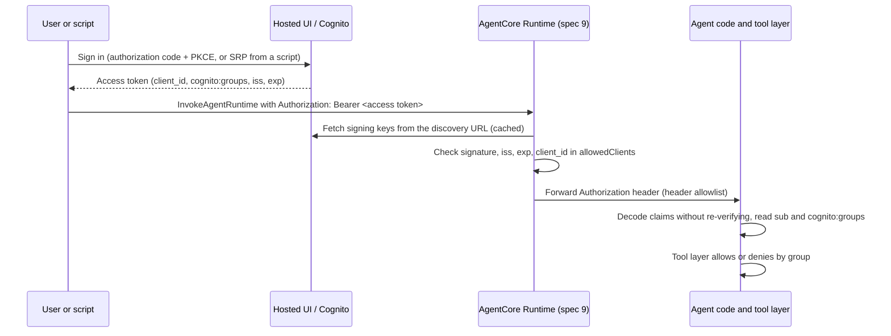
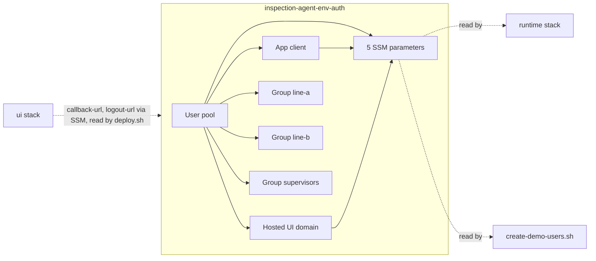

# Design Document

## Overview

GitHub issue: #4

This design covers three deliverables: `infra/auth.yaml` (stack `inspection-agent-<env>-auth`), `scripts/create-demo-users.sh`, and `docs/auth.md`. The template creates one Cognito user pool, one public app client, one hosted UI domain, three groups, and five SSM parameters. It contains no IAM resource, no Lambda trigger, no custom attribute, and no reference to the UI stack.

The issue number was confirmed on 2026-11-20 with `gh issue view 4`. Issue #4 is titled "Cognito user pool, groups, and demo users (infra/auth.yaml)", has the labels `core`, `infra`, and `auth`, belongs to milestone M0 Skeleton, and depends on #1.

AWS facts below were verified on **2026-11-20** (see "Verification record"). Results that shape the template:

1. The AgentCore Runtime JWT authorizer is documented and sampled with **Cognito access tokens**. `allowedClients` matches the `client_id` claim. `allowedAudience` matches the `aud` claim. A Cognito access token has `client_id` and has no `aud` unless a resource binding is requested, so the runtime spec uses `allowedClients` only.
2. Cognito puts `cognito:groups` in both the access token and the ID token. No token customization is needed (Requirement 4.6 does not apply).
3. The runtime does not forward decoded claims. It forwards the raw `Authorization` header, and only when the runtime lists `Authorization` in its request header allowlist. Agent code decodes the JWT without signature verification, because the runtime already validated it.
4. A parameter name that contains "Token" and has a `Default` breaks Requirement 10.2, and Requirement 6.1 asks for exactly such a parameter. The design renames the parameters (see "Gaps and conflicts", G1).
5. With email as the sign-in alias, the Cognito username cannot be the label `inspector-a`. The script creates users by email address and stores the persona label in the standard `name` attribute (G2).

Key decisions:

| Decision | Choice | Rationale |
|---|---|---|
| Token the runtime validates | Access token | Documented sample and the claim table in the AgentCore guide. See "Token and claim verification" |
| Authorizer matching | `allowedClients = [app-client-id]`, no `allowedAudience`, no `allowedScopes` | The access token carries `client_id` and no `aud`. If both lists are set the runtime checks both, so `allowedAudience` would reject every token |
| Where authorization comes from | `cognito:groups` array of the access token, read in the tool layer | Requirement 3. Absent claim means no access |
| Token customization | None | The claim is present by default. Adding a pre-token trigger would add a Lambda, IAM, and a feature-plan change for no gain |
| Feature plan | `UserPoolTier: LITE`, `ManagedLoginVersion: 1` (classic hosted UI) | Classic hosted UI is available on every plan. Managed login needs Essentials or Plus plus a branding resource. Nothing in this spec needs Essentials features. A plan change later is an in-place update |
| Sign-in alias | `UsernameAttributes: [email]`, case-insensitive | Requirement 1.3. `UsernameConfiguration` is immutable after creation, so it is set now |
| Hosted UI domain prefix | `inspection-agent-<env>-<8 hex characters of the stack ID>` | Unique without an account ID or a secret. See "Hosted UI domain prefix" |
| Callback and logout URLs | Parameters `CallbackUrl` and `LogoutUrl`. List has the localhost default, plus the supplied value when it differs | Requirements 2.4 to 2.7. No UI stack reference. `scripts/deploy.sh` already runs the step 2 / step 9 sequence |
| Output equals SSM value | Each output is `!GetAtt <parameter>.Value` | Requirement 7.10. One expression per value, so the two cannot drift |
| Property-based testing | Not applicable | The deliverables are a CloudFormation template, a shell script, and a document. See "Testing Strategy" |

Note on Demo_Questions: this design does not mention them. This stack does not touch them. The group-to-line mapping is documented in `docs/auth.md` and enforced later in the tool layer (spec for `inspection_core`). The user pool stores only the group names.

## Verification record

All checks ran on 2026-11-20. Documentation pages carry no revision date, so the access date is the date of record. Content was rephrased for compliance with licensing restrictions.

### Token and claim verification (Requirements 4.3 to 4.5, 4.8, Notes 1 and 2)

| # | Question | Result | Status | Source |
|---|---|---|---|---|
| T1 | Which token does the AgentCore Runtime JWT authorizer validate? | The guide for inbound auth builds its sample around Cognito **access tokens** (a bearer token created with `initiate-auth`, passed as `Authorization: Bearer <token>`). Its troubleshooting section decodes an access token with `token_use: access` and `client_id` | Verified for access tokens. That ID tokens are rejected is inferred, not stated (see T3) | [Authenticate and authorize with Inbound Auth and Outbound Auth](https://docs.aws.amazon.com/bedrock-agentcore/latest/devguide/runtime-oauth.html) |
| T2 | Which claim does each authorizer setting match? | Discovery URL: the issuer, matched against `iss`. `allowedClients`: matched against `client_id`. `allowedAudience`: matched against `aud`. `allowedScopes`: matched against the scope claim. If more than one list is set, the authorizer verifies all of them. At least one of audiences, clients, scopes, or required custom claims must be set | Verified | [Authenticate and authorize...](https://docs.aws.amazon.com/bedrock-agentcore/latest/devguide/runtime-oauth.html) (authorizer table), [Configure inbound JWT authorizer](https://docs.aws.amazon.com/bedrock-agentcore/latest/devguide/inbound-jwt-authorizer.html) |
| T3 | `client_id` or `aud` for the app client ID? | Cognito access token: `client_id` holds the app client ID, and `aud` appears only when a resource binding was requested. Cognito ID token: `aud` holds the app client ID, and there is no `client_id`. So `allowedClients` fits access tokens, and `allowedAudience` fits ID tokens | Verified for both Cognito token shapes. The AgentCore behavior with an ID token is an inference from T2, so the runtime spec decides nothing on it: it uses the access token | [Understanding the access token](https://docs.aws.amazon.com/cognito/latest/developerguide/amazon-cognito-user-pools-using-the-access-token.html), [Understanding the ID token](https://docs.aws.amazon.com/cognito/latest/developerguide/amazon-cognito-user-pools-using-the-id-token.html) |
| T4 | Does the Cognito access token carry `cognito:groups`? | Yes. The access token payload lists `cognito:groups` as an array of group names. The groups page says both ID and access tokens carry it. The ID token page says the claim is always an array, even for one group, and that group claims are added when the user belongs to at least one group | Verified. The "absent when the user has no group" case for the access token is inferred from the ID token page, so V7 checks it | [Understanding the access token](https://docs.aws.amazon.com/cognito/latest/developerguide/amazon-cognito-user-pools-using-the-access-token.html), [Adding groups to a user pool](https://docs.aws.amazon.com/cognito/latest/developerguide/cognito-user-pools-user-groups.html) |
| T5 | Do verified claims reach agent code, and in what form? | Not as a decoded claim set. The runtime validates the token, and forwards the raw `Authorization` header to the agent only if `Authorization` is in the runtime's request header allowlist (allowed only with a `customJWTAuthorizer`). Agent code reads it from `context.request_headers['Authorization']` and decodes it. The guide's sample uses PyJWT with `verify_signature` off, because the runtime already validated the token | Verified | [Authenticate and authorize...](https://docs.aws.amazon.com/bedrock-agentcore/latest/devguide/runtime-oauth.html) (step "Propagate a JWT token"), [Pass custom headers to AgentCore Runtime](https://docs.aws.amazon.com/bedrock-agentcore/latest/devguide/runtime-header-allowlist.html) |
| T6 | Is the runtime authorizer configurable from CloudFormation? | Yes. `AWS::BedrockAgentCore::Runtime` has `CustomJWTAuthorizerConfiguration` (discovery URL, allowed clients, allowed audience, allowed scopes, custom claims) | Verified by the resource reference page title and property list returned by search. Spec #9 reads the exact property names | [CustomJWTAuthorizerConfiguration](https://docs.aws.amazon.com/AWSCloudFormation/latest/TemplateReference/aws-properties-bedrockagentcore-runtime-customjwtauthorizerconfiguration.html) |
| T7 | Discovery URL form | Must match `^[^\s?#]+/\.well-known/(openid-configuration|oauth-authorization-server)(/[^\s?#]+)?$`. The Cognito URL `https://cognito-idp.<region>.amazonaws.com/<pool-id>/.well-known/openid-configuration` fits | Verified | [Configure inbound JWT authorizer](https://docs.aws.amazon.com/bedrock-agentcore/latest/devguide/inbound-jwt-authorizer.html) |
| T8 | A custom attribute in the access token? | Not used. Custom attributes are not in access tokens without a customization, and this design adds none (Requirement 3.3, Note 2) | By decision | [Understanding the access token](https://docs.aws.amazon.com/cognito/latest/developerguide/amazon-cognito-user-pools-using-the-access-token.html) |

What the runtime spec (#9) must do with this:

- Set `discoveryUrl` from `/inspection-agent/<env>/auth/discovery-url` and `allowedClients` to the value of `/inspection-agent/<env>/auth/app-client-id`. Set no `allowedAudience`.
- Put `Authorization` in the request header allowlist.
- In the tool layer, read the bearer token from `context.request_headers`, decode it without signature verification (the runtime did the verification), require `token_use == "access"`, read `sub` as the user identity and `cognito:groups` as the list of groups. Treat an absent claim as an empty list. Never take identity from a model-supplied argument.
- Optional extra gate: a required custom claim rule on `cognito:groups` (type `STRING_ARRAY`, operator `CONTAINS_ANY`, values `line-a`, `line-b`, `supervisors`) rejects users with no group before the agent starts. It is a coarse gate. Line-level authorization stays in the tool layer. The runtime spec decides whether to use it.
- Use `sub` as the stable user identifier. With email as the sign-in alias, Cognito generates the internal username, so the `username` claim is not the email address.

A token reflects group membership at the time Cognito issued it. A group change shows up in tokens issued after the change, so a signed-in demo user keeps the old groups for up to `JwtValidityMinutes`.

### Hosted UI domain and tier facts

| Item | Result | Source |
|---|---|---|
| Prefix domain form | `<prefix>.auth.<region>.amazoncognito.com` | [Using the Amazon Cognito prefix domain](https://docs.aws.amazon.com/cognito/latest/developerguide/cognito-user-pools-assign-domain-prefix.html) |
| `Domain` property | Pattern `^[a-z0-9](?:[a-z0-9\-]{0,61}[a-z0-9])?$`, 1 to 63 characters. Changing it requires replacement | [AWS::Cognito::UserPoolDomain](https://docs.aws.amazon.com/AWSCloudFormation/latest/TemplateReference/aws-resource-cognito-userpooldomain.html) |
| Reserved text | A prefix cannot contain `aws`, `amazon`, or `cognito`. Cognito answers "Domain cannot contain reserved word: aws" with a 400 error | [Zenn note quoting the Cognito documentation](https://zenn.dev/mn87/articles/ab001587b2fe35), [GitHub issue showing the error](https://github.com/aws-solutions/content-analysis-on-aws/issues/8) |
| `ManagedLoginVersion` | `1` is the classic hosted UI, `2` is managed login | [AWS::Cognito::UserPoolDomain](https://docs.aws.amazon.com/AWSCloudFormation/latest/TemplateReference/aws-resource-cognito-userpooldomain.html) |
| Plans | The classic hosted UI is available on all plans including Lite. Managed login and its branding editor need Essentials or Plus. Custom access tokens need Essentials | [Migrating from the classic hosted UI](https://docs.aws.amazon.com/cognito/latest/developerguide/migrate-classic-hosted-ui-to-managed-login.html), [Essentials plan features](https://docs.aws.amazon.com/cognito/latest/developerguide/feature-plans-features-essentials.html), [User pool feature plans](https://docs.aws.amazon.com/cognito/latest/developerguide/cognito-sign-in-feature-plans.html) |
| `UserPoolTier` | `LITE`, `ESSENTIALS`, or `PLUS`. Default `ESSENTIALS`. Update needs no interruption | [AWS::Cognito::UserPool](https://docs.aws.amazon.com/AWSCloudFormation/latest/TemplateReference/aws-resource-cognito-userpool.html) |
| Taggable types | `AWS::Cognito::UserPool` has `UserPoolTags` (a map). `UserPoolClient`, `UserPoolGroup`, and `UserPoolDomain` have no tag property. `AWS::SSM::Parameter` has `Tags` (a map) | The four CloudFormation resource reference pages, property lists read on 2026-11-20 |
| Passing parameters with `aws cloudformation deploy` | Parameters not named in `--parameter-overrides` use the previous value | [aws-cli `deploy.py`, `merge_parameters`](https://github.com/aws/aws-cli/blob/v2/awscli/customizations/cloudformation/deploy.py) |

### Other sources used

| Topic | Source |
|---|---|
| Existing conventions | `docs/cloudformation-conventions.md`, `docs/kiro-workflow.md`, `.kiro/steering/*.md`, `infra/network.yaml`, `scripts/deploy.sh`, `scripts/teardown.sh`, specs 01 to 03 |
| Group descriptions, hosted UI flow, token endpoints | [Amazon Cognito developer guide](https://docs.aws.amazon.com/cognito/latest/developerguide/) pages cited above |

## Architecture

### Sign-in and token flow



### Stack layout



The dashed lines are SSM reads. No CloudFormation dependency exists between the stacks.

### Deploy order (Requirement 8, Note 3)

`scripts/deploy.sh deploy-all` already runs the sequence below. This spec changes nothing in the script.

| Step | Stack | Auth-relevant action |
|---|---|---|
| 1 | network | none |
| 2 | auth | Created with the default localhost `CallbackUrl` and `LogoutUrl`. Publishes the five SSM parameters. `scripts/create-demo-users.sh` can run from here on, once per environment |
| 3 | database | none |
| 4 | runtime (`MemoryId=` empty) | Reads `discovery-url` and `app-client-id`. Auth is already deployed at step 2, so the order holds |
| 5, 6 | memory, runtime | none |
| 7 | observability | none |
| 8 | ui | Creates the CloudFront URL. Publishes `/inspection-agent/<env>/ui/callback-url` and `/logout-url` |
| 9 | auth (update) | `deploy.sh` reads the two UI parameters and deploys auth with `CallbackUrl` and `LogoutUrl`, then checks both parameters on the stack. The pool, client, and users stay |
| 10 | mcp | none |

How the circular dependency is avoided: the auth template never reads the UI stack. The UI value reaches auth only as a stack parameter that the deploy script copies from SSM at step 9. Both sides of the loop go through SSM, so there is no CloudFormation cycle.

Behavior to know:

- **Rerunning step 2 after step 9.** `aws cloudformation deploy` passes `UsePreviousValue` for parameters that are not overridden, so the CloudFront URLs from step 9 stay in place. V11 checks this.
- **The app client ID does not change at step 9.** `CallbackURLs` and `LogoutURLs` are in-place updates of the client, so the runtime's `allowedClients` value stays valid. V10 checks it by comparing IDs before and after.
- **Teardown.** `scripts/teardown.sh` already deletes auth after runtime and before network. The stack removes the domain, client, groups, and pool, including the demo users. `DeletionProtection` is set to `INACTIVE` so the delete works.

### Hosted UI domain prefix (Note 4)

Scheme: `inspection-agent-${Env}-<suffix>`, where `<suffix>` is the first dash-separated block (8 hexadecimal characters) of the stack's UUID, taken from `AWS::StackId`.

```yaml
Domain: !Sub
  - inspection-agent-${Env}-${Suffix}
  - Suffix: !Select [0, !Split ["-", !Select [2, !Split ["/", !Ref "AWS::StackId"]]]]
```

| Property | Result |
|---|---|
| Literal account ID in the template | None. The account ID is part of the stack ID ARN, but only the UUID block is taken. The domain does not reveal the account |
| Secret | None. The suffix is public once the domain is in use |
| Unique across accounts | The UUID is random per stack. 8 hex characters give 32 bits, so a collision needs about 65,000 stacks with the same `Env` in one Region to reach a one-in-two chance. Not a concern for a demo. A collision fails creation with `ROLLBACK_COMPLETE` (Requirement 1.9) |
| Stable across updates | The stack ID does not change when the stack is updated, so the domain does not change and `Domain` is not replaced |
| Changes after delete and create | A recreated stack gets a new UUID and a new domain. Every consumer reads the domain from SSM, so none breaks |
| Reserved words | The suffix is hexadecimal, so it cannot contain `aws`, `amazon`, or `cognito`. The fixed text `inspection-agent` does not either. `Env` is the only place a reserved word can enter, and `Env=aws` is a valid value of the `Env` pattern. That case fails at creation, which V12 uses to exercise Requirement 1.9 |
| Length | At most 16 + 1 + 10 + 1 + 8 = 36 characters, inside the 63 limit. The pattern is met: lowercase letters, digits, and hyphens, starting and ending with an alphanumeric character |

Alternatives rejected:

- `${AWS::AccountId}` in the prefix: legal under Rule 6 (a pseudo parameter, not a literal), but it puts the account ID into every sign-in URL. Requirement note 4 asks for no account ID.
- An operator-supplied prefix parameter: moves the uniqueness problem to the operator and adds a parameter that needs its own pattern.
- A random suffix from a custom resource: needs a Lambda and IAM for no extra benefit.

## Components and Interfaces

### 1. Template parameters (`infra/auth.yaml`)

Every parameter has a Description of 1 to 200 characters and a constraint (Requirement 1.6, Rule 2).

| Parameter | Type | Default | Constraint | Requirement |
|---|---|---|---|---|
| `Env` | String | `demo` | `AllowedPattern: ^[a-z][a-z0-9]{0,9}$` | 1.5, 1.10, Rule 9 |
| `CallbackUrl` | String | `http://localhost:3000/callback` | `AllowedPattern: '^(https://[A-Za-z0-9-]+(\.[A-Za-z0-9-]+)*(:[0-9]{1,5})?(/[^\s#,*]*)?\|http://localhost(:[0-9]{1,5})?(/[^\s#,*]*)?)$'`, `MaxLength: 1024` | 2.4 to 2.6 |
| `LogoutUrl` | String | `http://localhost:3000/` | Same pattern, `MaxLength: 1024` | 2.4 to 2.6 |
| `JwtValidityMinutes` | Number | `60` | `MinValue: 60`, `MaxValue: 1440` | 6.1, 6.2, 6.11 |
| `RefreshValidityDays` | Number | `1` | `MinValue: 1`, `MaxValue: 3650` | 6.3 |

Notes on the table:

- The URL pattern accepts `https://` followed by a host of one or more DNS labels (letters, digits, hyphens) separated by dots, an optional `:port`, and an optional path, or `http://localhost` with an optional port and optional path. The path excludes whitespace, `#`, `,`, and `*`. `http://localhost.example.com` does not match, because after `localhost` only `:port` or `/` may follow. `https://*.example.com/callback` and `https://user@evil.com/` do not match, because `*` and `@` are not host characters.
- Change note: the first design let any `https://` text through and expected Cognito to reject a wildcard host. V11b showed that Cognito accepts `https://*.example.com/callback` as a callback URL, which is a security weakness (a wildcard redirect URI). The pattern now rejects it before deployment. The V11b check now uses `cancel-update-stack` to exercise the rollback.
- The default port 3000 is a development default. The UI spec can override it with a parameter value.
- `JwtValidityMinutes` sets both the access token and the ID token validity. The parameter names avoid the word "Token" on purpose (G1).
- Cognito allows access and ID token validity from 5 minutes to 1 day, so 60 to 1440 is inside the service range. Refresh token validity from 1 hour to 10 years (3650 days) is inside the service range.
- A parameter name containing "Password", "Secret", or "Token" does not exist, so Requirement 10.2 holds.

### 2. Conditions

| Condition | Definition | Use |
|---|---|---|
| `CallbackIsDefault` | `CallbackUrl` equals `http://localhost:3000/callback` | Avoid a duplicate entry in `CallbackURLs` |
| `LogoutIsDefault` | `LogoutUrl` equals `http://localhost:3000/` | Same for `LogoutURLs` |

The literals in the conditions repeat the parameter defaults. A YAML comment above each condition says to keep them in sync. Cognito rejects duplicate URLs in a list, which is why the condition exists.

### 3. Resources

Tags column: "map" means the type takes a tag map and carries `Project=inspection-agent` and `Env=<Env>` (Requirement 1.4, Rule 4). "none" means the CloudFormation type has no tag property, so Rule 4 does not apply to it.

| Logical ID | Type | Key properties | Tags |
|---|---|---|---|
| `UserPool` | `AWS::Cognito::UserPool` | See below | map (`UserPoolTags`) |
| `UserPoolClient` | `AWS::Cognito::UserPoolClient` | See below | none |
| `UserPoolDomain` | `AWS::Cognito::UserPoolDomain` | `Domain` per "Hosted UI domain prefix", `ManagedLoginVersion: 1`, `UserPoolId: !Ref UserPool` | none |
| `GroupLineA` | `AWS::Cognito::UserPoolGroup` | `GroupName: line-a`, description | none |
| `GroupLineB` | `AWS::Cognito::UserPoolGroup` | `GroupName: line-b`, description | none |
| `GroupSupervisors` | `AWS::Cognito::UserPoolGroup` | `GroupName: supervisors`, description | none |
| `UserPoolIdParameter`, `AppClientIdParameter`, `IssuerUrlParameter`, `DiscoveryUrlParameter`, `HostedUiDomainParameter` | `AWS::SSM::Parameter` | `Type: String`, see "Published identifiers" | map (`Tags`) |

`UserPool` properties:

| Property | Value | Requirement |
|---|---|---|
| `UserPoolName` | `inspection-agent-${Env}` | |
| `UserPoolTier` | `LITE` | Design decision |
| `UsernameAttributes` | `[email]` | 1.3 |
| `UsernameConfiguration` | `CaseSensitive: false` | Avoids two users that differ only by case |
| `AutoVerifiedAttributes` | `[email]` | Account recovery by email needs a verified address (6.10) |
| `AdminCreateUserConfig` | `AllowAdminCreateUserOnly: true` | 6.5, 6.6 |
| `Policies.PasswordPolicy` | `MinimumLength: 8`, `RequireLowercase`, `RequireUppercase`, `RequireNumbers`, and `RequireSymbols` all `false`, with the comment "Demo setting. Use a stronger password policy for any non-demo use." directly above `PasswordPolicy`, `TemporaryPasswordValidityDays: 1`. Change note: the first design required 12 characters with lowercase, uppercase, and digits. The user relaxed it during V4 (Requirement 6.8) | 6.8, 6.9 |
| `MfaConfiguration` | `"OFF"` with the comment "Demo setting. Enable MFA for any non-demo use." on the line directly above | 6.7 |
| `AccountRecoverySetting` | One mechanism: `verified_email`, priority 1 | 6.10 |
| `DeletionProtection` | `INACTIVE` | 1.8 |
| `Schema`, `LambdaConfig` | Not set | 3.3, 3.4 |
| `UserPoolTags` | `Project`, `Env` | 1.4 |

`UserPoolClient` properties:

| Property | Value | Requirement |
|---|---|---|
| `ClientName` | `inspection-agent-${Env}-app` | |
| `GenerateSecret` | `false` | 2.1 |
| `AllowedOAuthFlowsUserPoolClient` | `true` | Needed for OAuth flows |
| `AllowedOAuthFlows` | `[code]` | 2.2 (no `implicit`, no `client_credentials`) |
| `AllowedOAuthScopes` | `[openid, email, profile]` | 2.3 |
| `SupportedIdentityProviders` | `[COGNITO]` | Required with OAuth flows |
| `CallbackURLs` | `!If [CallbackIsDefault, [!Ref CallbackUrl], [http://localhost:3000/callback, !Ref CallbackUrl]]` | 2.7, 8.1 |
| `LogoutURLs` | Same shape with `LogoutIsDefault` | 2.7, 8.1 |
| `ExplicitAuthFlows` | `[ALLOW_USER_SRP_AUTH, ALLOW_REFRESH_TOKEN_AUTH]` | 2.9 |
| `PreventUserExistenceErrors` | `ENABLED` | 2.10 |
| `AccessTokenValidity`, `IdTokenValidity` | `!Ref JwtValidityMinutes` | 6.1, 6.2 |
| `RefreshTokenValidity` | `!Ref RefreshValidityDays` | 6.3 |
| `TokenValidityUnits` | `AccessToken: minutes`, `IdToken: minutes`, `RefreshToken: days` | 6.4 |
| Claim override | None. No `ReadAttributes` setting or token customization is defined, so nothing removes `cognito:groups` | 4.7 |

Group descriptions (Requirement 3.2): "Line A inspector persona. Members can read line A inspection data.", "Line B inspector persona. Members can read line B inspection data.", "Quality supervisor persona. Members can read inspection data of both lines." Each is between 1 and 200 characters. The descriptions state the persona and the intended reach, but the pool enforces nothing from them.

Naming: only `Env` and pseudo parameters appear in names. Region and partition come from pseudo parameters, so Rule 6 holds. The two hostnames `cognito-idp.<region>.amazonaws.com` and `<prefix>.auth.<region>.amazoncognito.com` use `${AWS::Region}`.

### 4. Published identifiers (Requirement 7)

Five SSM parameters, each `Type: String`, each with a Description, and each tagged with the `Project` and `Env` map. No `Export` and no `Fn::ImportValue` exist in the template.

| SSM name | Value expression | Output | Requirement |
|---|---|---|---|
| `/inspection-agent/${Env}/auth/user-pool-id` | `!Ref UserPool` | `UserPoolId` | 7.2 |
| `/inspection-agent/${Env}/auth/app-client-id` | `!Ref UserPoolClient` | `AppClientId` | 7.3 |
| `/inspection-agent/${Env}/auth/issuer-url` | `!Sub https://cognito-idp.${AWS::Region}.amazonaws.com/${UserPool}` | `IssuerUrl` | 7.4, 7.7 |
| `/inspection-agent/${Env}/auth/discovery-url` | `!Sub https://cognito-idp.${AWS::Region}.amazonaws.com/${UserPool}/.well-known/openid-configuration` | `DiscoveryUrl` | 7.5, 7.7 |
| `/inspection-agent/${Env}/auth/hosted-ui-domain` | `!Sub ${UserPoolDomain}.auth.${AWS::Region}.amazoncognito.com` | `HostedUiDomain` | 7.6 |

Each output is `Value: !GetAtt <Parameter>.Value` and has a Description (Requirement 7.1, 7.10). `Ref` on the domain resource returns the prefix, so the host name is built from it. The value has no scheme and no trailing slash.

If one parameter fails to create, CloudFormation rolls the stack back and no partial set remains (Requirement 7.11). This is the default behavior of the stack.

### 5. `scripts/create-demo-users.sh` (Requirement 5, 10.5, 10.6, 10.8)

Interface:

```text
scripts/create-demo-users.sh [--env <env>] [--region <region>]
```

Defaults `demo` and `us-west-2`, validated with the same pattern and help text style as `deploy.sh`. Environment variables:

| Variable | Holds |
|---|---|
| `DEMO_PASSWORD_INSPECTOR_A` | Password of `inspector-a@example.com` |
| `DEMO_PASSWORD_INSPECTOR_B` | Password of `inspector-b@example.com` |
| `DEMO_PASSWORD_SUPERVISOR` | Password of `supervisor@example.com` |

Demo users:

| Persona label (`name` attribute) | Email (Cognito username) | Group |
|---|---|---|
| `inspector-a` | `inspector-a@example.com` | `line-a` |
| `inspector-b` | `inspector-b@example.com` | `line-b` |
| `supervisor` | `supervisor@example.com` | `supervisors` |

Order of operations. Everything up to step 4 happens before any change to the pool (Requirements 5.7, 5.15, 5.16):

1. `set -Eeuo pipefail` is the first command, after the shebang and a comment header. Parse and validate options. Fail when `aws` is not on `PATH`.
2. Read `/inspection-agent/<env>/auth/user-pool-id` from SSM. When the read fails, exit non-zero and name the parameter.
3. For each of the three users, take the password from its variable. When the variable is unset or empty and standard input is a terminal, prompt with `read -r -s`, which does not echo. When no value is available, exit non-zero and name the variable.
4. For each group, call `aws cognito-idp get-group`. When one is missing, exit non-zero and name it.
5. For each user: call `admin-get-user`. When the error is `UserNotFoundException`, call `admin-create-user` with `--message-action SUPPRESS` and the attributes `email`, `email_verified=true`, and `name`. Any other error stops the script. Then call `admin-set-user-password --permanent`. Then call `admin-add-user-to-group`.
6. Print one line per user (`ok <label>`), never a password or token. Exit 0.

Design details:

- **Passwords stay out of the process list.** At startup the script runs `umask 077`, creates one private directory with `mktemp -d` under `${TMPDIR:-/tmp}` (outside the repository), and sets `trap 'rm -rf "$tmpdir"' EXIT`. For each user it writes the JSON with the `printf` builtin to a mode-600 file in that directory, calls `aws cognito-idp admin-set-user-password --cli-input-json "file://$f"`, and runs `rm -f "$f"` right after the call whether it succeeded or failed. `printf` is a shell builtin, so the password does not show in `ps`, and no password is a command-line argument. Change note: the first design piped the JSON to `file:///dev/stdin`. Manual check V4 failed on AWS CLI 2.31.22 (macOS, bash 3.2) with "Invalid JSON received", and process substitution failed the same way, so the user chose the temporary file (Requirements 5.13, 5.14, 10.8).
- **JSON escaping.** The script escapes `\` and `"` with `sed` and rejects a password that contains a control character (including newline), so the JSON stays valid without `jq`.
- **Error output masking.** The script captures AWS CLI error text and removes every occurrence of the password with bash pattern substitution (`${out//"$pw"/***}`, supported by bash 3.2) before printing. A password-policy failure (`InvalidPasswordException`) prints the masked Cognito message and exits non-zero (Requirement 5.8). Any other failure prints the masked message and exits non-zero (5.17).
- **Idempotence (5.9, 5.10).** An existing user is not recreated. `admin-set-user-password --permanent` with the same value leaves the same password. `admin-add-user-to-group` does nothing when the user is already a member. The second run therefore ends with three users, the same memberships, and exit 0.
- **bash 3.2 only.** No associative arrays, no `mapfile`, no `readarray`, no `${var,,}`, no `${var^^}`. The three users are handled by a `for` loop over a space-separated list of `label:email:group:variable` records split with `IFS=:`, and indirect expansion `${!var}` (available in bash 3.2) reads the password variable.
- **No password in the repository.** The script has no password literal and writes nothing in the repository. The only file that holds a password is the short-lived mode-600 temporary file described above. A temporary variable holds each password only for the loop iteration and is unset afterward.
- **`scripts/README.md` is unchanged.** It already lists "create demo users" as one of the 10 scripts, and Requirement 10.5 allows a change only when the README lists the script by its file name. The Makefile gets no new target, since the requirements do not ask for one.

### 6. `docs/auth.md` (Requirement 9)

Sections, in order. All text is English. No password, token, or account ID appears.

1. **Personas and groups.** Table of the three personas: label, email, group. Statement that the `cognito:groups` claim is the only authorization input and that email, username, and custom attributes are never used (3.6). Statement that tokens carry groups as of the time of issue.
2. **Group-to-line mapping.** Table with exactly three rows: `line-a` reads line A only, `line-b` reads line B only, `supervisors` reads line A and line B (9.2).
3. **Create the demo users.** Run after step 2 of the deploy, once per environment. Command with the three environment variable names and the interactive-prompt alternative (9.3, 8.6). No value for any password. Note that the step 9 update does not need a rerun.
4. **Sign in, deploy order, and the SSM parameters.** The deploy order table (8.5) and the five parameter names, one sentence each (9.8).
5. **Get an access token through the hosted UI** (numbered steps, 9.4): read the domain and client ID from SSM, create a PKCE verifier and challenge with `openssl`, open the `/oauth2/authorize` URL with `response_type=code`, `scope=openid+email+profile`, and `code_challenge_method=S256`, sign in, copy the `code` from the redirect address, exchange it with `curl` at `/oauth2/token`, and keep the token in a shell variable, not in a file. The page states that PKCE is required, because the app client has no secret (2.11).
6. **Inspect the group claim locally** (9.5): decode the payload with `cut`, `base64`, and `jq` (or a `python3 -c` one-liner). The page states that tokens must not be pasted into online decoders or any third-party service.
7. **Get an access token from a script, including `scripts/invoke`** (numbered steps, 9.6): the app client enables SRP only, and the AWS CLI cannot do SRP, so the page uses the `pycognito` library in a short Python snippet run from a throwaway virtual environment outside the repository. The snippet reads the password with `getpass` or from an environment variable and never accepts it as an argument. See G3.
8. **Handling rules** (9.7): never commit tokens, never paste them into issues, never put a password on a command line.
9. **MFA** (9.9): MFA is off for the demo only. Enable it for any non-demo use.
10. **Token lifetimes and failure messages**: defaults of 60 minutes and 1 day, where to change them, and the usual error causes (wrong client ID, expired token, missing `Authorization` header allowlist).

## Data Models

### Token claims the tool layer relies on

Access token for a user in `supervisors` (shape from the Cognito documentation; values are placeholders):

```json
{
  "sub": "<opaque user id>",
  "cognito:groups": ["supervisors"],
  "iss": "https://cognito-idp.<region>.amazonaws.com/<user-pool-id>",
  "client_id": "<app client id>",
  "token_use": "access",
  "scope": "aws.cognito.signin.user.admin",
  "username": "<opaque>",
  "exp": 0,
  "iat": 0
}
```

| Claim | Meaning for this project |
|---|---|
| `cognito:groups` | Array of group names. Absent or empty means no access. Always read as an array |
| `sub` | Stable user identifier. Used as the verified user identity |
| `client_id` | Equals `/inspection-agent/<env>/auth/app-client-id`. Matched by the runtime `allowedClients` |
| `iss` | Equals the `issuer-url` parameter |
| `token_use` | `access` for the token the runtime accepts |
| `scope` | Tokens from SRP sign-in carry only `aws.cognito.signin.user.admin`. Tokens from the hosted UI carry `openid`, `email`, and `profile`. No authorization depends on scope |

### Group model

| Group | Persona | Lines readable (enforced by the tool layer, not by the pool) |
|---|---|---|
| `line-a` | Line A inspector | A |
| `line-b` | Line B inspector | B |
| `supervisors` | Quality supervisor | A and B |

### SSM parameters

See the table in "Published identifiers". All five parameters have type `String`.

## Gaps and conflicts

### Conflicts with steering and conventions (Requirements note 5)

| # | Item | Result |
|---|---|---|
| S1 | Rule 2: every parameter has a constraint, including the URL parameters | **No conflict.** The URL parameters use `AllowedPattern` and `MaxLength` (Requirement 2.5). The numeric parameters use `MinValue` and `MaxValue` |
| S2 | Rule 4: tags on every resource that supports tags | **No conflict.** `UserPool` takes `UserPoolTags` and the five SSM parameters take `Tags`. The client, the groups, and the domain have no tag property in CloudFormation (checked 2026-11-20), so Rule 4 does not apply to them. `cfn-lint` confirms at implementation |
| S3 | Rule 6: no literal region, account, or ARN strings, including the issuer URL | **No conflict.** The issuer, discovery URL, and domain host use `!Sub` with `${AWS::Region}`. The domain suffix uses `AWS::StackId` and takes only the UUID block, so the account ID never appears. The only literals are `localhost` URLs, which are not region, account, or ARN values |
| S4 | Rule 7: zero cfn-lint errors and warnings | **Applies.** CI pins cfn-lint 1.60.1. The local copy is 1.46.0, so the task runs the check locally and the CI result is the final one. A rule difference between the two versions is handled at implementation |
| S5 | Rule 10: SSM, no `Export` | **No conflict.** Five SSM parameters. No `Export` and no `Fn::ImportValue` |
| S6 | Rule 3: an output for every consumed identifier, each with a Description | **No conflict.** Five outputs map one to one to the SSM parameters |
| S7 | Rule 5: IAM least privilege | **Not applicable.** The template has no IAM resource and no policy statement |
| S8 | `structure.md`: `scripts/` holds only the 10 Operational_Scripts | **No conflict.** `create-demo-users.sh` is the "create demo users" script. The name matches the `deploy.sh` and `teardown.sh` style. Nothing else is added to `scripts/` |
| S9 | `tech.md` testing policy | **No conflict.** No test file or harness is created. Verification is manual |
| S10 | `product.md` and `tech.md`: permissions enforced in code at the tool layer from the verified identity; the model never supplies identity | **No conflict.** The design hands the tool layer `sub` and `cognito:groups` from the verified header and states the model never supplies either |
| S11 | `docs/kiro-workflow.md`: issue reference on the first Overview line | **Done** (`GitHub issue: #4`) |
| S12 | `deploy.sh` always passes `--capabilities CAPABILITY_NAMED_IAM` | **No conflict.** The auth stack has no IAM resource. CloudFormation accepts an unused capability |
| S13 | `deploy.sh deploy <component>` takes no stack parameters | **No conflict, but a limit.** Parameters reach auth only through `deploy-all` (step 9). Manual checks that need other parameter values (V9 to V12) call `aws cloudformation deploy` directly |

### Gaps in the requirements found while verifying

None of these is applied to `requirements.md` without approval.

| # | Gap | What the design does | Proposed requirement change |
|---|---|---|---|
| G1 | Requirement 6.1 asks for an Access_Token validity parameter with a default. Requirement 10.2 forbids a default on any parameter whose name contains "Token" | Names the parameters `JwtValidityMinutes` and `RefreshValidityDays`. Neither contains "Token", "Secret", or "Password" | State parameter names in 6.1 and 6.3, or limit 10.2 to values that look like secrets |
| G2 | Requirement 5 names users `inspector-a`, `inspector-b`, `supervisor`. With email as the sign-in alias (1.3) the Cognito username must be an email address, and Cognito generates the internal username | The script creates each user by email address and stores the label in the `name` attribute. Sign-in uses the email. The `username` claim is opaque, so consumers use `sub` | Reword 5.1 to 5.3 as "the Demo_User with the email ... and the `name` attribute `inspector-a`" |
| G3 | Requirement 2.9 enables SRP and refresh only. Requirement 9.6 wants a scripted token with no literal password argument. The AWS CLI cannot perform SRP | `docs/auth.md` uses `pycognito` in a Python snippet outside the repository. Enabling `ALLOW_USER_PASSWORD_AUTH` would make `aws cognito-idp initiate-auth` work, but it sends the password to Cognito as a request field and contradicts 2.9, so it is not used. V6 verifies the snippet. The later `scripts/invoke` spec decides how that script gets a token | Amend 2.9 only if V6 shows `pycognito` unusable |
| G4 | Requirement 6.9 says "1 day in the default configuration", which suggests a parameter | Sets the value to 1 with no parameter. A parameter for the temporary password lifetime has no use here, because the demo users get permanent passwords | None. Wording is satisfied |
| G5 | Requirements 3.8 and 4.2 allow "absent or empty" for a user with no group. The access token page does not state which one | The tool layer treats both the same. V7 observes the real behavior and records it in `docs/auth.md` | None |
| G6 | Requirement 1.9 asks for a failure on a prefix that is "already in use". With a stack-ID suffix a real collision is near impossible, so it cannot be tested directly | V12 triggers the same failure path with `Env=aws`, which puts a reserved word in the prefix. Cognito rejects the prefix at the domain resource, and the stack ends in `ROLLBACK_COMPLETE` | None |
| G7 | Requirement 2.7 says both URLs are registered. When the supplied value equals the localhost default, listing it twice makes Cognito reject the list | Conditions `CallbackIsDefault` and `LogoutIsDefault` list the default once | None |
| G8 | Requirement 8.4 asks for a rollback on a failed update. The URL pattern catches bad URL values before deployment, and Cognito accepts every value that passes it (V11b showed it even accepts a wildcard host), so no bad value can fail inside Cognito | V11b cancels a running URL update with `cancel-update-stack`, which makes CloudFormation roll back to the previous values | None |
| G9 | The runtime spec must set `allowedClients`, and an extra `allowedAudience` would reject every token | Recorded in "Token and claim verification". The runtime spec reads this section | Add a pointer to this design in the runtime spec's requirements |

## Error Handling

| Condition | Behavior | Requirement |
|---|---|---|
| `Env` does not match the pattern | CloudFormation rejects the value at change set creation. No resource is created or changed | 1.10 |
| `CallbackUrl` or `LogoutUrl` fails the pattern or exceeds 1024 characters | Same. The stack keeps its previous state | 2.6 |
| `JwtValidityMinutes` outside 60 to 1440, or `RefreshValidityDays` outside 1 to 3650 | Same | 6.11 |
| Domain prefix in use or against Cognito's rules | The domain resource fails, the stack ends in `ROLLBACK_COMPLETE`, the events name `UserPoolDomain`, and no pool remains | 1.9 |
| An SSM parameter cannot be created | The stack rolls back and leaves no parameters | 7.11 |
| Update with new URLs fails in Cognito | The stack ends in `UPDATE_ROLLBACK_COMPLETE`. The pool, client, and users stay unchanged | 8.4 |
| Stack left in `ROLLBACK_COMPLETE` | `scripts/deploy.sh` stops and tells the operator to run `make delete-auth` first | Spec 01 |
| Script: no `aws` CLI, invalid `--env`, unknown option | Exit non-zero with a message, before any AWS call | 5.12 |
| Script: SSM parameter `user-pool-id` unreadable | Exit non-zero naming the parameter, before any change | 5.15 |
| Script: password variable unset and no terminal | Exit non-zero naming the variable, before any change | 5.7 |
| Script: group missing | Exit non-zero naming the group | 5.16 |
| Script: `InvalidPasswordException` | Exit non-zero and print the masked Cognito message | 5.8 |
| Script: another AWS CLI failure | Exit non-zero and print the masked error | 5.17 |
| Script: a failure after the first user was created | Exit non-zero. The next run continues, because every step is idempotent | 5.9 |
| Token without `cognito:groups` reaches the tool layer | The tool layer grants no access. Not handled in this spec | 3.8 |
| Runtime receives an expired token or the wrong client | The runtime answers 401. Not handled in this spec | Spec 9 |

Deletion: `make delete-auth` removes the domain, client, groups, and pool (and the users inside the pool) in dependency order. The domain prefix is released after the delete. The stack must not be deleted while a runtime still depends on its SSM values. `scripts/teardown.sh` orders this.

## Testing Strategy

Property-based testing does not apply. The deliverables are a declarative CloudFormation template, a shell script that calls AWS APIs, and a document. The template is infrastructure as code with no function to quantify over, and the script's behavior depends on Cognito and SSM. The project policy also forbids automated tests (`.kiro/steering/tech.md`). So this design has no Correctness Properties section and runs no prework step. No test file, test suite, fixture, or eval harness is created. Every acceptance criterion is verified by hand, with cfn-lint and by inspecting the deployed stack. The result goes in the task notes (`docs/kiro-workflow.md`, section 7).

Commands use a named profile and region as placeholders. They contain no account ID, password, or token. Passwords come from the shell environment or a prompt, and tokens live in shell variables. Verification costs nothing beyond Cognito's free tier. The steps reuse one stack and finish with deletion.

| Step | Action | Pass criterion | Covers |
|---|---|---|---|
| V1 | `cfn-lint infra/auth.yaml` from the repository root. Read the template: `Export`, `ImportValue`, literal account IDs, region names, `arn:` strings, `Schema`, `LambdaConfig`. Search the parameter names for "Token", "Secret", "Password" | Exit code 0, zero errors, zero warnings. None of the forbidden items is present. No parameter name contains the three words | 1.4 to 1.7, 3.3, 3.4, 7.9, 10.2 to 10.4 |
| V2 | `make deploy-auth`. Then `aws cloudformation describe-stacks`, `aws cognito-idp describe-user-pool`, `describe-user-pool-client`, `describe-user-pool-domain`, `list-groups`, and `aws ssm get-parameters-by-path --path /inspection-agent/demo/auth/ --recursive` | Stack `CREATE_COMPLETE`. One pool with `UsernameAttributes=[email]`, `MfaConfiguration=OFF`, `AdminCreateUserConfig.AllowAdminCreateUserOnly=true`, password minimum 8 with no required character classes, temporary password validity 1, one recovery mechanism `verified_email`, no `LambdaConfig` entries, no `custom:` attribute, tier `LITE`. One client without a secret, flows `[code]`, scopes `[openid,email,profile]`, auth flows `[ALLOW_USER_SRP_AUTH, ALLOW_REFRESH_TOKEN_AUTH]`, `PreventUserExistenceErrors=ENABLED`, token validity 60/60/1 with units minutes/minutes/days, exactly one callback and one logout URL, each starting `http://localhost`. One domain of the form `inspection-agent-demo-<8 hex>` with version 1. Exactly three groups with 1-to-200-character descriptions. Exactly five SSM names, all `String`. Five stack outputs with descriptions. Each SSM value equals the output of the same name. `issuer-url` and `discovery-url` have the stated forms. `hosted-ui-domain` has no scheme and no trailing slash. The pool has the tags `Project` and `Env` and each SSM parameter does too | 1.1 to 1.4, 2.1 to 2.4, 2.9, 2.10, 3.1 to 3.4, 6.1 to 6.5, 6.7 to 6.10, 7.1 to 7.10, 8.1 |
| V3 | Unset the three password variables and run `scripts/create-demo-users.sh </dev/null`. Then `aws cognito-idp list-users` | Exit code non-zero. The message names a password variable. `list-users` shows zero users. Then run with a wrong `--env` value such as `nope1`, which has no SSM parameters: the message names `/inspection-agent/nope1/auth/user-pool-id` and the exit code is non-zero | 5.7, 5.12, 5.15 |
| V4 | Export the three variables (read with `read -s`), then run the script. Then `aws cognito-idp list-users` and `admin-list-groups-for-user` for each email. Also run `grep -n -- '--password' scripts/create-demo-users.sh` | Exit code 0. Exactly three users named by email, status `CONFIRMED`, `email_verified=true`, `name` equal to the label. Each in exactly its group. The grep prints nothing. The output of the script contains no password. The script passes the password to the CLI through a short-lived mode-600 temporary file outside the repository, and the call succeeds. Afterward no file remains in the temporary directory | 5.1 to 5.6, 5.10, 5.11, 5.13, 5.14, 10.8 |
| V5 | Run the script a second time with the same inputs, then repeat the `list-users` and group queries. Run it once more with a password that breaks the policy (for example 6 lowercase letters) | Second run: exit 0 and the same three users, groups, and status. Policy run: exit non-zero, the message states the password policy failure, and the output does not contain the password text. Remove the broken value from the environment and rerun to restore | 5.8, 5.9, 5.17 |
| V6 | For each demo user, sign in with SRP from a Python session in a throwaway virtual environment outside the repository (`pycognito`, password from `getpass`). Decode the access token and ID token locally. Also sign in with an unknown email and with a wrong password | Access token: `token_use=access`, `client_id` equals the `app-client-id` parameter, `iss` equals the `issuer-url` parameter, `cognito:groups` equals exactly the user's one group, no other group name. ID token: `aud` equals the same client ID and `cognito:groups` equals the same list. `exp - iat` equals 3600. The unknown-email and wrong-password errors are the same error type and message. The decoded token is not written to a file | 3.7, 4.1, 2.10, 6.1, 6.2, 9.6, Notes 1 and 2 |
| V7 | Create a temporary user without a group (`admin-create-user`, then `admin-set-user-password --permanent` with a generated value read from the environment), sign in as in V6, decode the access token, then `admin-delete-user` | The access token has no `cognito:groups` claim or an empty array. The result is recorded in `docs/auth.md`. The user is deleted afterward and `list-users` shows three users again | 3.8, 4.2 |
| V8 | `aws cognito-idp sign-up --client-id <app client id> --username new.user@example.com --password <throwaway value from openssl rand>`. Then `list-users` | The call fails with `NotAuthorizedException` (the message says sign-up is not permitted). `list-users` still shows three users | 6.5, 6.6 |
| V9 | `aws cloudformation deploy` directly with each bad value in turn: `Env=Demo`, `CallbackUrl=ftp://x.example.com`, `CallbackUrl=http://localhost.example.com`, `LogoutUrl=http://example.com/`, `CallbackUrl=https://*.example.com/callback`, a `CallbackUrl` of 1025 characters, `JwtValidityMinutes=30`, `JwtValidityMinutes=1441`, `RefreshValidityDays=0` | Each call fails at change set creation with a parameter validation error naming the parameter. `describe-stacks` shows `UPDATE_COMPLETE`/`CREATE_COMPLETE` and unchanged parameters, and `describe-user-pool-client` shows unchanged URLs | 1.10, 2.5, 2.6, 6.11 |
| V10 | Record the user pool ID, client ID, and domain. Run `aws cloudformation deploy --parameter-overrides Env=demo CallbackUrl=https://d111111abcdef8.cloudfront.net/callback LogoutUrl=https://d111111abcdef8.cloudfront.net/` (a placeholder host). Then `describe-user-pool-client`, `list-users`, and `describe-stacks` | Stack `UPDATE_COMPLETE`. Pool ID, client ID, and domain unchanged. The client lists two callback URLs (the localhost default and the CloudFront URL) and two logout URLs. Three users remain. No resource shows replacement in the change set | 2.7, 8.2, 8.3 |
| V11 | (a) Run `make deploy-auth` with no overrides. (b) Start an update that changes the URLs (for example `LogoutUrl=https://d111111abcdef8.cloudfront.net/logout`) and, while the stack is `UPDATE_IN_PROGRESS`, run `aws cloudformation cancel-update-stack --stack-name inspection-agent-demo-auth` | (a) `UPDATE_COMPLETE` or no changes, and the client still lists the CloudFront URLs from V10 (previous values kept). (b) The stack ends in `UPDATE_ROLLBACK_COMPLETE`, the client URLs equal the values before the update, the three users remain, and the pool, client, and domain IDs are unchanged | 8.3, 8.4 |
| V12 | Run `aws cloudformation deploy --stack-name inspection-agent-aws-auth --template-file infra/auth.yaml --parameter-overrides Env=aws`. Then `describe-stack-events` and `aws cognito-idp list-user-pools` filtered on the name `inspection-agent-aws`. Then `make delete-auth ENV=aws` | The stack ends in `ROLLBACK_COMPLETE`. The events show `UserPoolDomain` as `CREATE_FAILED` with the reserved-word message. No user pool named `inspection-agent-aws` remains. After the delete the stack is gone | 1.9 |
| V13 | Open the hosted UI sign-in page in a browser at `https://<hosted-ui-domain>/login?client_id=<id>&response_type=code&scope=openid+email+profile&redirect_uri=http://localhost:3000/callback`. Follow the `docs/auth.md` steps for PKCE with `inspector-a`, then decode the access token locally | The sign-in page loads over HTTPS. After sign-in the browser redirects to the localhost URL with a `code`. The token exchange returns an access token whose `cognito:groups` is `["line-a"]` and whose `client_id` equals the app client ID. The sign-in page has no sign-up link | 2.2, 2.3, 6.5, 9.4, 9.5 |
| V14 | `/bin/bash -n scripts/create-demo-users.sh` (the macOS system bash is 3.2). Run `head -3` on the file. Search for banned constructs: `grep -nE 'declare -A|mapfile|readarray|\$\{[A-Za-z_]+(,,|\^\^)' scripts/create-demo-users.sh`. Run `git status` and `git diff --stat` | Syntax check exit 0. `set -Eeuo pipefail` appears before the first command. The grep prints nothing. The only new file under `scripts/` is `create-demo-users.sh`, and no existing file there changed | 10.5, 10.6 |
| V15 | Search all files added or changed by this spec for secrets: `git grep -n -i -E 'password|secret|token|AKIA' -- infra/auth.yaml scripts/create-demo-users.sh docs/auth.md` and read each hit. Read `docs/auth.md` against Requirement 9, item by item | Every hit is a variable name, a description, or a placeholder, and none is a value. The document has the sections in "`docs/auth.md`", exactly five SSM names, exactly three table rows for the group mapping, the three variable names, numbered steps for the browser and script token flows, the MFA statement, the deploy order, and the PKCE statement | 2.11, 3.5, 3.6, 8.5, 8.6, 9.1 to 9.10, 10.1, 10.7 |
| V16 | `make delete-auth`, then `describe-stacks`, `describe-user-pool-domain` for the old prefix, `list-user-pools`, and `aws ssm get-parameters-by-path --path /inspection-agent/demo/auth/` | Stack gone. The domain query returns no domain. No pool named `inspection-agent-demo` remains. Zero SSM parameters. If you want the environment back, rerun `make deploy-auth` and V4 | 1.8, 7.11 |

Items that these steps cannot prove, and who proves them later:

- That the AgentCore Runtime accepts the access token with `allowedClients`, reads `Authorization` through the header allowlist, and rejects other tokens: spec #9. Its manual check calls the runtime with a V6 access token (accepted) and with no token (rejected). If it also calls the runtime with an ID token, the answer settles inference T3.
- Group-based decisions in the tool layer: the `inspection_core` spec.
- The UI sign-in with the real CloudFront URL: the UI spec. V10 covers the stack update with a placeholder URL.

If a step fails, the verifier records the output, fixes the template, script, or document, redeploys, and repeats the step until it passes.
