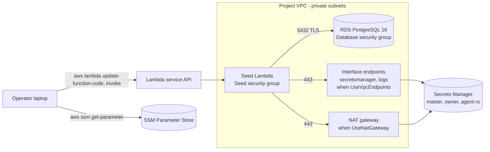
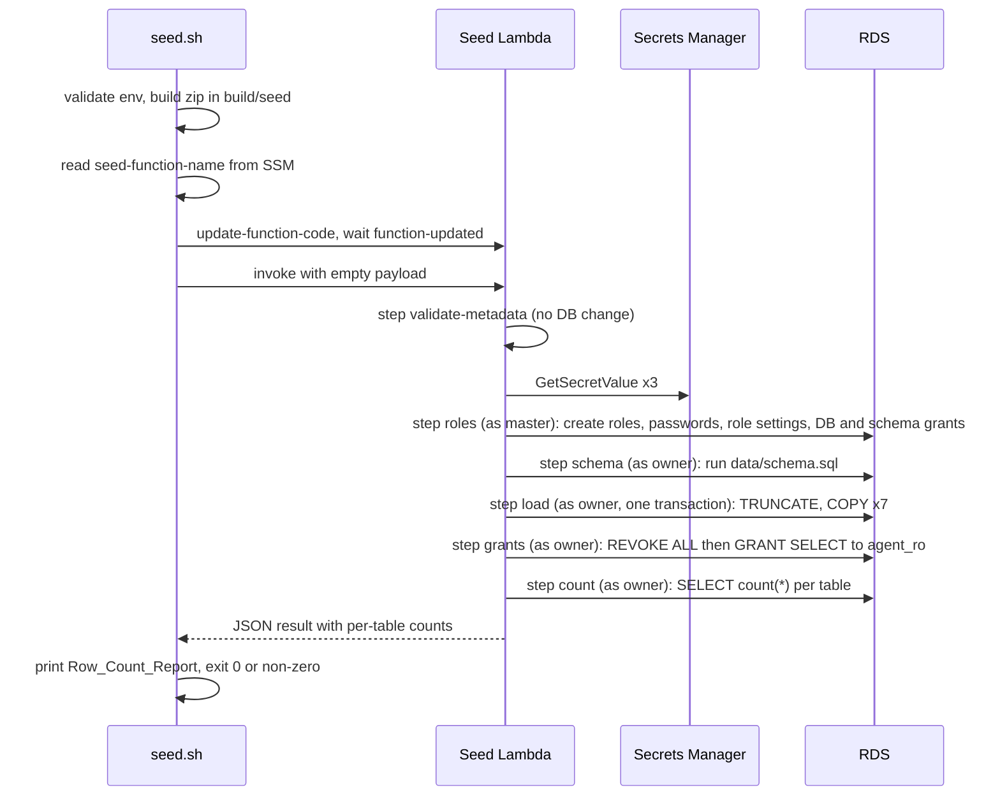

# Design Document

## Overview

This feature adds `infra/database.yaml` (stack `inspection-agent-<env>-database`) and a repeatable, in-VPC seed mechanism. The stack creates a private RDS for PostgreSQL 16 instance, three Secrets Manager credential secrets, a seed AWS Lambda function, and the SSM parameters that later components read. An operator runs `scripts/seed.sh` (or `make seed`). The script packages the schema, the seed CSV files, and the handler, uploads the package to the Lambda function, invokes it, and prints a row count report.

Key design decisions:

| # | Decision | Choice | Reason |
| --- | --- | --- | --- |
| D1 | Lambda source location | `src/inspection_core/seed/handler.py` | The code is database access code. `src/` is the home for application code, and `scripts/` must hold operational scripts only (Req 10.6). No new top-level folder or `src/` package is needed. |
| D2 | Packaging | `scripts/seed.sh` builds a zip in `build/seed/` and calls `aws lambda update-function-code`. The template ships an inline stub. | No artifact bucket, no new stack, and `scripts/deploy.sh` stays unchanged (Req 11.1). |
| D3 | Database driver | `psycopg[binary]` (psycopg 3), installed for `manylinux2014_aarch64` and Python 3.12 | Native `COPY ... FROM STDIN` for CSV, server-side SCRAM verifier helper, and a wheel that needs no compile step. |
| D4 | Schema idempotency | Edit `data/schema.sql` to use `CREATE TABLE IF NOT EXISTS` and `CREATE INDEX IF NOT EXISTS`. The handler runs the file unmodified. | One source of truth. `psql -f` keeps working. Satisfies Req 7.2 and 7.3 per object. |
| D5 | Data idempotency | `TRUNCATE` all seven tables, then `COPY` in FK order, inside one transaction | Gives exact equality with the CSV files on every run (Req 7.5, 7.6) and rolls back as a unit (Req 7.7, 7.8). |
| D6 | Network path to Secrets Manager | Add standalone egress rules on the existing Seed security group, plus an endpoint ingress rule, plus log group access on the Logs endpoint policy | Works with `UseNatGateway`, with `UseVpcEndpoints`, or with both. Existing rules are untouched (Req 4.6). |
| D7 | Cross-stack reads | `{{resolve:ssm:...}}` dynamic references built with `!Sub` from `Env` | `AWS::SSM::Parameter::Value<...>` parameters need a literal default path. `deploy.sh` passes only `Env`, so a typed parameter would read the `demo` network values for any other environment. |
| D8 | Secret host and port | `AWS::SecretsManager::SecretTargetAttachment` for each secret | Adds `host` and `port` after the instance exists. `dbname` is a static key in the secret template. |
| D9 | Password handling in SQL | Compute a SCRAM-SHA-256 verifier on the client and send `ALTER ROLE ... PASSWORD '<verifier>'` | The cleartext password never appears in statement text, so it cannot reach PostgreSQL error logs. |

The "Correctness Properties" section is omitted on purpose. The feature is CloudFormation, a shell script, and a database load with side effects only. No pure function with a universal property exists, and the testing policy forbids test files. See the Testing Strategy.

## Architecture



Deploy and seed order: `network` stack (with the change below), then `database` stack, then `seed.sh`.



### Network change in `infra/network.yaml` (Req 4)

Current state: `SeedSecurityGroup` has only the loopback placeholder egress inline, plus the standalone `SeedToDatabaseEgress` rule. It cannot reach Secrets Manager or CloudWatch Logs.

Changes, all additive:

1. New standalone `SeedToInternetEgress` (`AWS::EC2::SecurityGroupEgress`), `Condition: UseNat`: TCP 443 to `0.0.0.0/0`. This matches the runtime group's NAT rule.
2. New standalone `SeedToEndpointEgress`, `Condition: UseEndpoints`: TCP 443 to `EndpointSecurityGroup`.
3. New standalone `EndpointFromSeedIngress` (`AWS::EC2::SecurityGroupIngress`), `Condition: UseEndpoints`: TCP 443 on `EndpointSecurityGroup` from `SeedSecurityGroup`.
4. `LogsEndpoint` policy: add the resources `arn:${AWS::Partition}:logs:${AWS::Region}:${AWS::AccountId}:log-group:/aws/lambda/inspection-agent-${Env}-seed` and the same ARN with `:*`. Reason: the policy today allows only `/aws/bedrock-agentcore/*`. With private DNS on, a Lambda in endpoints-only mode would have its log writes denied by the endpoint policy.
5. The Secrets Manager endpoint policy already allows `GetSecretValue` on `secret:inspection-agent/${Env}/*`. The three secret names match. No change.

Existing runtime rules, the Database security group, the loopback placeholder, and all SSM parameters stay as they are. The `GroupDescription` of `EndpointSecurityGroup` stays as it is, because changing it forces a security group replacement. Its text says "Ingress only from the runtime group", which becomes inaccurate after item 3. The design accepts that and records it in `docs/database.md`.

## Components and Interfaces

### 1. `infra/database.yaml`

Parameters (each with `Description` and a constraint, Rule 2):

| Parameter | Type | Default | Constraint |
| --- | --- | --- | --- |
| `Env` | String | `demo` | `^[a-z][a-z0-9]{0,9}$` |
| `InstanceClass` | String | `db.t4g.micro` | `^db\.[a-z0-9]+\.[a-z0-9]+$` |
| `MultiAz` | String | `"false"` | `"true"`, `"false"` |
| `DeletionProtection` | String | `"false"` | `"true"`, `"false"` |

The database name `inspection` is a template-level constant exposed through a `DbName` parameter with `AllowedValues: [inspection]`. This keeps the name in one place.

Resources:

| Logical ID | Type | Notes |
| --- | --- | --- |
| `MasterSecret`, `OwnerSecret`, `AgentRoSecret` | `AWS::SecretsManager::Secret` | Names `inspection-agent/${Env}/database/master`, `.../owner`, `.../agent-ro`. `GenerateSecretString` with `SecretStringTemplate` `{"username":"<user>","dbname":"inspection"}`, `GenerateStringKey: password`, `PasswordLength: 32`, `ExcludePunctuation: true`. Users: `dbadmin`, `inspection_owner`, `agent_ro`. No resource policy. Tagged. |
| `MasterSecretAttachment`, `OwnerSecretAttachment`, `AgentRoSecretAttachment` | `AWS::SecretsManager::SecretTargetAttachment` | `TargetType: AWS::RDS::DBInstance`. Adds `host` and `port`. |
| `DbSubnetGroup` | `AWS::RDS::DBSubnetGroup` | `SubnetIds: !Split [",", "{{resolve:ssm:/inspection-agent/${Env}/network/private-subnet-ids}}"]` built with `!Sub`. |
| `DbParameterGroup` | `AWS::RDS::DBParameterGroup` | `Family: postgres16`, `rds.force_ssl: "1"`. |
| `Database` | `AWS::RDS::DBInstance` | See below. |
| `SeedLogGroup` | `AWS::Logs::LogGroup` | `/aws/lambda/inspection-agent-${Env}-seed`, 14 days retention. Created by the stack so that it is deleted with the stack and so the Logs endpoint policy can name it. |
| `SeedRole` | `AWS::IAM::Role` | Trust `lambda.amazonaws.com`. Managed policy `!Sub arn:${AWS::Partition}:iam::aws:policy/service-role/AWSLambdaVPCAccessExecutionRole`. Inline policy: `secretsmanager:GetSecretValue` on the three secret ARNs (`!Ref` of each secret) and nothing else. |
| `SeedFunction` | `AWS::Lambda::Function` | See below. |
| `*Parameter` x7 | `AWS::SSM::Parameter` | Section "Published parameters". |

`Database` properties: `Engine: postgres`, `EngineVersion: "16"`, `DBInstanceClass: !Ref InstanceClass`, `AllocatedStorage: "20"`, `StorageType: gp3`, `StorageEncrypted: true`, `BackupRetentionPeriod: 1`, `PubliclyAccessible: false`, `MultiAZ: !Ref MultiAz`, `DeletionProtection: !Ref DeletionProtection`, `DBName: !Ref DbName`, `Port: "5432"`, `DBSubnetGroupName`, `DBParameterGroupName`, `VPCSecurityGroups` from `{{resolve:ssm:/inspection-agent/${Env}/network/database-security-group-id}}`, `MasterUsername: {{resolve:secretsmanager:<MasterSecret>:SecretString:username}}`, `MasterUserPassword: {{resolve:secretsmanager:<MasterSecret>:SecretString:password}}`, `AutoMinorVersionUpgrade: true`, `CopyTagsToSnapshot: true`. `DeletionPolicy: Delete` and `UpdateReplacePolicy: Delete` are set explicitly. The CloudFormation default for `AWS::RDS::DBInstance` is `Snapshot`, which would leave a retained snapshot and violate Req 11.2.

`SeedFunction` properties: `FunctionName: inspection-agent-${Env}-seed`, `Runtime: python3.12`, `Architectures: [arm64]`, `Handler: index.handler`, `Timeout: 120`, `MemorySize: 256`, `Role`, `VpcConfig` (private subnets from SSM, `SecurityGroupIds` from the `seed-security-group-id` SSM value), `Environment.Variables`: `MASTER_SECRET_ARN`, `OWNER_SECRET_ARN`, `AGENT_RO_SECRET_ARN`, `DB_NAME` (non-secret only, Req 3.5). `LoggingConfig.LogGroup` points to `SeedLogGroup`. No event source, no EventBridge rule (Req 6.8). `Code.ZipFile` holds a stub whose handler returns `{"ok": false, "step": "package", "error": "Seed code not deployed. Run scripts/seed.sh."}`. CloudFormation only re-applies `Code` when the stub text changes, so later `deploy database` runs do not overwrite the uploaded code. If the function is ever replaced, the stub returns its message and the operator re-runs `make seed`.

Dependencies: `SeedFunction` depends on `SeedLogGroup` and `SeedRole`. No dependency on `Database` is needed, because nothing runs at create time.

Published parameters (type `String`, mandatory tags as a map, Rule 10) under `/inspection-agent/${Env}/database/`: `endpoint` (`!GetAtt Database.Endpoint.Address`), `port` (`!GetAtt Database.Endpoint.Port`), `db-name`, `master-secret-arn`, `owner-secret-arn`, `agent-ro-secret-arn`, `seed-function-name`. No password or secret value is published. No `Export` or `Fn::ImportValue`.

Outputs (non-empty descriptions, Rule 3): `DatabaseEndpoint`, `DatabasePort`, `DatabaseName`, `MasterSecretArn`, `OwnerSecretArn`, `AgentRoSecretArn`, `SeedFunctionName`.

No literal account ID, region, or ARN appears. All ARNs use `!Sub` with `AWS::Partition`, `AWS::Region`, `AWS::AccountId`, or `!Ref` of a secret.

### 2. Seed handler: `src/inspection_core/seed/handler.py`

A single Python 3.12 module, standard library plus `psycopg`. It takes no input from the event (Req 6.6). Staged into the zip as `index.py` so that the inline-stub handler name `index.handler` stays valid.

Environment: `MASTER_SECRET_ARN`, `OWNER_SECRET_ARN`, `AGENT_RO_SECRET_ARN`, `DB_NAME`.

Files read from the package, relative to the Lambda task root: `data/schema.sql`, `data/seed/*.csv`, `data/seed/METADATA.json`.

Steps, in order. Each step has a name that appears in errors.

1. `validate-metadata`: read `METADATA.json`. If `synthetic` is missing or not `true`, return an error before any secret read or DB connection (Req 7.10, 7.11).
2. `roles` (connection as master, autocommit, `sslmode=require`):
   - First check that the master owns the database (needed on PG15+ to change grants on schema `public`, which is owned by `pg_database_owner`). Create `inspection_owner` and `agent_ro` with `LOGIN` if absent (lookup in `pg_roles`). Then `ALTER ROLE ... PASSWORD '<SCRAM verifier>'` only. The master is `rds_superuser`, not a superuser, and on PG16 it cannot name `SUPERUSER`, `CREATEDB`, or `CREATEROLE` in `ALTER ROLE` (even `NO...`). New roles default to none of them, and the step verifies in `pg_roles` that neither role has any elevated attribute. The master never touches objects owned by `inspection_owner`, so it needs no membership in that role. The verifier comes from `conn.pgconn.encrypt_password(password, role, "scram-sha-256")` (Req 5.1, 5.2).
   - `ALTER ROLE agent_ro CONNECTION LIMIT 10`, `ALTER ROLE agent_ro SET statement_timeout = '10s'`, `ALTER ROLE agent_ro SET default_transaction_read_only = 'on'` (Req 5.8 to 5.10).
   - `REVOKE ALL ON DATABASE <db> FROM agent_ro`, then `GRANT CONNECT ON DATABASE <db> TO agent_ro`. `GRANT CONNECT ON DATABASE <db> TO inspection_owner`.
   - `REVOKE TEMPORARY ON DATABASE <db> FROM PUBLIC`. `REVOKE CREATE ON SCHEMA public FROM PUBLIC, agent_ro`. `GRANT USAGE ON SCHEMA public TO agent_ro, inspection_owner`. `GRANT CREATE ON SCHEMA public TO inspection_owner` (the owner needs it to create tables) (Req 5.4, 5.5, 5.7).
3. `schema` (connection as owner, autocommit): execute the full text of `data/schema.sql`. With no parameters, psycopg uses the simple query protocol, so the file's own `BEGIN` and `COMMIT` act as they do under `psql`. The schema step is atomic through that transaction.
4. `load` (connection as owner, `with conn.transaction()`): `TRUNCATE lines, parts, characteristics, inspectors, lots, inspection_reports, measurements` as one statement, then for each table in FK order run `COPY <table> (<header columns>) FROM STDIN WITH (FORMAT csv, HEADER true)`, streaming the file. Any exception rolls back the whole block (Req 7.4, 7.7, 7.8).
5. `grants` (owner): for each of the seven tables, `REVOKE ALL ON <t> FROM agent_ro`, then `GRANT SELECT ON <t> TO agent_ro` (Req 5.5, 5.6, 7.9). Table identifiers come from a fixed tuple in the code, never from input. All identifiers use `psycopg.sql.Identifier`.
6. `count` (owner): `SELECT count(*)` per table. File rows are counted with `csv.reader`, minus the header, so quoted multi-line notes count once.

Ownership: tables are created by `inspection_owner`, so it owns them (Req 5.3).

Result shape, returned as the Lambda response:

```json
{"ok": true,
 "tables": [{"table": "lines", "db_rows": 2, "file_rows": 2}]}
```

```json
{"ok": false, "step": "load", "table": "parts", "error": "UniqueViolation SQLSTATE 23505"}
```

The handler catches every exception and returns the second shape. The error text holds the exception class name and SQLSTATE. For the `load` and `schema` steps it also holds `diag.message_primary`, which describes synthetic data only. For the `roles` step and any Secrets Manager call it holds no message text, so a password cannot leak (Req 3.8). The handler never logs secret values, and logs only step names and counts.

Lambda ordering note: Req 7.9 asks for grants after schema and data. The owner role must exist before the schema step, so role creation and database-level grants run first in step 2. Table-level grants for `agent_ro` run last in step 5, after the tables exist. Section "Requirement refinements" lists this.

### 3. `scripts/seed.sh`

Usage: `scripts/seed.sh [--env <env>] [--region <region>]`. Bash 3.2 compatible, same style as `scripts/deploy.sh` (`set -Eeuo pipefail`, `ERR` trap with step context, `die` helper). The `Makefile` target is:

```make
seed:
	scripts/seed.sh --env "$(ENV)" --region "$(REGION)"
```

Add `seed` to `.PHONY` and to the `help` text.

Flow:

1. Parse options. Validate `--env` against `^[a-z][a-z0-9]{0,9}$` before any AWS call (Req 8.2). Check `aws`, `zip`, `python3` exist.
2. Read `/inspection-agent/<env>/database/seed-function-name` from SSM. A missing parameter prints the name and tells the operator to run `make deploy-database` (Req 8.3).
3. Build: create `build/seed/stage` fresh. Copy `src/inspection_core/seed/handler.py` as `index.py`, `data/schema.sql` and `data/seed/` as `data/...`. Install dependencies once into `build/seed/deps` with `python3 -m pip install --platform manylinux2014_aarch64 --implementation cp --python-version 3.12 --only-binary=:all: --target build/seed/deps -r src/inspection_core/seed/requirements-seed.txt`, then copy them into the stage. Zip to `build/seed/seed.zip`. `build/` is already ignored by Git. The package size is far below the 50 MB direct-upload limit.
4. `aws lambda update-function-code --zip-file fileb://build/seed/seed.zip`, then `aws lambda wait function-updated`.
5. `aws lambda invoke --cli-binary-format raw-in-base64-out --cli-read-timeout 150 --payload '{}'` writing to a `mktemp` file. A `FunctionError` header or a non-JSON body counts as failure.
6. Parse the response with `python3 -c` (no `jq` dependency). If `ok` is false, print `step`, `table`, `error` and exit 1 (Req 8.6). Otherwise print one line per table: `<table> db=<n> seed=<m> OK` or `... MISMATCH`. Exit 1 if any line mismatches, else 0 (Req 8.4, 8.5).
7. Remove the temp file on exit (`trap`). The script holds and prints no secret. It uses the caller's AWS credentials only.

Running twice prints the same report because the load replaces all rows (Req 8.9).

`requirements-seed.txt` lists `psycopg[binary]` pinned to the exact version chosen at implementation time. The file name differs from a plain `requirements.txt` so that a later agent or runtime package can own that name.

### 4. `data/schema.sql` change (Req 7.2, 7.3)

Edits: `CREATE TABLE` becomes `CREATE TABLE IF NOT EXISTS` for all seven tables. `CREATE INDEX` becomes `CREATE INDEX IF NOT EXISTS` for all six indexes. `COMMENT ON` is already repeatable. The `BEGIN` and `COMMIT` stay. The header comment changes from "Apply to an empty database" to "Safe to apply repeatedly; existing objects are left unchanged". Constraints are inline in `CREATE TABLE`, so an absent table gets all of them, and a present table is skipped whole. The design does not detect or repair drift in a table that exists with a different definition.

Considered alternatives: (a) have the handler check `to_regclass` and skip the file when tables exist, which fails Req 7.3 for a single missing index; (b) rewrite statements in the handler with regular expressions, which is fragile and splits the schema's truth across two files.

### 5. Documentation and small edits

- `docs/database.md` (new): architecture, parameters, three users, secret names, SSM parameters, the seed command, teardown and `DeletionProtection`, the network dependency and order, and the manual verification record (Req 11.3, 11.6, 12). No password or token in the file.
- `data/README.md`: replace "A loading script is not part of this folder." with a pointer to `scripts/seed.sh` and `make seed`.
- `scripts/README.md`: add a line saying `seed.sh` is the seed script. If `docs/README.md` indexes documents, add `database.md`.
- `Makefile`: `seed` target, `.PHONY`, help text.
- `infra/network.yaml`: changes listed above.
- `scripts/deploy.sh` and `scripts/teardown.sh`: no change required by the requirements. See open item O2.

## Data Models

Credential secret JSON (all three secrets share the shape; passwords are generated):

```json
{"username": "inspection_owner", "password": "<generated>", "dbname": "inspection", "host": "<added by attachment>", "port": 5432, "engine": "postgres", "dbInstanceIdentifier": "<added by attachment>"}
```

Database roles and privileges after a run:

| Role | Privileges | Settings |
| --- | --- | --- |
| `dbadmin` (master) | RDS master. Used only in step `roles`. | none |
| `inspection_owner` | `LOGIN`, `CONNECT` on the database, `USAGE` and `CREATE` on `public`, owner of the seven tables | none |
| `agent_ro` | `LOGIN`, `CONNECT`, `USAGE` on `public`, `SELECT` on the seven tables. Nothing else. | `CONNECTION LIMIT 10`, `statement_timeout = 10s`, `default_transaction_read_only = on` |

`PUBLIC` loses `TEMPORARY` on the database and `CREATE` on `public`. `default_transaction_read_only` is a second layer. The first layer is the missing privileges, because a session can switch itself to read-write but cannot grant itself `INSERT`.

Application tables, load order, and seed file row counts (data rows excluding the header) in the committed seed: `lines` 2, `parts` 6, `characteristics` 18, `inspectors` 6, `lots` 14, `inspection_reports` 50, `measurements` 150. The report compares live values and does not hard-code these.

Lambda response: see the handler section.

## Error Handling

| Failure | Detected by | Result |
| --- | --- | --- |
| `METADATA.json` missing, unreadable, or `synthetic` not `true` | handler step 1 | `ok:false`, step `validate-metadata`. No secret read, no DB change. |
| Required SSM parameter absent at stack create (subnets, security group) | CloudFormation dynamic reference resolution | Stack create fails and the message names the SSM parameter (Req 1.10). Verified by hand. |
| Secret unreadable (no network path, no permission) | handler | `ok:false`, step `roles`, class name only. The hint in `docs/database.md` points to the network change in D6. |
| Database unreachable or TLS failure | handler connect | `ok:false` with step and class name. Connection timeout is 10 s so the Lambda does not hang. |
| Role or grant statement fails | handler step 2 or 5 | `ok:false`, no message text. |
| `schema.sql` fails | handler step 3 | The file's own transaction rolls back. `ok:false`, step `schema`. |
| Any COPY or TRUNCATE fails | handler step 4 | The transaction rolls back and tables keep their previous content. `ok:false`, step `load`, with the table name that was being loaded. |
| Lambda timeout, out of memory | Lambda runtime | `FunctionError` in the invoke result. `seed.sh` reports it and exits 1. The open transaction is aborted by the closed connection. |
| Package stub still in place | stub handler | `ok:false`, step `package`. |
| Row count mismatch | `seed.sh` | Line marked `MISMATCH`, exit 1. |
| `--env` invalid, tools missing, SSM parameter missing | `seed.sh` | Message and exit before changing anything. |

Stack-level behavior: `DeletionProtection=true` makes stack deletion fail until the operator turns it off. With `false`, `DeletionPolicy: Delete` removes the instance with no final snapshot (Req 11.2).

## Testing Strategy

The testing policy forbids test files, suites, fixtures, and verification scripts. Property-based testing does not apply: the feature is infrastructure as code, a shell script, and a side-effecting database load. Each acceptance criterion is checked by hand and recorded in the task notes.

Static checks (the only automated tooling allowed):

- `cfn-lint infra/database.yaml infra/network.yaml` reports zero errors and zero warnings (Req 10.1, 10.3).
- `ruff check .` reports no violation in `src/inspection_core/seed/` (Req 10.7).
- Read `infra/database.yaml` against the 10 rules in `docs/cloudformation-conventions.md` (Req 10.2). Search the repository for passwords, keys, account IDs, and region literals in the new files (Req 10.4, 10.5).

Manual verification, in order:

1. Deploy `network` with `UseNatGateway=true`, then `make deploy-database`. Confirm the stack reaches `CREATE_COMPLETE`, the seven SSM parameters exist, no `Export` exists, and the instance is not publicly accessible, is encrypted, and has `rds.force_ssl=1` (Req 1, 2, 9).
2. Run `make seed`. Confirm seven report lines with matching counts and exit 0. Run it again and compare the output (Req 8, 7.6).
3. Make the load fail on purpose: unzip `build/seed/seed.zip`, break one foreign key in a copy of `data/seed/measurements.csv`, re-zip, and upload with `aws lambda update-function-code`. Invoke the function. Confirm the error names the step and table and the counts are unchanged (Req 7.8). Run `make seed` afterward to restore the real package. The repository files are not edited.
4. Edit a copy of `METADATA.json` in the staged zip to `synthetic: false` and invoke. Confirm the error and no DB change (Req 7.11).
5. Drop one index by hand as the owner, run `make seed`, and confirm the index returns (Req 7.3).
6. Repeat steps 1 and 2 with `UseNatGateway=false` and `UseVpcEndpoints=true` on a separate `Env`. Confirm the Lambda can read secrets and write logs (Req 4.2, 4.3).
7. Read the Lambda log group and the invoke response. Confirm neither holds a password (Req 3.8). Read the stack, the SSM parameters, and the Lambda configuration. Confirm no secret value (Req 3.5, 9.3).
8. Run the read-only checks from `docs/database.md` from a CloudShell VPC environment (Req 12): counts on each table, rejected `INSERT`, `UPDATE`, `DELETE`, `TRUNCATE`, `CREATE TABLE`, and `CREATE TEMPORARY TABLE`, and a failed connection from the laptop. Record the date and the observed result of each step. The document holds no password.
9. Run `scripts/teardown.sh` with `DeletionProtection=false`. Confirm the database stack deletes and leaves no snapshot (Req 11.2). Run a second `make deploy-database` (see O2).

## Requirement refinements

1. Req 7.9 says roles and grants apply after schema and data. The owner role must exist to run the schema, so role creation and database-level grants run first, and table-level grants run last. The `agent_ro` table grants satisfy the intent.
2. Req 4 covers the Secrets Manager path but not CloudWatch Logs. Add an acceptance criterion: the Logs endpoint policy allows the seed log group, and the Seed group can reach CloudWatch Logs under both network modes.
3. Req 6.5 limits master use to creating or updating roles. Step 2 also runs database-level grants and revokes as master, because only the database owner can revoke `TEMPORARY` on the database. Treat these as role configuration.
4. PG16 on RDS (found in task 8.2): the master cannot use `NOSUPERUSER NOCREATEDB NOCREATEROLE` in `ALTER ROLE`. The roles step now sets only the password and verifies attributes. Failures in this step return a fixed `substep=<label>` plus the exception class and SQLSTATE, never the database message.

## Steering and convention findings

Conflicts are marked C, items that need a decision are marked O.

- C1 (convention gap): `docs/cloudformation-conventions.md` Rule 2 and Rule 10 show consumers reading SSM through `AWS::SSM::Parameter::Value<...>` parameters with a `demo` default path. `scripts/deploy.sh` passes only `Env`. With any `Env` other than `demo`, that pattern silently reads the demo stack's values. This design uses dynamic references built from `Env` (D7), which Rule 10 permits because it only requires SSM and forbids Export. Later components (runtime, memory, mcp) will hit the same problem. Consider adding a note to the conventions document.
- C2 (structure): `structure.md` describes `src/inspection_core/` as "database access, authorization, and tool functions". The seed handler fits the first phrase. It is placed in a `seed/` subpackage so the agent package does not import it. The zip contains only the handler, so `inspection_core` needs no `__init__.py` for this feature.
- C3 (structure): the steering list has a separate `package` Operational_Script. `seed.sh` contains its own small build step, because the seed package differs from the runtime package. This is not a conflict as long as `package` stays reserved for the runtime artifact.
- C4 (testing policy): the workflow's Testing Strategy section and the requirements' acceptance checks are met by manual steps only. No test, fixture, or verification script is added. The documented hand checks in Req 12 replace the script that a test would otherwise provide.
- C5 (`.gitignore`): `lib/`, `var/`, `env/`, `target/`, and `downloads/` are ignored. No new folder uses those names. `build/` is ignored, which suits the zip and downloaded wheels.
- O1 (needs confirmation): `data/schema.sql` is edited (D4). It is a data-folder file the generator does not write, but its header says "apply to an empty database". Confirm that changing it is in scope.
- O2 (needs confirmation, to verify on first deploy): when CloudFormation deletes an `AWS::SecretsManager::Secret`, Secrets Manager normally keeps the name reserved during a recovery window. A teardown followed by a redeploy with the same `Env` could fail at secret creation. If that occurs, add a post-step to `scripts/teardown.sh` that runs `aws secretsmanager delete-secret --force-delete-without-recovery` for the three names after the database stack is gone. The requirements do not cover this change, so it is not in the base design.
- O3 (verify on first deploy): (a) `EngineVersion: "16"` as a major-only value, (b) `Fn::Split` on a `{{resolve:ssm:...}}` string for `SubnetIds`, (c) two or three `SecretTargetAttachment` resources on one instance. Fallbacks: (a) pin a minor version, (b) read the subnet IDs in `seed.sh` and pass them as a parameter, (c) let the handler read host and port from SSM parameters instead of the secret, which would need a small change to Req 3.5.
- O4 (operational note): deleting a Lambda function in a VPC leaves its network interfaces for a while. Teardown of the `network` stack right after the `database` stack can fail on the security group or subnets. Retrying `make delete-network` after a few minutes resolves it. Record this in `docs/database.md`.
- O5 (security trade-off): the handler connects with `sslmode=require`, which encrypts but does not verify the server certificate. Verifying it needs the RDS CA bundle in the zip. `rds.force_ssl=1` already rejects unencrypted clients, and the path stays inside the VPC. Upgrade to `verify-full` if the demo moves beyond a private, single-account setup.
