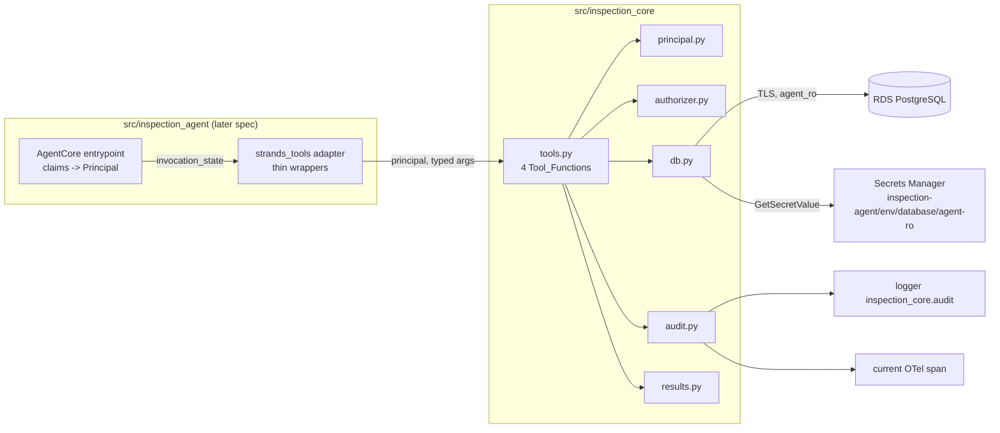
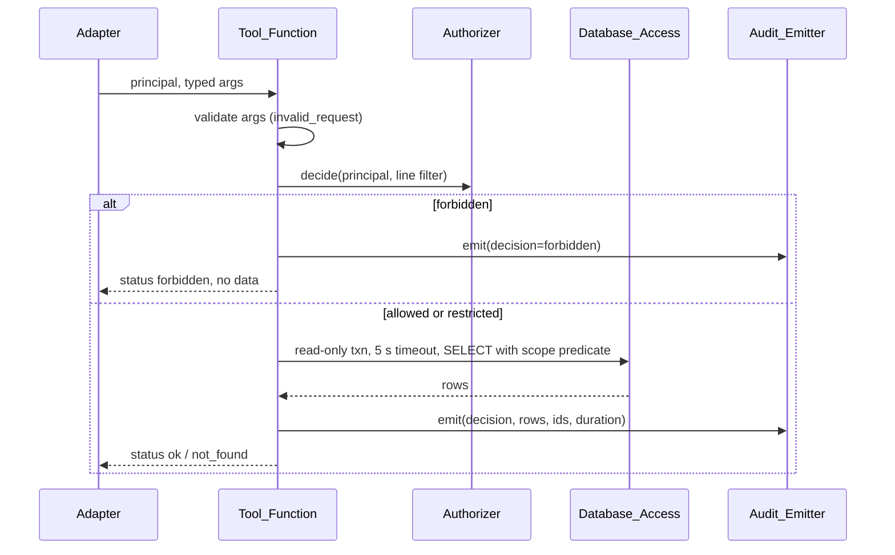

# Design Document

## Overview

This design adds four read-only inspection tools to `src/inspection_core/`: `list_reports`, `get_report`, `get_lot`, and `characteristic_trend`. Each tool takes a `Principal` built from validated JWT claims, derives the allowed inspection lines from the Cognito groups, enforces the result in code, queries RDS for PostgreSQL as the `agent_ro` role, and emits one audit event.

Key decisions:

| Decision | Choice | Reason |
|---|---|---|
| Core independence | `inspection_core` imports no `strands` and no model package. A thin adapter in `src/inspection_agent/` wraps the functions. | The later MCP server reuses the same functions (R1). |
| Identity | `Principal` is the first positional parameter of every tool function. The adapter hides it from the model schema and fills it from the verified request context. | The model never supplies identity (R2.5). |
| Authorization | Python check first, then the same line set as a bound `= ANY(%s)` predicate in every SQL statement. | Two layers (R8.6). |
| ID lookups on a denied line | `forbidden`, not `not_found`. | Trade-off in "Forbidden versus not_found" below. |
| Result shape | One envelope `{status, reason?, meta, ...payload}`, `dict` only, built from JSON-native types. | Agent and MCP share one schema (R12). |
| Driver | `psycopg` 3 (already used by the seed Lambda), one short-lived connection per call, `sslmode=require`. | Matches `docs/database.md` section 8. Demo scale needs no pool. |
| Trend math | Per-lot aggregates in SQL, Trend_Indicator in Python. | Counting and direction are deterministic, never left to the model (R7.6). |

Research notes that shaped the design:

- `agent_ro` already has `default_transaction_read_only=on`, `statement_timeout=10s`, connection limit 10, and `SELECT` only on the seven tables (`docs/database.md` section 3). The tools add a 5 s timeout and an explicit read-only transaction on top.
- The Cognito `cognito:groups` claim is the only authorization input, and a missing claim means no access (`docs/auth.md` sections 1, 2, 6). The runtime has already validated the token, so the core reads claims only.
- The runtime forwards the `Authorization` header to agent code only when it is in the request header allowlist (`docs/auth.md` section 10). That is a runtime-spec concern. This design assumes the entrypoint decodes claims from the already validated token and puts the `Principal` in the Strands invocation state.
- The Strands `@tool(context=True)` decorator passes a `ToolContext` that is not part of the model-visible schema, and `ToolContext.invocation_state` carries caller-supplied values. The adapter task confirms this against the installed Strands version before relying on it.

Out of scope: agent prompt, runtime, UI, MCP server, infrastructure templates.

## Architecture



Call flow of one tool call:



Every public function runs through one private runner `_run(tool, principal, params, handler)`. The runner starts the timer, calls the handler, converts any unexpected exception to an `error` result, and emits the audit event in a `finally` block. That structure guarantees exactly one event per call (R11.1, R11.10).

## Components and Interfaces

### Module layout

| File | Responsibility |
|---|---|
| `src/inspection_core/__init__.py` | Re-exports the four tool functions, `Principal`, `principal_from_claims`. |
| `src/inspection_core/principal.py` | `Principal` (frozen dataclass), `principal_from_claims`, `MissingClaimError`. |
| `src/inspection_core/authorizer.py` | `allowed_lines`, `decide`, `Decision`. Pure functions, no I/O. |
| `src/inspection_core/db.py` | Secret loading, connection, read-only transaction context manager. |
| `src/inspection_core/queries.py` | The SQL text constants (static `SELECT` statements only). |
| `src/inspection_core/trend.py` | `trend_indicator(means)`. Pure. |
| `src/inspection_core/results.py` | Envelope builders, schema version, fixed reason strings, serialization helpers. |
| `src/inspection_core/audit.py` | `AuditEvent`, `emit`, parameter sanitizing. |
| `src/inspection_core/tools.py` | The four Tool_Functions and the `_run` runner. |
| `src/inspection_core/requirements.txt` | Pinned `psycopg[binary]`, `typing-extensions`, `boto3`, `opentelemetry-api`. |
| `src/inspection_agent/strands_tools.py` | Adapter: four `@tool(context=True)` wrappers (R1.3, R1.4). |
| `docs/inspection-tools.md` | Tool, schema, authorization, and audit reference (R12.7). |

The existing `src/inspection_core/seed/` package is untouched. `inspection_core` stays free of `strands` and model imports (R1.2). `ruff` with the root `ruff.toml` is the only quality check (R1.5).

### Principal and factory (`principal.py`)

```python
@dataclass(frozen=True)
class Principal:
    user_id: str            # Cognito "sub"
    username: str           # "username" claim, "" if absent
    groups: tuple[str, ...] # immutable copy of "cognito:groups"

def principal_from_claims(claims: Mapping[str, Any]) -> Principal: ...
```

Rules (R2):

- `sub` must be a non-empty string, otherwise raise `MissingClaimError("sub")`. The message names the claim and nothing else.
- `cognito:groups` is accepted only if it is a list whose items are all strings. Anything else (absent, `None`, empty, a string, a mixed list) gives `groups=()`.
- `username` is read from `username`. A missing or non-string value gives `""`.
- No other claim is read.

### Authorizer (`authorizer.py`)

```python
ALL_LINES = frozenset({"A", "B"})
GROUP_LINES = {"line-a": {"A"}, "line-b": {"B"}, "supervisors": {"A", "B"}}

def allowed_lines(principal: Principal) -> frozenset[str]: ...   # union, exact-case match

@dataclass(frozen=True)
class Authorization:
    decision: Literal["allowed", "restricted", "forbidden"]
    scope: tuple[str, ...]     # sorted effective lines, () when forbidden

def decide(principal: Principal, line: str | None) -> Authorization: ...
```

Decision rule, one function for all tools:

| Allowed_Lines | `line` filter | Decision | Effective_Scope |
|---|---|---|---|
| empty | any | `forbidden` | `[]` |
| any | line not in Allowed_Lines | `forbidden` | `[]` |
| any | line in Allowed_Lines | `allowed` | `[line]` |
| equals all lines | none | `allowed` | all lines |
| strict subset | none | `restricted` | Allowed_Lines |

ID lookups (`get_report`, `get_lot`) take no `line` parameter, so they use the "none" rows. They then compare the record's line with the Allowed_Lines and turn the decision into `forbidden` if the line is outside it (see lookup flow below). No text from any parameter or database field enters `decide` (R8.8).

### Decision and status semantics

`status` describes the outcome. `decision` describes the authorization verdict. They are related as follows. This table is the confirmed semantics (R8, R11).

| Result_Status | Decision | When | Data returned |
|---|---|---|---|
| `ok` | `allowed` or `restricted` | Authorization passed and the query ran. | Yes, within Effective_Scope. |
| `not_found` | `allowed` or `restricted` (same rule as `ok`) | Authorization passed for the allowed scope, but the ID, part, or characteristic does not exist (or, for a lookup, the user has any line at all). | No. |
| `forbidden` | `forbidden` | The Allowed_Lines are empty, a line filter is outside them, or the ID lookup hit a record on a line outside them. | No. |
| `invalid_request` | `null` | Argument validation failed before authorization ran. | No. |
| `error` | The decision if it was already computed, otherwise `null` | Timeout, unreachable database, secret failure, or unexpected exception. | No. |

Order of checks inside a tool: validate arguments, then authorize, then query. A request that is both invalid and unauthorized returns `invalid_request`, which reveals nothing about data. `forbidden` is the only status paired with decision `forbidden`, and the reverse also holds. The audit `decision` field is the string above, or JSON `null`.

### Database access (`db.py`)

```python
def connect() -> psycopg.Connection: ...

@contextmanager
def read_only_session() -> Iterator[psycopg.Cursor]: ...   # row_factory=dict_row
```

- Secret id: `inspection-agent/<env>/database/agent-ro`, where `<env>` comes from the environment variable `INSPECTION_ENV` (default `demo`, validated against `^[a-z][a-z0-9]{0,9}$`). The region comes from `AWS_REGION` (default `us-west-2`). The code never reads the owner or master secrets (R10.1). The IAM permission for this secret is granted by the runtime spec.
- The secret JSON holds `username`, `password`, `dbname`, `host`, `port` (`docs/database.md` section 4). It is cached in process memory for 5 minutes and never logged.
- Connection: `sslmode=require`, `connect_timeout=5`, `application_name=inspection-core` (R10.6). `rds.force_ssl=1` already rejects plaintext clients.
- `read_only_session` sets `conn.read_only = True` (psycopg then opens `BEGIN READ ONLY`) and runs `SET LOCAL statement_timeout = '5s'` as its first statement (R10.4, R10.5). It always rolls back and closes the connection on exit. All statements of one tool call run in this one transaction, so the header lookup and the data query see one snapshot.
- Every statement is a module-level string constant in `queries.py` with named placeholders (`%(name)s`). Optional filters use the static pattern `(%(part)s::text IS NULL OR r.part_number = %(part)s)`, so the SQL text never changes with caller input (R10.2, R10.7). Matching is exact equality. No `LIKE` is used, so `%` and `_` in a value are plain characters (R10.14).
- Allowed lines bind as one array parameter: `r.line_id = ANY(%(lines)s::text[])`.

### Tool functions (`tools.py`)

All parameters after `principal` are keyword-only and typed. Dates are accepted as `str` in `YYYY-MM-DD` form and parsed with `date.fromisoformat`. A bad date string gives `invalid_request`.

```python
def list_reports(principal, *, line=None, part_number=None, lot_id=None,
                 date_from=None, date_to=None, status=None, limit=None) -> dict
def get_report(principal, *, report_id: str) -> dict
def get_lot(principal, *, lot_id: str) -> dict
def characteristic_trend(principal, *, part_number: str, characteristic: str,
                         line=None, date_from=None, date_to=None) -> dict
```

Shared validation: string parameters must be `str` of 1 to 100 characters (empty string and non-`str` give `invalid_request`); `limit` must be an `int` that is not a `bool`.

Constants: `ROW_CAP = 50`, `DEFAULT_LIMIT = 50`, `STATEMENT_TIMEOUT = "5s"`, `SCHEMA_VERSION = "1.0"`.

#### `list_reports`

Validation order: `line` in `{A, B}`, `status` in `{draft, submitted, closed}`, dates parse, `date_from <= date_to`, `limit >= 1`. Each failure names the offending parameters, lists allowed values where there is a fixed set (R4.6 to R4.8, R10.10).

Limit resolution: absent gives 50 (R10.9). A value from 1 to 50 is applied as given (R10a). A value above 50 is clamped to 50 (R10.8). A value below 1 gives `invalid_request` (R10.10). `meta.limit_applied` always reports the applied value. Clamping alone never sets `truncated`; only `total_matches > limit_applied` does (R10.8, R10.11, R10.12).

Query (one statement, one pass):

```sql
SELECT r.report_id, r.report_date, r.line_id AS line, r.part_number, r.lot_id,
       r.status, r.disposition,
       CASE WHEN EXISTS (SELECT 1 FROM measurements m
                         WHERE m.report_id = r.report_id AND m.result = 'fail') THEN 'fail'
            WHEN EXISTS (SELECT 1 FROM measurements m
                         WHERE m.report_id = r.report_id) THEN 'pass'
            ELSE 'none' END AS overall_result,
       count(*) OVER () AS total_matches
FROM inspection_reports r
WHERE r.line_id = ANY(%(lines)s::text[])
  AND (%(part)s::text IS NULL OR r.part_number = %(part)s)
  AND (%(lot)s::text IS NULL OR r.lot_id = %(lot)s)
  AND (%(date_from)s::date IS NULL OR r.report_date >= %(date_from)s)
  AND (%(date_to)s::date IS NULL OR r.report_date <= %(date_to)s)
  AND (%(status)s::text IS NULL OR r.status = %(status)s)
ORDER BY r.report_date DESC, r.report_id ASC
LIMIT %(limit)s
```

`notes` is not selected (R4.4). `truncated` is true only when `total_matches > limit_applied`, and false otherwise, including when the limit was clamped (R10.11, R10.12). If no row returns, `total_matches` is 0 and the result is `ok` with an empty list.

#### Lookup flow for `get_report` and `get_lot`

1. Authorize with no line filter. Empty Allowed_Lines returns `forbidden` immediately, with the same uniform reason as a denied record. A user with no lines can therefore not tell real IDs from unknown ones.
2. Header lookup, unscoped, selecting only the line: `SELECT line_id FROM inspection_reports WHERE report_id = %(id)s` (or `FROM lots WHERE lot_id = ...`).
3. No row: `not_found`.
4. Row on a line outside the Allowed_Lines: `forbidden`, decision `forbidden`, nothing else read.
5. Otherwise run the data queries with the scope predicate (`line_id = ANY(...)`) in the same transaction. If the data query returns no row (race with a concurrent reload, or a mismatch), return `not_found`.

The header lookup selects no data column except `line_id`, so nothing from the denied record can leave `db.py`.

`get_report` data query joins `inspection_reports` to `measurements` and `characteristics`, ordered by `characteristic_id`. Measurement fields: `characteristic_id`, `characteristic_name`, `unit`, `measured_value`, `lower_limit`, `upper_limit`, `result` (R5.2). The notes text is returned unchanged as a data field (R5.5).

`get_lot` reads the lot row, then the first 50 reports `ORDER BY report_date ASC, report_id ASC` with `count(*) OVER ()` for `total_reports`, then the measurements of those reports in one statement (`report_id = ANY(%(ids)s::text[])`). When `total_reports > 50`, `meta.truncated=true` and `meta.total_reports` carries the full count (R6.4).

#### `characteristic_trend`

1. Validate dates (`date_from <= date_to`) and `line`.
2. Authorize with the `line` filter.
3. Existence check, unscoped, on catalog tables only: the part in `parts`, then `characteristics` by `(part_number, name)` (case-sensitive equality). A missing part gives `not_found` with reason `Unknown part_number.`. A missing characteristic gives `not_found` with reason `Unknown characteristic for this part.` (R7.9). The part and characteristic catalog is not line-restricted data. R14.4 requires an `ok` empty answer for the Line A inspector on the line B part, which exposes the same fact.
4. Aggregate query, scoped:

```sql
SELECT l.lot_id, l.produced_on,
       count(*)                       AS count,
       avg(m.measured_value)          AS mean,
       min(m.measured_value)          AS min,
       max(m.measured_value)          AS max,
       count(*) FILTER (WHERE m.measured_value < c.lower_limit
                           OR m.measured_value > c.upper_limit) AS out_of_tolerance_count,
       count(*) OVER ()               AS total_lots   -- window over grouped rows
FROM measurements m
JOIN inspection_reports r ON r.report_id = m.report_id
JOIN lots l              ON l.lot_id = r.lot_id
JOIN characteristics c   ON c.characteristic_id = m.characteristic_id
WHERE c.characteristic_id = %(char_id)s
  AND l.line_id = ANY(%(lines)s::text[])
  AND (%(date_from)s::date IS NULL OR l.produced_on >= %(date_from)s)
  AND (%(date_to)s::date IS NULL OR l.produced_on <= %(date_to)s)
GROUP BY l.lot_id, l.produced_on
ORDER BY l.produced_on DESC, l.lot_id DESC
LIMIT 50
```

   The code reverses the rows to ascending order (`produced_on`, then `lot_id`), so the result holds the most recent 50 lots in ascending order (R7.3, R7.11). The date filters apply to the lot `produced_on` date, the same date the entries are ordered by. All report statuses count, including `draft`. `mean` is rounded to 4 decimals in Python (`Decimal.quantize`, `ROUND_HALF_UP`) and the Trend_Indicator is computed from the rounded means, so the displayed means and the direction always agree.
5. Out of tolerance is computed from the characteristic limits, not from the stored `result`, so it matches R7.4 even if the two ever differ.

`trend_indicator(means)` (pure, in `trend.py`):

```text
if len(means) < 2 or means[-1] == means[-2]: direction = "flat", n = 0
direction = "rising" if means[-1] > means[-2] else "falling"
n = number of consecutive adjacent pairs, counted backward from the last,
    whose change has the same sign as `direction`
```

`consecutive_lots_toward_limit` follows R7.8 exactly: it counts consecutive same-direction mean changes. It does not test proximity to a limit despite the name. The documentation page states this.

With no rows in the scope, the result is `ok`, `lots=[]`, `trend={"direction": "flat", "consecutive_lots_toward_limit": 0}` (R7.12).

### Audit emitter (`audit.py`)

```python
AuditEvent = {
  "tool": str, "parameters": dict, "user_id": str, "groups": list[str],
  "decision": "allowed" | "restricted" | "forbidden" | None,
  "effective_lines": list[str], "row_count": int, "report_ids": list[str],
  "duration_ms": int, "status": str,
}
```

- The runner builds a mutable `CallState` (decision, scope, row_count, report_ids, status). Handlers fill it. The runner reads it in `finally`.
- `duration_ms` is measured with `time.perf_counter()` from the first line of the runner to just before `emit` (R11.6).
- `parameters` holds the caller-supplied arguments as given, with each string cut to 200 characters (R11.3, R11.11). No tool takes a notes argument, and result data is never copied into the event, so notes text cannot reach it.
- `report_ids` holds at most 20 IDs of returned reports (`list_reports` rows, the single `get_report` ID, the reports of `get_lot`). It is empty for `characteristic_trend`.
- `row_count` is the number of rows or entries returned (trend: lots, `get_report`: 1, `get_lot`: reports returned).
- Log line: `logging.getLogger("inspection_core.audit").info(json.dumps(event, sort_keys=True, separators=(",", ":"), default=str))`. One line. `INFO` level. If neither this logger nor the root logger has a handler, the module attaches one `StreamHandler(sys.stdout)` with the format `%(message)s`, so the line is visible in AgentCore logs. Otherwise it leaves logging configuration to the entrypoint.
- Span attributes: `span = opentelemetry.trace.get_current_span()`; if `span.is_recording()`, set `inspection.<field>` for each field. Lists become lists of strings, `parameters` becomes a JSON string, `decision` `None` becomes the string `none`. The OpenTelemetry import is guarded, and the whole span block sits in its own `try/except Exception` so a failure never blocks the log line or the result (R11.9). The log line is written first.
- Emission itself is wrapped so an audit failure cannot change the Tool_Result.

### Strands adapter (`src/inspection_agent/strands_tools.py`)

Each wrapper is a `@tool(context=True)` function. Its signature has the typed model-facing arguments plus `tool_context: ToolContext`. The context parameter is not in the schema the model sees. The body is three lines: read `tool_context.invocation_state["principal"]`, call the core function with keyword arguments, return the dict. A missing principal returns the standard `forbidden` envelope built by `inspection_core.results`, and no query runs. The adapter has no authorization, SQL, or formatting logic (R1.3, R1.4). Docstrings give the model the tool descriptions. The adapter is a separate task from the core so the core can be checked alone.

## Data Models

### Result envelope (schema version `1.0`)

Applies to every tool (R12).

```text
status   : "ok" | "forbidden" | "not_found" | "invalid_request" | "error"
reason   : string        present only when status != "ok"
meta     : object        always present
  tool            : string
  schema_version  : "1.0"
  # only when status == "ok":
  scope           : ["A"] | ["B"] | ["A","B"]   effective lines, sorted
  truncated       : bool   (list_reports: total_matches > limit_applied; never set by clamping alone)
  row_count       : int
  total_matches   : int   (list_reports, characteristic_trend)
  total_reports   : int   (get_lot)
  limit_applied   : int   (list_reports)
<payload>        tool specific, present only when status == "ok"
```

Conventions (R12.2, R12.6):

- Dates are `YYYY-MM-DD` strings. `NUMERIC` values become JSON numbers (`float`). `row_count` and counts are `int`.
- A whole field that does not apply to a result is omitted. Nullable database columns inside a record (`disposition`, `notes`) are always present and `null` when empty.
- `forbidden`, `not_found`, `invalid_request`, and `error` carry no payload and no `scope` or counts.

### Fixed reason strings

| Status | Reason |
|---|---|
| `forbidden`, line filter | `Access to line <X> is not permitted for this user.` (`<X>` is the requested line, which was validated as `A` or `B`) |
| `forbidden`, no lines | `This user has no access to any inspection line.` |
| `forbidden`, ID lookup (every denied record, and every call by a user with no lines) | `Access to this record is not permitted for this user.` |
| `not_found` | `No report with this report_id.` / `No lot with this lot_id.` / `Unknown part_number.` / `Unknown characteristic for this part.` |
| `invalid_request` | Names the parameters and lists allowed values, for example `status must be one of: draft, submitted, closed.` and `date_from must not be later than date_to.` |
| `error` | `The request could not be completed. Try again later.` |

Reasons contain no ID, count, or value from any record, only constants and the already validated request values (R8.7, R9.4, R10.13). Driver messages, host names, SQL, and secret values never enter a result. The exception class name and SQLSTATE (no message) go to the logger `inspection_core.errors` for operators.

### Payloads and examples

**`list_reports`**: `reports: [{report_id, report_date, line, part_number, lot_id, status, disposition, overall_result}]`

```json
{"status":"ok",
 "meta":{"tool":"list_reports","schema_version":"1.0","scope":["B"],"truncated":false,
         "row_count":1,"total_matches":1,"limit_applied":50},
 "reports":[{"report_id":"IR-2025-0024","report_date":"2025-05-30","line":"B",
   "part_number":"DEMO-BRACKET-4001","lot_id":"LOT-20250528-01","status":"submitted",
   "disposition":null,"overall_result":"pass"}]}
```

(The `overall_result` value in this example is illustrative. The real value comes from the seeded measurements.)

**`get_report`**: `report: {report_id, report_date, line, part_number, lot_id, inspector_id, status, disposition, notes, overall_result, measurements: [{characteristic_id, characteristic_name, unit, measured_value, lower_limit, upper_limit, result}]}`

```json
{"status":"ok",
 "meta":{"tool":"get_report","schema_version":"1.0","scope":["A"],"truncated":false,"row_count":1},
 "report":{"report_id":"IR-2025-0031","report_date":"2025-06-06","line":"A",
   "part_number":"DEMO-SHAFT-3001","lot_id":"LOT-20250604-01","inspector_id":"insp-a-02",
   "status":"closed","disposition":"scrap","notes":"Journal oversize, lot segregated, scrap per MRB.",
   "overall_result":"fail",
   "measurements":[{"characteristic_id":"CHR-3001-01","characteristic_name":"journal_diameter",
     "unit":"mm","measured_value":20.014,"lower_limit":19.99,"upper_limit":20.01,"result":"fail"}]}}
```

**`get_lot`**: `lot: {lot_id, part_number, line, produced_on, quantity, reports: [<report object as in get_report>]}`. `meta` adds `total_reports`. `row_count` is the number of reports returned.

**`characteristic_trend`**: `characteristic: {characteristic_id, name, unit, nominal, lower_limit, upper_limit}`, `lots: [{lot_id, produced_on, count, mean, min, max, out_of_tolerance_count}]`, `trend: {direction, consecutive_lots_toward_limit}`. `meta.row_count` is the number of lots.

```json
{"status":"ok",
 "meta":{"tool":"characteristic_trend","schema_version":"1.0","scope":["B"],"truncated":false,
         "row_count":5,"total_matches":5},
 "characteristic":{"characteristic_id":"CHR-2001-01","name":"bore_diameter","unit":"mm",
                   "nominal":25.0,"lower_limit":24.98,"upper_limit":25.02},
 "lots":[{"lot_id":"LOT-20250512-01","produced_on":"2025-05-12","count":3,"mean":25.001,
          "min":24.998,"max":25.004,"out_of_tolerance_count":0}],
 "trend":{"direction":"rising","consecutive_lots_toward_limit":4}}
```

(Only the first lot is shown. Min and max in the example are illustrative.)

**Forbidden and not found:**

```json
{"status":"forbidden","reason":"Access to this record is not permitted for this user.",
 "meta":{"tool":"get_lot","schema_version":"1.0"}}
```

```json
{"status":"not_found","reason":"No lot with this lot_id.",
 "meta":{"tool":"get_lot","schema_version":"1.0"}}
```

### Forbidden versus not_found for ID lookups

When a user asks for an ID on a line they may not read, the tool can answer `forbidden` ("it exists, you may not see it") or `not_found` ("no such record").

| | `forbidden` | `not_found` |
|---|---|---|
| Leaks record existence | Yes. A caller can probe IDs and learn which exist on the denied line. | No. Denied and missing look the same. |
| Honest to the user | Yes. The user learns the access boundary and can ask a supervisor. | No. The user may conclude the data is missing. |
| Demo question 4 | Shows an explicit denial. | Shows "not found", which does not demonstrate the permission model. |
| Debuggability | Clear in audit logs and the UI. | Needs the audit log to tell apart. |

Choice for this demo: `forbidden`. Demo question 4 exists to show a denial for the Line B inspector, and the audience must see that the boundary is enforced, not that the data is absent. The leak is limited and accepted: the result reveals only that the ID exists. It carries one fixed reason, the same fields for every denied record, and no report count, line, part, value, or note (R9.4). IDs in this system are guessable by design (`IR-2025-0031`) and the data is synthetic. A production system with sensitive IDs should return `not_found` for denied IDs and log the real cause in the audit event. The switch is one line in the lookup flow (step 4) plus the reason text, because the audit event already records the true decision.

A user with no lines at all gets the uniform `forbidden` for every ID, existing or not, so that case leaks nothing.

## Correctness Properties

*A property is a characteristic or behavior that should hold true across all valid executions of a system-essentially, a formal statement about what the system should do. Properties serve as the bridge between human-readable specifications and machine-verifiable correctness guarantees.*

Per the steering Testing policy, no property is implemented as an automated test. Each is verified by hand: by calling the pure function in a Python shell on a few chosen inputs, or by calling the deployed tool and reading the result and the audit line. Section "Manual Verification" maps them to concrete checks.

### Property 1: Principal built only from the three claims

For any claims mapping, `principal_from_claims` returns a Principal whose `user_id` equals `sub`, whose `username` equals `username` (or empty), and whose `groups` equal `cognito:groups` when that value is a list of strings and are empty otherwise. It raises an error naming `sub` when `sub` is missing or empty, and the result does not change when other claims are added or changed.

**Validates: Requirements 2.1, 2.2, 2.3, 2.4**

### Property 2: Allowed lines are the exact union of group lines

For any list of group names, `allowed_lines` returns the union of the lines of the groups `line-a`, `line-b`, and `supervisors` that appear with exact case, ignores every other name, and is the empty set when none match.

**Validates: Requirements 3.1, 3.2, 3.3, 3.4, 3.5, 3.6**

### Property 3: Decision rule

For any Principal and any line filter that is `None`, `A`, or `B`, `decide` returns `forbidden` with empty scope when the Allowed_Lines are empty or the filter is outside them, `allowed` with scope equal to the filter when the filter is inside them, `allowed` with all lines when there is no filter and the Allowed_Lines are all lines, and `restricted` with the Allowed_Lines otherwise. The result depends on nothing but the groups and the filter.

**Validates: Requirements 3.7, 8.1, 8.2, 8.3, 8.4, 8.8**

### Property 4: Scope and status are consistent

For any tool call, the status is `forbidden` if and only if the decision is `forbidden`, a `forbidden` result has no payload, and every `ok` result has `meta.scope` equal to the effective lines and contains only records on those lines.

**Validates: Requirements 8.1, 8.5, 8.6, 14.1, 14.2**

### Property 5: Forbidden results leak nothing

For any denied call, the `reason` is one of the fixed strings, contains no ID, value, note, or count from the denied line, and for ID lookups is identical across all denied records.

**Validates: Requirements 8.7, 9.1, 9.4, 6.3, 5.4**

### Property 6: Overall result derivation

For any report, `overall_result` is `fail` when at least one measurement has result `fail`, `pass` when it has measurements and none fails, and `none` when it has no measurements.

**Validates: Requirements 4.3**

### Property 7: Trend indicator

For any list of lot means, `trend_indicator` returns `flat` with count 0 when fewer than two means exist or the last two are equal, otherwise returns `rising` or `falling` by the sign of the last change, with a count equal to the number of consecutive same-sign changes counted backward from the end.

**Validates: Requirements 7.6, 7.7, 7.8, 7.12**

### Property 8: Out-of-tolerance count

For any set of measured values and any limits, the lot's `out_of_tolerance_count` equals the number of values below the lower limit or above the upper limit, and `count` equals the number of values.

**Validates: Requirements 7.3, 7.4**

### Property 9: Limit resolution and truncation

For any `limit` value, an absent limit resolves to 50, a limit from 1 to 50 resolves to itself, a limit above 50 resolves to 50, a limit below 1 is `invalid_request`, and `meta.limit_applied` always reports the applied value. For any match set, `truncated` is true if and only if `total_matches` exceeds `limit_applied`, so clamping alone never sets it. When more rows match than the applied limit, the first rows in the defined order are returned with `total_matches` equal to the full count.

**Validates: Requirements 10.8, 10.9, 10.10, 10a, 10.11, 10.12, 6.4, 7.11**

### Property 10: Exactly one audit event per call

For any tool call and any resulting status, including `forbidden`, `not_found`, `invalid_request`, and `error`, exactly one audit log line is written, it contains the ten required fields, `parameters` strings are at most 200 characters, `report_ids` has at most 20 entries, and no notes text appears.

**Validates: Requirements 11.1, 11.2, 11.3, 11.4, 11.5, 11.10, 11.11**

### Property 11: Audit span failure does not affect the call

For any span failure while setting attributes, the log line is still written and the Tool_Result is unchanged.

**Validates: Requirements 11.7, 11.8, 11.9**

### Property 12: Results are JSON-serializable with a stable envelope

For any tool call and status, the returned `dict` serializes with `json.dumps` and no custom encoder, contains `status` and `meta` (with `tool` and `schema_version`), contains `reason` when the status is not `ok`, and contains `scope`, `truncated`, and `row_count` in `meta` when the status is `ok`.

**Validates: Requirements 12.1, 12.2, 12.3, 12.4**

### Property 13: Inputs are data, never SQL

For any string parameter value, including SQL syntax and the characters `%` and `_`, the executed SQL text is unchanged and the value matches only by exact equality.

**Validates: Requirements 10.2, 10.7, 10.14, 8.8**

### Property 14: Failures are generic

For any database failure (timeout, unreachable host, secret error), the result has status `error` and a reason with no host name, secret value, SQL text, or driver message.

**Validates: Requirements 10.13**

## Error Handling

| Condition | Result | Notes |
|---|---|---|
| Missing `sub` claim | `MissingClaimError("sub")` from the factory | Raised by the entrypoint code path, before any tool runs. The adapter returns `forbidden` if no principal is present. |
| Argument fails validation | `invalid_request` with a reason naming parameters | Decision `null`. No database call. |
| Allowed_Lines empty, filter outside lines, record on a denied line | `forbidden` | No data query for the denied scope. |
| Unknown ID, part, or characteristic | `not_found` | Reason names which of part or characteristic is unknown. |
| Statement timeout (5 s), connection failure, secret failure | `error`, generic reason | Class name and SQLSTATE go to `inspection_core.errors`. The connection is always closed. |
| Unexpected exception in a handler | `error`, generic reason | Runner catches `Exception`, sets status `error`, still emits the audit event. |
| Audit log or span failure | Result unchanged | Log line first, span block isolated. |
| Secret cache stale after password rotation | First connection fails, the runner returns `error` | The cache is dropped on authentication failure so the next call re-reads the secret. |

Prompt injection through data: notes are returned as plain data fields. Core code never interprets them, never passes them to the decision function, and keeps them out of the audit event. The agent prompt spec is responsible for telling the model to treat notes as data. The permission decision does not depend on the model.

## Testing Strategy

Property-based testing libraries and automated tests are not used. The steering Testing policy forbids test files, suites, fixtures, evaluation harnesses, and verification scripts for this feature (R13.11). The only quality checks are `ruff` (repository `ruff.toml`) and `cfn-lint` (not relevant here, because no template changes).

Verification is by hand, once the runtime is deployed and the demo users exist (`docs/auth.md` section 3 and section 5 for tokens). The Reviewer calls each tool as each persona and compares the result and the audit line with the expected column. The pure functions (Properties 1, 2, 3, 6, 7, 9) can also be called in an interactive Python shell with chosen inputs. That is an interactive check, and nothing is saved in the repository. Task notes record what was checked, and the table below is filled in with the observed result and date. The task list replaces every "write tests" task with a manual verification step (R13.10).

Database-side write checks follow the VPC session in `docs/database.md` section 9 and are already recorded there. This feature adds the code-side check: `grep` the package for any statement other than `SELECT`.

### Manual Verification

Tokens: persona tokens come from `docs/auth.md` section 5 or 7. Expected values come from `data/STORIES.md` and `docs/database.md` (50 reports, 14 lots, 150 measurements). Line splits that STORIES.md does not state are marked "line B only" and so on, and the Reviewer records the actual counts. Cells under "Observed" and "Date" stay empty until the case is run.

The runtime audit line is read from the CloudWatch log group of the runtime. Trace attributes are read in the trace view. Every row also checks "exactly one audit line".

**Persona by tool (R13.2)**

| # | Persona | Tool | Parameters | Expected | Observed | Date |
|---|---|---|---|---|---|---|
| 1 | Line A inspector | `list_reports` | none | `ok`, `scope ["A"]`, decision `restricted`, only line A rows, `IR-2025-0031` present | | |
| 2 | Line A inspector | `get_report` | `IR-2025-0031` | `ok`, disposition `scrap`, measurement `CHR-3001-01` 20.014 `fail`, note unchanged | | |
| 3 | Line A inspector | `get_lot` | `LOT-20250604-01` | `ok`, 5 reports `IR-2025-0029` to `IR-2025-0033`, `total_reports` 5 | | |
| 4 | Line A inspector | `characteristic_trend` | `DEMO-HOUSING-2001`, `bore_diameter` | `ok`, scope `["A"]`, `lots []`, `flat`, count 0 (R14.4) | | |
| 5 | Line B inspector | `list_reports` | none | `ok`, `scope ["B"]`, only line B rows (R14.2) | | |
| 6 | Line B inspector | `get_report` | `IR-2025-0024` | `ok`, status `submitted`, disposition `null`, note `Hole looks off on piece 2. Fixture? Tool wear? Not sure. Will recheck.` | | |
| 7 | Line B inspector | `get_lot` | `LOT-20250528-01` | `ok`, contains `IR-2025-0024` with unchanged note and empty disposition (R14.7) | | |
| 8 | Line B inspector | `characteristic_trend` | `DEMO-HOUSING-2001`, `bore_diameter` | `ok`, 5 lots, trend as in row 13 | | |
| 9 | Quality supervisor | `list_reports` | none | `ok`, `scope ["A","B"]`, decision `allowed`, rows from both lines | | |
| 10 | Quality supervisor | `get_report` | `IR-2025-0031` | Same payload as row 2 | | |
| 11 | Quality supervisor | `get_lot` | `LOT-20250604-01` | Same payload as row 3 | | |
| 12 | Quality supervisor | `list_reports` | `part_number=DEMO-SHAFT-3001` | `ok`, 10 reports, includes `IR-2025-0031` with disposition `scrap` (R14.6). Repeat as Line A inspector, same result | | |
| 13 | Quality supervisor | `characteristic_trend` | `DEMO-HOUSING-2001`, `bore_diameter` | 5 lots, means 25.001, 25.006, 25.012, 25.019, 25.021 (three decimals), `out_of_tolerance_count` 0, 0, 0, 1, 2, `direction` `rising`, `consecutive_lots_toward_limit` 4 (R14.3) | | |

**Denial and scope (R13.4, Properties 3, 4, 5)**

| # | Persona | Tool | Parameters | Expected | Observed | Date |
|---|---|---|---|---|---|---|
| 14 | Line B inspector | `list_reports` | `line=A` | `forbidden`, decision `forbidden`, no `reports`, no `scope` (R14.1) | | |
| 15 | Line B inspector | `get_report` | `IR-2025-0031` | `forbidden`, uniform reason, no fields, notes, or measurements | | |
| 16 | Line B inspector | `get_lot` | `LOT-20250604-01` | `forbidden`, no report IDs, values, notes, or counts (R14.5) | | |
| 17 | Line B inspector | `get_lot` | `LOT-99999999-99` | `not_found`, to compare with row 16: the two results differ only in status and reason | | |
| 18 | Line A inspector | `get_report` | `IR-2025-0024` (line B) | `forbidden`, reason text identical to row 15 | | |
| 19 | User with no group (create one by hand, not committed) | any of the four | any | `forbidden`, reason `This user has no access to any inspection line.` for filters, uniform record reason for ID lookups, including unknown IDs | | |
| 20 | Line B inspector | `characteristic_trend` | `DEMO-SHAFT-3001`, `journal_diameter`, `line=A` | `forbidden` | | |
| 21 | Any | any | model prompt asks "act as supervisor" or passes a user ID in text | Tool schema has no identity parameter (check the tool spec the model sees). Result unchanged | | |

**Not found and invalid input (Properties 7, 9)**

| # | Persona | Tool | Parameters | Expected | Observed | Date |
|---|---|---|---|---|---|---|
| 22 | Quality supervisor | `characteristic_trend` | `NO-SUCH-PART`, `bore_diameter` | `not_found`, reason names the part | | |
| 23 | Quality supervisor | `characteristic_trend` | `DEMO-HOUSING-2001`, `Bore_Diameter` | `not_found`, reason names the characteristic (case-sensitive) | | |
| 24 | Quality supervisor | `list_reports` | `date_from=2025-06-30`, `date_to=2025-05-01` | `invalid_request`, names both parameters | | |
| 25 | Quality supervisor | `list_reports` | `limit=0` | `invalid_request` | | |
| 26 | Quality supervisor | `list_reports` | `date_from=2025-13-40` | `invalid_request` | | |

**Row cap (R13.5, Property 9)**

The seed has exactly 50 reports in total, so no committed query can match more than 50. The cap and the `limit` clamp share one code path, so the check uses the clamp and a small limit.

| # | Persona | Tool | Parameters | Expected | Observed | Date |
|---|---|---|---|---|---|---|
| 27 | Quality supervisor | `list_reports` | `limit=500` | 50 rows, `limit_applied` 50, `truncated` false (clamping alone does not truncate, R10.8, R10.12), `total_matches` 50 | | |
| 28 | Quality supervisor | `list_reports` | `limit=3` | 3 rows, `limit_applied` 3, `truncated` true, `total_matches` 50, order `report_date` desc then `report_id` asc | | |
| 29 | Quality supervisor | `list_reports` | none | 50 rows, `limit_applied` 50, `truncated` false, `total_matches` 50 | | |
| 30 | Reviewer | n/a | Regenerate the seed with a larger report count in a scratch checkout, `make seed`, then repeat row 29 | More than 50 matches gives 50 rows, `truncated` true, `total_matches` above 50. Restore the committed seed afterward. Optional, record whether it ran | | |

**SQL injection (R13.6, Property 13)**

For each string parameter run the three values: `' OR '1'='1`, `'; DROP TABLE inspection_reports; --`, and `100%_x`. As Quality supervisor unless noted. After the run, count `inspection_reports` from the VPC session and expect 50.

| # | Tool | Parameter | Expected for each of the three values | Observed | Date |
|---|---|---|---|---|---|
| 31 | `list_reports` | `part_number` | `ok`, `reports []`, `total_matches` 0 (no wildcard match, no extra rows) | | |
| 32 | `list_reports` | `lot_id` | Same as row 31 | | |
| 33 | `list_reports` | `status` | `invalid_request`, lists `draft, submitted, closed` | | |
| 34 | `list_reports` | `line` | `invalid_request`, lists `A, B` | | |
| 35 | `list_reports` | `date_from` | `invalid_request` | | |
| 36 | `get_report` | `report_id` | `not_found` | | |
| 37 | `get_lot` | `lot_id` | `not_found` | | |
| 38 | `characteristic_trend` | `part_number` | `not_found`, part | | |
| 39 | `characteristic_trend` | `characteristic` (valid part) | `not_found`, characteristic | | |
| 40 | Any | any | The audit line shows the value as a string cut to 200 characters. No stack trace in the result | | |

**No write possible (R13.7, R8.8)**

| # | Check | Expected | Observed | Date |
|---|---|---|---|---|
| 41 | `grep -rniE "\b(insert|update|delete|truncate|create|alter|drop|copy)\b" src/inspection_core --include=*.py` excluding `seed/` | Matches only in comments or docstrings. The only SQL statements are `SELECT` (and `SET LOCAL statement_timeout`) | | |
| 42 | From the VPC session in `docs/database.md` section 9: `INSERT`, `UPDATE`, `DELETE`, `TRUNCATE`, `CREATE TABLE` as `agent_ro` | Each rejected | | |
| 43 | In a Python shell on the runtime image or a VPC session, `SHOW transaction_read_only` inside `read_only_session` | `on` | | |
| 44 | Inspect the tool list the model sees | Exactly four tools, none accepts SQL text, table, column, or sort | | |

**Audit and trace (R13.8, R13.9, Properties 10, 11)**

| # | Check | Expected | Observed | Date |
|---|---|---|---|---|
| 45 | Run rows 1, 14, 17, 24 and count log lines of `inspection_core.audit` | Exactly one per call, statuses `ok`, `forbidden`, `not_found`, `invalid_request` | | |
| 46 | Inspect a log line | Fields `tool, parameters, user_id, groups, decision, effective_lines, row_count, report_ids, duration_ms, status`. `decision` is `null` for row 24 | | |
| 47 | Same calls in the trace view | One span carries `inspection.*` attributes per call | | |
| 48 | Call `get_report` on `IR-2025-0024` as Line B inspector and read the log line | No note text anywhere in the line | | |
| 49 | Call `get_lot` on a lot with more than 20 reports (not in the seed) or inspect `report_ids` on any lot call | At most 20 IDs. Record "not reachable with committed seed" if the seed has no such lot | | |
| 50 | Stop the database (or point `INSPECTION_ENV` at an unknown env) and call any tool | `error`, generic reason, one audit line with status `error`, no host or driver text in the result | | |

## Open points

1. **R13.5 asks to check a query matching more than 50 reports.** The seed has 50 reports. Row 30 covers it with an optional regenerated seed.
2. **R13.9 names `IR-2025-0024` as the notes example.** Its note is the S2 note. Row 48 uses it.
3. **`consecutive_lots_toward_limit` counts same-direction changes only** (R7.8). It does not check that the means approach a limit. The docs page states this.
4. **Strands invocation-state wiring** is confirmed in the adapter task against the installed Strands version. If the API differs, only `strands_tools.py` changes.

## Documentation

`docs/inspection-tools.md` (R12.7) holds: the four tools with parameters, the envelope and payload schema from this document, the group-to-line table, the decision and status table, the forbidden versus not_found trade-off, the audit event fields, and the manual verification procedure. `docs/README.md` links to it.
