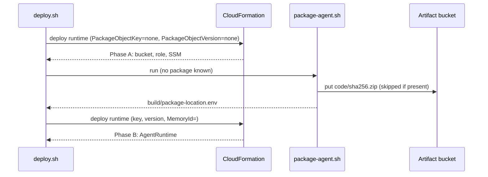
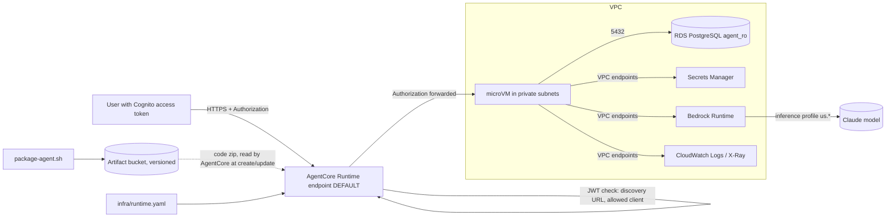

> Note (2026-11-24, after implementation): the single runtime stack with a two-phase deploy was split into two stacks, `pre-runtime` (artifact bucket, execution role, model and memory SSM parameters, formerly Phase A) and `runtime` (AgentRuntime, formerly Phase B). See docs/runtime.md. The text below describes the original design.

# Design Document

## Overview

This design deploys the Strands agent (`src/inspection_agent/` with `src/inspection_core/`) to Amazon Bedrock AgentCore Runtime. It uses the code-in-S3 artifact option, VPC network mode, and a custom JWT authorizer backed by the Cognito user pool from the auth stack.

Deliverables:

| File | Change |
|---|---|
| `infra/runtime.yaml` | New. Artifact bucket, execution role, `AWS::BedrockAgentCore::Runtime`, SSM parameters, outputs. |
| `scripts/package-agent.sh` | New. Builds a reproducible arm64 zip, uploads it to the artifact bucket, prints the package location. |
| `scripts/deploy.sh` | Changed. Passes the package location, the SSM parameter names, and the profile scope derived from `ModelId` to the runtime stack. Supports `--param`. Empties the artifact bucket before deleting the runtime stack. |
| `scripts/invoke.sh` | Changed. Adds `--persona` sign-in and non-zero exit on non-2xx. |
| `src/inspection_core/db.py` | Changed (small). Reads two optional environment variables (database host and secret ARN). |
| `src/inspection_agent/entrypoint.py` | Changed (small). Applies `INSPECTION_LOG_LEVEL` to the project loggers. |
| `docs/runtime.md` | New. Update procedure, parameters, platform facts, manual verification. |

Out of scope: `infra/memory.yaml`, the observability stack, the UI, and the MCP server.

### Key decisions

| # | Decision | Reason |
|---|---|---|
| 1 | **Unconfirmed, verified at first deploy.** The runtime stack deploys in two phases. Phase A creates only the bucket, the role, and SSM parameters. Phase B adds the `AgentRuntime` after a package is uploaded. | `AWS::BedrockAgentCore::Runtime` needs an existing S3 object at create time, and the bucket belongs to the same stack. No AWS document confirms this flow, so the first deploy tests it. The named fallbacks are a shared artifacts bucket and a bootstrap package. See [Resolved item 1](#resolved-item-1-bucket-and-first-package). |
| 2 | The package is keyed by its SHA-256 digest (`code/<sha256>.zip`). The upload is skipped when the key already exists. | A rebuild of the same source gives the same key and the same S3 version ID, so `deploy runtime` is a no-change operation (Requirement 10.4). |
| 3 | `PlatformVersion` is pinned to `V1` through a parameter. | The AgentCore docs disagree on the default (see [Research record](#research-record)). V2 changes session and snapshot behavior. The pin keeps Requirement 12 accurate. |
| 4 | `ModelId` accepts geographic profile IDs (`us.`) and global profile IDs (`global.`). The template derives the foundation model ID from it. A second parameter, `ModelScope` (`us` or `global`), selects the IAM statement set, and `deploy.sh` derives it from the `ModelId` prefix. | Standard CloudFormation conditions cannot split a string. See [Resolved item 3](#resolved-item-3-model-and-region-derivation). |
| 5 | The agent entry point is a generated root-level `main.py` that imports `inspection_agent.entrypoint`. | `entrypoint.py` uses relative imports, so AgentCore cannot run it as a script. |
| 6 | The execution role starts with no S3 and no EC2 permission. Two switch parameters (`EnableS3ReadFallback`, `EnableEniFallback`, both default `false`) add narrowly scoped statements only if the first deploy shows they are needed. | The AgentCore direct-deploy role sample has neither. Least privilege applies. See [First-deploy verification and conditional fallbacks](#first-deploy-verification-and-conditional-fallbacks). |
| 7 | The template does not compare `IdleRuntimeSessionTimeout` with `MaxLifetime`. The AgentCore service validates the pair. | See [Resolved item 4](#resolved-item-4-idle-timeout-and-maxlifetime). |

## Research record

All pages were read on **2026-11-23**. The facts below are what the design relies on.

| Topic | Finding | Source |
|---|---|---|
| CPU architecture | AgentCore Runtime supports only arm64. The service scans every `.so` file and rejects x86_64 or Mach-O binaries (`Your artifact contains binary files that are incompatible with Linux ARM64.`). | [Direct code deployment for Python](https://docs.aws.amazon.com/bedrock-agentcore/latest/devguide/runtime-get-started-code-deploy-python.html), [Troubleshooting](https://docs.aws.amazon.com/bedrock-agentcore/latest/devguide/runtime-code-deploy-common-issues.html) |
| Python version | `PYTHON_3_10` to `PYTHON_3_14` on Amazon Linux 2023. This project uses `PYTHON_3_12` (deprecation 2028-10-31), the tech-rule target. | [Supported language runtimes](https://docs.aws.amazon.com/bedrock-agentcore/latest/devguide/runtime-code-deploy-supported-runtimes.html), [CodeConfiguration](https://docs.aws.amazon.com/AWSCloudFormation/latest/TemplateReference/aws-properties-bedrockagentcore-runtime-codeconfiguration.html) |
| Package size | 250 MB zipped and 750 MB unzipped, combined size of all files. | [Direct code deployment for Python](https://docs.aws.amazon.com/bedrock-agentcore/latest/devguide/runtime-get-started-code-deploy-python.html) |
| Entry point | `CodeConfiguration.EntryPoint` is an array of 1 to 2 strings. The last string is a `.py` path inside the zip. An optional first string `opentelemetry-instrument` needs the OpenTelemetry distro in the zip. The file must define `@app.entrypoint` (Python SDK) or serve `POST /invocations` and `GET /ping`. | [CodeConfiguration](https://docs.aws.amazon.com/AWSCloudFormation/latest/TemplateReference/aws-properties-bedrockagentcore-runtime-codeconfiguration.html), [Troubleshooting](https://docs.aws.amazon.com/bedrock-agentcore/latest/devguide/runtime-code-deploy-common-issues.html) |
| Archive layout | Agent files and dependencies at the zip root. The zip is mounted at `/var/task`, the first entry of `sys.path`. POSIX permissions 644 for files and 755 for directories and executables. No `__pycache__`. | [Direct code deployment for Python](https://docs.aws.amazon.com/bedrock-agentcore/latest/devguide/runtime-get-started-code-deploy-python.html) |
| Wheel platform (conflict) | The docs show `--python-platform aarch64-manylinux2014`. With this project's pins, uv fails: `psycopg-binary 3.3.9` ships aarch64 wheels only as `manylinux_2_27` and `manylinux_2_28`. Amazon Linux 2023 has glibc 2.34, so `aarch64-manylinux_2_28` is valid. Probe on 2026-11-23: install succeeds, 9 top-level entries, all `.so` files are ELF aarch64, 81 MB unzipped, 36 MB zipped. | Local probe with `uv pip install --python-platform aarch64-manylinux_2_28 --python-version 3.12 --only-binary=:all: --target <dir> -r src/inspection_agent/requirements.txt` |
| S3 access | `s3:GetObject` is needed by "the role used to call Create/UpdateAgentRuntime", not by the execution role. The sample execution role has no S3 statement. For a versioned object the caller also needs `s3:GetObjectVersion`. | [Troubleshooting](https://docs.aws.amazon.com/bedrock-agentcore/latest/devguide/runtime-code-deploy-common-issues.html), [Runtime permissions](https://docs.aws.amazon.com/bedrock-agentcore/latest/devguide/runtime-permissions.html) |
| Runtime resource | Required: `AgentRuntimeArtifact`, `AgentRuntimeName` (`[a-zA-Z][a-zA-Z0-9_]{0,47}`, replacement on change), `RoleArn`. Optional used here: `AuthorizerConfiguration`, `EnvironmentVariables`, `LifecycleConfiguration`, `NetworkConfiguration`, `PlatformVersion`, `RequestHeaderConfiguration`, `Tags`. `Ref` returns the ARN. `GetAtt`: `AgentRuntimeArn`, `AgentRuntimeId`, `AgentRuntimeVersion`, `Status`. Every artifact property update is "No interruption". | [AWS::BedrockAgentCore::Runtime](https://docs.aws.amazon.com/AWSCloudFormation/latest/TemplateReference/aws-resource-bedrockagentcore-runtime.html), [AgentRuntimeArtifact](https://docs.aws.amazon.com/AWSCloudFormation/latest/TemplateReference/aws-properties-bedrockagentcore-runtime-agentruntimeartifact.html) |
| S3 location | `Code.S3` has `Bucket` (required), `Prefix` (required, the object key), `VersionId` (optional, 3 to 1024 characters). | [S3Location](https://docs.aws.amazon.com/AWSCloudFormation/latest/TemplateReference/aws-properties-bedrockagentcore-runtime-s3location.html) |
| JWT authorizer | `AuthorizerConfiguration.CustomJWTAuthorizer`: `DiscoveryUrl` (required, must end in `/.well-known/openid-configuration`), `AllowedClients`, `AllowedAudience`, `AllowedScopes`. Cognito access tokens carry `client_id` and no `aud`, so the design sets `AllowedClients` only. | [CustomJWTAuthorizerConfiguration](https://docs.aws.amazon.com/AWSCloudFormation/latest/TemplateReference/aws-properties-bedrockagentcore-runtime-customjwtauthorizerconfiguration.html) |
| Header allowlist | `RequestHeaderConfiguration.RequestHeaderAllowlist` has 1 to 20 names. `Authorization` is allowed only when a custom JWT authorizer is configured. `context.request_headers` then holds `Authorization`. | [RequestHeaderConfiguration](https://docs.aws.amazon.com/AWSCloudFormation/latest/TemplateReference/aws-properties-bedrockagentcore-runtime-requestheaderconfiguration.html), [Custom headers](https://docs.aws.amazon.com/bedrock-agentcore/latest/devguide/runtime-header-allowlist.html) |
| VPC mode | `NetworkConfiguration.NetworkMode` is `PUBLIC` or `VPC`. `NetworkModeConfig` needs 1 to 16 `Subnets` and 1 to 16 `SecurityGroups`. AgentCore creates the ENIs through the service-linked role `AWSServiceRoleForBedrockAgentCoreNetwork`, so the execution role needs no EC2 action. Supported AZ IDs in us-west-2: `usw2-az1`, `usw2-az2`, `usw2-az3`. | [Configure AgentCore Runtime for VPC](https://docs.aws.amazon.com/bedrock-agentcore/latest/devguide/agentcore-vpc.html), [VpcConfig](https://docs.aws.amazon.com/AWSCloudFormation/latest/TemplateReference/aws-properties-bedrockagentcore-runtime-vpcconfig.html) |
| Lifecycle | `IdleRuntimeSessionTimeout` and `MaxLifetime`: 60 to 28800 seconds on microVMs (CloudFormation schema allows up to 1209600, for Instances). Defaults 900 and 28800. The service rejects `idle > max` with `ValidationException`. | [Lifecycle settings](https://docs.aws.amazon.com/bedrock-agentcore/latest/devguide/runtime-lifecycle-settings.html), [LifecycleConfiguration](https://docs.aws.amazon.com/AWSCloudFormation/latest/TemplateReference/aws-properties-bedrockagentcore-runtime-lifecycleconfiguration.html) |
| Versions and sessions | Each update creates an immutable runtime version. The `DEFAULT` endpoint moves to the new version. A running session keeps its microVM, and so its code, until it stops (idle timeout, max lifetime, `StopRuntimeSession`, or failed health). A new `runtimeSessionId` starts a new microVM. | [How it works](https://docs.aws.amazon.com/bedrock-agentcore/latest/devguide/runtime-how-it-works.html), [Sessions](https://docs.aws.amazon.com/bedrock-agentcore/latest/devguide/runtime-sessions.html) |
| Platform version (conflict) | The developer guide says V1 is the default when `platformVersion` is omitted. A 2026-11 announcement says the next generation (V2) is now the default in some Regions. V2 snapshots the environment, takes minutes to create or update, and pins sessions to the JWT `sub`. `PlatformVersion` is a CloudFormation property. | [How it works](https://docs.aws.amazon.com/bedrock-agentcore/latest/devguide/runtime-how-it-works.html), [What's new](https://aws.amazon.com/about-aws/whats-new/2026/11/new-agentcore-runtime-default/) |
| Execution role | Sample statements: logs on `/aws/bedrock-agentcore/runtimes/*`, X-Ray (`*`), `cloudwatch:PutMetricData` with namespace condition `bedrock-agentcore`, Bedrock invoke. Trust: `bedrock-agentcore.amazonaws.com` with `aws:SourceAccount` and `aws:SourceArn` (`arn:...:bedrock-agentcore:<region>:<account>:*`). ECR and workload-identity statements apply to containers and outbound auth, so they are left out. | [Runtime permissions](https://docs.aws.amazon.com/bedrock-agentcore/latest/devguide/runtime-permissions.html) |
| Memory | `CreateEvent` and the other data-plane calls accept a memory ID matching `[a-zA-Z][a-zA-Z0-9-_]{0,99}-[a-zA-Z0-9]{10}`. Memory ARN form: `arn:<partition>:bedrock-agentcore:<region>:<account>:memory/<id>`. | [CreateEvent](https://docs.aws.amazon.com/bedrock-agentcore/latest/APIReference/API_CreateEvent.html) |
| CloudFormation Rules | Rule functions are `Fn::And`, `Contains`, `EachMemberEquals`, `EachMemberIn`, `Equals`, `If`, `Not`, `Or`, `RefAll`, `ValueOf`, `ValueOfAll`. None compares numbers. | [Rules](https://docs.aws.amazon.com/AWSCloudFormation/latest/UserGuide/rules-section-structure.html) |
| Conditions and FindInMap | Inside `Fn::Equals` only `Fn::FindInMap`, `Ref`, and other condition functions are allowed. `Fn::Select` and `Fn::Split` are not. `Fn::FindInMap` keys accept only `Ref` and `Fn::FindInMap`, unless the `AWS::LanguageExtensions` transform is used. | [Condition functions](https://docs.aws.amazon.com/AWSCloudFormation/latest/TemplateReference/intrinsic-function-reference-conditions.html), [FindInMap enhancements](https://docs.aws.amazon.com/AWSCloudFormation/latest/TemplateReference/intrinsic-function-reference-findinmap-enhancements.html) |
| Model routing | `us.anthropic.claude-haiku-4-5-20251001-v1:0` and `us.anthropic.claude-sonnet-4-6` route to us-east-1, us-east-2, us-west-2 (confirmed through `GetInferenceProfile` on 2026-11-20). | `docs/spikes/model-access.md` |
| Global profile IAM | A global inference profile needs three statements. (1) The profile ARN `arn:<partition>:bedrock:<source-region>:<account>:inference-profile/global.<model>` with `aws:RequestedRegion` equal to the source Region. (2) The in-Region foundation model ARN `arn:<partition>:bedrock:<source-region>::foundation-model/<model>` with `aws:RequestedRegion` equal to the source Region and `bedrock:InferenceProfileArn` equal to the profile ARN. (3) The Region-less foundation model ARN `arn:<partition>:bedrock:::foundation-model/<model>` with `aws:RequestedRegion` equal to `unspecified` and the same `bedrock:InferenceProfileArn` condition. The empty Region and account in (3) are intentional. Removing any one statement denies global inference. | [Global cross-Region inference](https://docs.aws.amazon.com/bedrock/latest/userguide/global-cross-region-inference.html) |
| Geographic profile IAM | Two statements: the profile ARN in the source Region, and the foundation model ARN in each destination Region with `bedrock:InferenceProfileArn` equal to the profile ARN. No `aws:RequestedRegion` condition. | [Geographic cross-Region inference](https://docs.aws.amazon.com/bedrock/latest/userguide/geographic-cross-region-inference.html) |
| Direct-deploy execution role | The AgentCore sample role for direct code deployment (read 2026-11-23) holds logs, X-Ray, `cloudwatch:PutMetricData` with the `bedrock-agentcore` namespace condition, and Bedrock invoke. It holds no S3 and no EC2 action. | [Runtime permissions](https://docs.aws.amazon.com/bedrock-agentcore/latest/devguide/runtime-permissions.html) |
| ENI permissions | The service-linked role `AWSServiceRoleForBedrockAgentCoreNetwork` holds the EC2 actions (create, tag, delete, assign addresses, describe). It is created on first VPC use. The creating identity needs `iam:CreateServiceLinkedRole` for `network.bedrock-agentcore.amazonaws.com`. | [Service-linked roles](https://docs.aws.amazon.com/bedrock-agentcore/latest/devguide/service-linked-roles.html), [Configure AgentCore Runtime for VPC](https://docs.aws.amazon.com/bedrock-agentcore/latest/devguide/agentcore-vpc.html) |
| S3 endpoint policy | For zip deployments, AgentCore reads the code from a service-owned bucket (`acr-code-*-<region>-an`) through the S3 gateway endpoint, and the documented endpoint policy allows that bucket for the AgentCore service principal. `infra/network.yaml` already carries this policy. Application code does not reach S3, so the policy needs no change. | [Runtime security best practices](https://docs.aws.amazon.com/bedrock-agentcore/latest/devguide/runtime-security-best-practices.html) |
| Lint | `cfn-lint` 1.60.1 (the CI pin) accepts `PlatformVersion` and all properties used here. The local `cfn-lint` 1.46.0 reports `PlatformVersion` as an unknown property. A scratch template with the planned parameter pattern, Rule, and conditional runtime linted clean on 1.60.1 on 2026-11-23. Run it with `uvx --from "cfn-lint==1.60.1" cfn-lint infra/runtime.yaml`. | Local probe |

## Resolved open items

### Resolved item 1: bucket and first package

Problem: `AWS::BedrockAgentCore::Runtime` needs the S3 object at create time. The bucket is created by the same stack. A single create therefore cannot succeed.

Decision: two phases inside the same stack, selected by the parameters `PackageObjectKey` and `PackageObjectVersion`.

- Both default to the sentinel `none`. A condition `HasPackage` is true when the key is not `none`.
- `AgentRuntime` and the SSM parameters for the runtime ARN and ID exist only when `HasPackage` is true.
- A Rule requires both parameters to be `none` or both to be real values.
- A sentinel is used instead of an empty string because cfn-lint raises W1030 (value shorter than 3 characters) on an empty `VersionId` default.

**Status: unconfirmed.** No AWS page describes this two-phase flow. It follows from two documented facts (the runtime needs an existing S3 object, and the bucket is in the same stack). The first deploy tests it, and the result is recorded in the task notes. The flow is unconfirmed on these points: whether `Code.S3.VersionId` must be given, whether the first create of the runtime succeeds with the object in a bucket of the same stack, and whether a failed Phase B rolls back cleanly to Phase A.

Fallbacks, in order, if Phase B fails for a reason other than a fixable permission or parameter error:

1. **Shared artifacts bucket.** Move the bucket to a stack that does not contain the runtime. The stack list allows only the 8 component templates, so the bucket would live in `infra/network.yaml` (the first stack deployed) as a new output and SSM parameter `/inspection-agent/<env>/network/artifact-bucket`. The runtime template then reads the bucket name through an SSM parameter and holds no bucket. This needs a change to `infra/network.yaml`, and the choice must be made with the user.
2. **Bootstrap package.** Keep the bucket in the runtime stack, and have `deploy.sh` upload a bootstrap zip (the same Package_Script output) before the first runtime create, using a one-time `aws s3api create-bucket` outside the stack. This breaks the rule that the stack owns the bucket, so it is the second choice.

Phase A (bucket only) is the first create of the stack. A failure in Phase B is then a stack update, so CloudFormation rolls back to Phase A and the bucket (which now holds the package) is never part of a failed create. This also avoids a `ROLLBACK_COMPLETE` stack that cannot delete its non-empty versioned bucket.

Sequence in `deploy.sh deploy-all` step 4:



Rules in `deploy.sh` for the package location, in order:

1. `build/package-location.env`, when its `PACKAGE_ENV` and `PACKAGE_REGION` match and `s3api head-object --version-id` confirms the object.
2. The current parameter values of the runtime stack (`describe-stacks`), when the key is not `none`. Step 6 and every later `deploy runtime` use this.
3. Otherwise there is no package. `deploy-all` runs `scripts/package-agent.sh` and continues. `deploy runtime` deploys Phase A, then exits non-zero and names `scripts/package-agent.sh` (Requirement 10.2).

Rule 3 never runs on a stack that already has a runtime, so Phase A cannot delete an existing runtime.

### Resolved item 2: database environment variables

`src/inspection_core/db.py` today reads only `INSPECTION_ENV` and `AWS_REGION`. It derives the secret name `inspection-agent/<env>/database/agent-ro` and takes the host from the secret JSON. Requirement 5.3 asks for a host variable and a secret ARN variable.

Decision: add two optional variables and keep the current behavior as the fallback.

| Variable | Value | `db.py` behavior |
|---|---|---|
| `INSPECTION_DB_SECRET_ARN` | ARN from `/inspection-agent/<env>/database/agent-ro-secret-arn` | `_secret_id()` returns it when set. Otherwise the derived name. |
| `INSPECTION_DB_HOST` | Endpoint from `/inspection-agent/<env>/database/endpoint` | `connect()` uses it instead of `secret["host"]` when set. |

Both values are validated before use: the ARN must match `^arn:aws[a-z-]*:secretsmanager:[a-z0-9-]+:[0-9]{12}:secret:inspection-agent/<env>/database/agent-ro-.+$` (this keeps the code pinned to the one secret it is allowed to read), and the host must match `^[A-Za-z0-9.-]{1,253}$`. A value that fails validation raises `ValueError` with a fixed message, like the existing `INSPECTION_ENV` check. The secret ARN carries a random suffix, so the IAM resource is the same ARN from the same SSM parameter.

No secret value, password, or token is passed in the environment (Requirement 5.8).

### Resolved item 3: model and Region derivation

Requirement 8.4 asks the template to derive the foundation model ID (and, for a geographic profile, the Destination_Regions) from the profile ID. CloudFormation conditions cannot split strings, and `Fn::FindInMap` keys cannot use `Fn::Select` without the `AWS::LanguageExtensions` transform. That transform would add `CAPABILITY_AUTO_EXPAND` to every deploy call, so it is not used.

Decision: restrict `ModelId` with a pattern, derive the foundation model ID with `Fn::Select` and `Fn::Split` inside resource properties (where they are allowed), and choose the IAM statement set with a second parameter that `deploy.sh` derives.

- `ModelId` pattern: `^(us|global)\.[a-z0-9-]+\.[a-z0-9][a-z0-9:_-]*$`. It allows exactly three dot-separated segments and the prefix `us` or `global`. Any other prefix (`eu.`, `apac.`), a bare foundation model ID, or an ID with extra dots is rejected before any resource changes (Requirement 8.5).
- Foundation model ID: `!Join [".", [!Select [1, !Split [".", !Ref ModelId]], !Select [2, !Split [".", !Ref ModelId]]]]`. It works for both prefixes, because a global ID has the same three-segment shape (`global.anthropic.<model>`).
- `ModelScope` parameter: `us` or `global`, default `us`. Conditions `IsGlobalModel` (`ModelScope` equals `global`) and `IsGeoModel` (the negation) select the statements. `deploy.sh` sets it from the prefix of the effective `ModelId` (`${MODEL_ID%%.*}`), so the user passes one value.
- Consistency: the template cannot compare the two parameters. A mismatch fails closed. A `us.` profile with scope `global` or a `global.` profile with scope `us` leaves a statement set that does not match the routing, so invocation is denied, and no other model becomes invocable. The task list checks the derived value by reading the stack parameters after the deploy (Requirement 13.6).
- Geographic Destination_Regions: a `Mappings` table `ProfileRoutes` with the one key `us`. Each region is stored as a geography plus a suffix and joined with `!Sub`, so the table holds no literal Region name (Rule 6). Rows come from the spike record above and are read with the literal key `us`. A global profile uses no table, because its foundation model ARN has no Region.

**Least-privilege Bedrock statements** (sources in the Research record):

| Sid | Condition on | Resource | Conditions |
|---|---|---|---|
| `InvokeProfile` | always | `arn:${Partition}:bedrock:${Region}:${AccountId}:inference-profile/${ModelId}` | When `IsGlobalModel`: `StringEquals aws:RequestedRegion = ${Region}`. |
| `InvokeFoundationModelsGeo` | `IsGeoModel` | `arn:${Partition}:bedrock:<region>::foundation-model/<foundation-model-id>` for each of the three Destination_Regions | `StringEquals bedrock:InferenceProfileArn` = the profile ARN. |
| `InvokeFoundationModelInRegion` | `IsGlobalModel` | `arn:${Partition}:bedrock:${Region}::foundation-model/<foundation-model-id>` | `StringEquals aws:RequestedRegion = ${Region}` and `bedrock:InferenceProfileArn` = the profile ARN. |
| `InvokeFoundationModelGlobal` | `IsGlobalModel` | `arn:${Partition}:bedrock:::foundation-model/<foundation-model-id>` | `StringEquals aws:RequestedRegion = unspecified` and `bedrock:InferenceProfileArn` = the profile ARN. A comment states that the empty Region and account are intentional. |

All four statements allow only `bedrock:InvokeModel` and `bedrock:InvokeModelWithResponseStream`. Every foundation model statement names the configured foundation model ID and is bound to the configured profile ARN by the `bedrock:InferenceProfileArn` condition, so the role cannot invoke the foundation model directly, and cannot invoke any other model (Requirements 8.2 and 8.3). The `Resource` entries use the `!Sub` form with a variable map, because `Fn::Select` cannot appear inside a plain `${}` reference.

Consequences of a global profile, for the reviewer:

- Routing can go to any commercial AWS Region that the profile supports, outside the US. The data is synthetic (product rule), so this is acceptable for the demo. `docs/runtime.md` states it.
- An Organizations service control policy that denies by `aws:RequestedRegion` must allow `unspecified` for this role, or global inference fails. `docs/runtime.md` states it.
- Requirement 13.6 re-checks the deployed role against the live routing for a geographic profile (`aws bedrock get-inference-profile`). For a global profile there is no Region list to compare, so the check reads the three statements and runs the simulation (below).

A geographic profile whose routes differ from the `us` table needs a table review first: `aws bedrock get-inference-profile --inference-profile-identifier <id>`.

### Resolved item 4: idle timeout and MaxLifetime

Decision (revised after review): the design does not enforce `IdleRuntimeSessionTimeout <= MaxLifetime` anywhere in this repository. There is no template rule and no check in `scripts/deploy.sh`.

- Both parameters stay numeric with the individual ranges `MinValue: 60` and `MaxValue: 28800` (Requirements 4.5 and 4.6). `MaxLifetime` keeps the default 28800.
- For an invalid combination, the design relies on the AgentCore service. The service rejects it with `ValidationException` (see the Lifecycle row of the Research record). Because the runtime is created in Phase B (an update of an existing stack), CloudFormation rolls back to the previous configuration.
- **Interpretation to confirm.** The request was read as "remove the idle-versus-max rule and its check, and keep the `MaxLifetime` parameter". If the intent was to remove the `MaxLifetime` parameter itself, tell me and I will remove it and keep only the idle timeout.
- Trade-off: the error appears at deploy time from the service, after the change set starts, not before any AWS call. The stack rolls back, so no half-applied state remains.

### Other decisions

- **`--param` option.** `deploy.sh deploy <component> --param Key=Value` (repeatable) passes extra parameter overrides to one component. It is needed for Requirement 13.4 (change the idle timeout) and for the fallback switches. `deploy-all` rejects it.
- **Environment names other than `demo`.** The SSM-typed parameters default to `/inspection-agent/demo/...`. `deploy.sh` always passes the six names for the current `Env` when it deploys the runtime component. It also passes `ModelScope`, derived from the effective `ModelId`.
- **Bash 3.2.** An empty array expands to an unbound variable under `set -u` in bash 3.2. Scripts use `${arr[@]+"${arr[@]}"}`.

## Architecture



Network path: the runtime security group and the private subnets come from the network stack. That stack publishes VPC endpoints for `bedrock-runtime`, `bedrock-agentcore`, `secretsmanager`, `logs`, `xray`, and an S3 gateway endpoint, and the security group allows 443 to the endpoints and 5432 to the database. No new network resource is added here.

Deploy order (existing sequence with the package step added):

| Step | Stack | Runtime-stack inputs |
|---|---|---|
| 1 to 3 | network, auth, database | none |
| 4 | runtime | Phase A, then package, then Phase B with `MemoryId=` |
| 5 | memory | none |
| 6 | runtime | package parameters from the current stack, `MemoryId=<id>` |
| 7 to 10 | observability, ui, auth, mcp | none |

## Components and Interfaces

### `infra/runtime.yaml`

**Parameters** (every parameter has a `Description` and a constraint, Rule 2):

| Name | Type | Default | Constraint |
|---|---|---|---|
| `Env` | String | `demo` | `^[a-z][a-z0-9]{0,9}$` |
| `ModelId` | String | `us.anthropic.claude-haiku-4-5-20251001-v1:0` | `^(us\|global)\.[a-z0-9-]+\.[a-z0-9][a-z0-9:_-]*$` |
| `ModelScope` | String | `us` | `us`, `global`. Set by `deploy.sh` from the `ModelId` prefix. |
| `IdleRuntimeSessionTimeout` | Number | 900 | 60 to 28800 |
| `MaxLifetime` | Number | 28800 | 60 to 28800 |
| `LogLevel` | String | `INFO` | `DEBUG`, `INFO`, `WARNING`, `ERROR` |
| `MemoryId` | String | empty | `^$\|^[a-zA-Z][a-zA-Z0-9_-]{0,99}-[a-zA-Z0-9]{10}$` |
| `PackageObjectKey` | String | `none` | `^(none\|code/[A-Za-z0-9._-]{1,200})$` |
| `PackageObjectVersion` | String | `none` | `^(none\|[A-Za-z0-9._-]{3,1024})$` |
| `PlatformVersion` | String | `V1` | `V1`, `V2` |
| `EnableS3ReadFallback` | String | `false` | `true`, `false`. Fallback switch, see the fallback section. |
| `EnableEniFallback` | String | `false` | `true`, `false`. Fallback switch, see the fallback section. |
| `PrivateSubnetIds` | `AWS::SSM::Parameter::Value<List<String>>` | `/inspection-agent/demo/network/private-subnet-ids` | SSM type |
| `RuntimeSecurityGroupId` | `AWS::SSM::Parameter::Value<String>` | `/inspection-agent/demo/network/runtime-security-group-id` | SSM type |
| `DiscoveryUrl` | `AWS::SSM::Parameter::Value<String>` | `/inspection-agent/demo/auth/discovery-url` | SSM type |
| `AppClientId` | `AWS::SSM::Parameter::Value<String>` | `/inspection-agent/demo/auth/app-client-id` | SSM type |
| `DbEndpoint` | `AWS::SSM::Parameter::Value<String>` | `/inspection-agent/demo/database/endpoint` | SSM type |
| `DbSecretArn` | `AWS::SSM::Parameter::Value<String>` | `/inspection-agent/demo/database/agent-ro-secret-arn` | SSM type |

**Rules:** `PackageBothOrNeither` (both package parameters are `none`, or neither is).

**Conditions:** `HasPackage` (`PackageObjectKey` is not `none`), `HasMemory` (`MemoryId` is not empty), `IsGlobalModel` (`ModelScope` is `global`), `IsGeoModel` (`ModelScope` is not `global`), `UseS3ReadFallback` and `UseEniFallback` (the matching switch is `true`).

**Resources:**

| Logical ID | Type | Notes |
|---|---|---|
| `ArtifactBucket` | `AWS::S3::Bucket` | Versioning on, SSE-S3 (`AES256`), all four public-access blocks, `BucketOwnerEnforced`, tags. No fixed name, so there is no global-name clash. |
| `ArtifactBucketPolicy` | `AWS::S3::BucketPolicy` | Denies every `s3:*` request with `aws:SecureTransport` false, on the bucket and its objects. |
| `ExecutionRole` | `AWS::IAM::Role` | Trust and one inline policy, see [IAM](#execution-role-policy). Role name `inspection-agent-<env>-runtime-exec`. |
| `AgentRuntime` | `AWS::BedrockAgentCore::Runtime` | Condition `HasPackage`. Name `inspection_agent_<env>`. |
| `ArtifactBucketParameter`, `ExecutionRoleArnParameter`, `InvocationUrlParameter` | `AWS::SSM::Parameter` | Always created. |
| `RuntimeArnParameter`, `RuntimeIdParameter` | `AWS::SSM::Parameter` | Condition `HasPackage`. |

**`AgentRuntime` properties:**

```yaml
AgentRuntimeName: !Sub inspection_agent_${Env}   # 17 + up to 10 characters, within 48
RoleArn: !GetAtt ExecutionRole.Arn
PlatformVersion: !Ref PlatformVersion
AgentRuntimeArtifact:
  CodeConfiguration:
    Runtime: PYTHON_3_12
    EntryPoint: [main.py]
    Code:
      S3:
        Bucket: !Ref ArtifactBucket
        Prefix: !Ref PackageObjectKey
        VersionId: !Ref PackageObjectVersion
NetworkConfiguration:
  NetworkMode: VPC
  NetworkModeConfig:
    Subnets: !Ref PrivateSubnetIds
    SecurityGroups: [!Ref RuntimeSecurityGroupId]
AuthorizerConfiguration:
  CustomJWTAuthorizer:
    DiscoveryUrl: !Ref DiscoveryUrl
    AllowedClients: [!Ref AppClientId]
RequestHeaderConfiguration:
  RequestHeaderAllowlist: [Authorization]
LifecycleConfiguration:
  IdleRuntimeSessionTimeout: !Ref IdleRuntimeSessionTimeout
  MaxLifetime: !Ref MaxLifetime
EnvironmentVariables: { ... see Data Models ... }
Tags: { Project: inspection-agent, Env: !Ref Env }
```

Update behavior: changing only `IdleRuntimeSessionTimeout` changes only `LifecycleConfiguration`. Every property in the Research record is "No interruption", so the runtime is updated in place and the `Code.S3` values stay the same (Requirement 4.11). Changing `PackageObjectKey` or `PackageObjectVersion` creates a new runtime version, and the `DEFAULT` endpoint moves to it (Requirement 3.7).

**Outputs** (each with a `Description`): `ArtifactBucketName`, `ExecutionRoleArn`, `InvocationUrlPattern`, and, when `HasPackage`, `AgentRuntimeArn` and `AgentRuntimeId`. No `Export`.

The invocation URL pattern is `https://bedrock-agentcore.${AWS::Region}.amazonaws.com/runtimes/{EncodedRuntimeArn}/invocations?qualifier=DEFAULT`. CloudFormation has no URL-encode function, so the placeholder `{EncodedRuntimeArn}` stands for the URL-encoded ARN. `invoke.sh` encodes the ARN itself.

### `scripts/package-agent.sh`

Usage: `scripts/package-agent.sh [--env <env>] [--region <region>]`. Defaults `demo` and `us-west-2`. Bash 3.2. Needs `aws`, `uv`, and `python3` (standard library only).

Steps:

1. Parse arguments. Validate `--env` against `^[a-z][a-z0-9]{0,9}$` and exit 2 before any AWS call (Requirement 1.7). Check that the tools exist.
2. Read `/inspection-agent/<env>/runtime/artifact-bucket`. If it is missing, exit 1 with: `Artifact bucket not found. Deploy the runtime stack first: scripts/deploy.sh --env <env> deploy runtime` (Requirement 1.8). Read the account ID with `sts get-caller-identity` for `--expected-bucket-owner`.
3. Recreate `build/agent-package/`.
4. Install dependencies: `uv pip install --python-platform aarch64-manylinux_2_28 --python-version 3.12 --only-binary=:all: --target build/agent-package -r src/inspection_agent/requirements.txt`.
5. Copy `src/inspection_agent/` and `src/inspection_core/` to the zip root, excluding `__pycache__`, `*.pyc`, `*.md`, and `inspection_core/seed/` (the seed Lambda handler is not part of the agent). `system_prompt.txt` is included because `config.py` reads it relative to its own file (Requirement 2.3).
6. Write the root `main.py`:

   ```python
   from inspection_agent.entrypoint import app

   if __name__ == "__main__":
       app.run()
   ```

7. Build `build/inspection-agent.zip` with an inline `python3` heredoc using `zipfile`: sorted entry names, fixed timestamp `1980-01-01 00:00:00`, mode 0644 for files and 0755 for directories and `.so` files, `ZIP_DEFLATED` level 9, no extra fields. Remove any `__pycache__` first.
8. Check the size: zipped at most 250,000,000 bytes and unzipped at most 750,000,000 bytes (the decimal values are stricter than the documented MB limits). Otherwise exit 1.
9. Compute the SHA-256. The key is `code/<sha256>.zip`.
10. `s3api head-object` on that key. When it exists, reuse its `VersionId` and skip the upload. Otherwise `s3api put-object` with `--metadata sha256=<digest>` and `--expected-bucket-owner`, and read the returned `VersionId`.
11. Print `bucket`, `key`, `version-id`, `sha256`, and the zipped and unzipped sizes. Write `build/package-location.env` with `PACKAGE_ENV`, `PACKAGE_REGION`, `PACKAGE_BUCKET`, `PACKAGE_KEY`, `PACKAGE_VERSION_ID`, `PACKAGE_SHA256`.

The script reads no secret and prints none. `build/` is ignored by Git.

Reproducibility (Requirement 1.3) depends on identical dependency wheel contents and the same `zlib` build. The task list checks it by building twice on one machine and comparing digests.

### `scripts/deploy.sh` changes

- `deploy_stack` for the component `runtime` appends: the package parameters (from the resolution rules above), the six SSM parameter names for `<env>`, and any `--param` overrides.
- New helper `resolve_package` (rules 1 to 3 above) and `empty_artifact_bucket`.
- `deploy-all` step 4: run Phase A when no package is known, run `scripts/package-agent.sh`, then deploy Phase B with `MemoryId=`. Step 6 resolves the package from the stack (rule 2).
- `delete runtime`: before `delete-stack`, delete every object version and delete marker in the artifact bucket (`s3api list-object-versions` and `delete-objects`, JSON built with `python3`). This satisfies Requirement 3.5 without leaving a manual step. `docs/runtime.md` also gives the manual command. Only build artifacts are removed, and they can be rebuilt from source.
- `ModelScope` derivation from the effective `ModelId` (from `--param`, then the current stack parameter, then the template default). It rejects a `ModelId` whose prefix is not `us` or `global` with exit 2 before any AWS call that changes a resource.
- No idle-versus-max check (see Resolved item 4).

### `scripts/invoke.sh` changes

New option `--persona inspector-a|inspector-b|supervisor`. Behavior:

| Case | Result |
|---|---|
| `--persona` and `AGENT_ACCESS_TOKEN` both set | Exit 2 naming both (Requirement 11.3). |
| `--persona` only | Sign in (below). |
| `AGENT_ACCESS_TOKEN` only | Current behavior. |
| Neither | Exit 2, as today. |

Sign-in follows `docs/auth.md` section 7: read the pool ID and client ID from SSM (`/inspection-agent/<env>/auth/user-pool-id` and `.../app-client-id`), create a virtual environment with `mktemp -d`, install `pycognito`, and run SRP authentication. The email comes from a fixed persona table in the script (`inspector-a@example.com`, `inspector-b@example.com`, `supervisor@example.com`). The password comes from `DEMO_PASSWORD_INSPECTOR_A`, `DEMO_PASSWORD_INSPECTOR_B`, or `DEMO_PASSWORD_SUPERVISOR`, or from `getpass` (no echo). The Python snippet prints only the access token on stdout into a shell variable. An `EXIT` trap removes the virtual environment and the response temp file.

No option accepts a password, token, or user identity. The token still reaches `curl` through `printf ... | curl -H @-`.

The call writes the body to a `chmod 600` temp file and reads the code with `-w '%{http_code}'`. It prints `HTTP <code>` to stderr and the body to stdout. A non-2xx code exits 1. Exit codes 2 (usage or missing token) and 3 (missing runtime ARN parameter) stay as they are.

### Code changes under `src/`

1. `src/inspection_core/db.py`: `_secret_id()` and the host selection, as in Resolved item 2.
2. `src/inspection_agent/entrypoint.py`: a small `_configure_logging()` called at import. It reads `INSPECTION_LOG_LEVEL`, accepts only `DEBUG`, `INFO`, `WARNING`, `ERROR` (default `INFO`), and sets the level on the `inspection_agent` and `inspection_core` loggers only. It does not touch the root logger, so `botocore` and `urllib3` do not start logging request details at `DEBUG`.
3. `INSPECTION_MEMORY_ID` is set by the template but not read yet. The memory spec reads it.

### `docs/runtime.md` outline

1. Platform facts (arm64, `PYTHON_3_12`, size limits, entry point, layout, `manylinux_2_28` note), identical to the Research record.
2. Parameters table with defaults and ranges.
3. SSM parameters read and published.
4. First deploy (Phase A, package, Phase B) and the update procedure: run the Package_Script, deploy the runtime stack with the new location, invoke with a fresh session ID.
5. Session behavior: a session keeps the code of the version that created its microVM until it ends by idle timeout, `MaxLifetime`, or `StopRuntimeSession`. A new `X-Amzn-Bedrock-AgentCore-Runtime-Session-Id` starts a new microVM on the new version.
6. Deploying identity prerequisites: `s3:GetObject` and `s3:GetObjectVersion` on the bucket, `iam:PassRole` on the execution role, and `iam:CreateServiceLinkedRole` for `network.bedrock-agentcore.amazonaws.com` on the first VPC runtime in the account.
7. Pre-deploy AZ check: `aws ec2 describe-subnets --subnet-ids <ids> --query 'Subnets[].AvailabilityZoneId'` must show only `usw2-az1`, `usw2-az2`, `usw2-az3` (Requirement 6.4).
8. Teardown and the manual bucket-emptying command.
9. Manual verification steps for Requirement 13, including the first-deploy verification and the two conditional fallbacks.
10. Global inference profiles: routing can leave the US, a service control policy that denies by `aws:RequestedRegion` must allow `unspecified` for the role, and the `ModelScope` parameter is derived by `deploy.sh`.

## Data Models

### Environment variables of the runtime

| Variable | Value | Requirement |
|---|---|---|
| `INSPECTION_ENV` | `!Ref Env` | 5.1 |
| `AWS_REGION` | `!Ref AWS::Region` | 5.1 |
| `INSPECTION_MODEL_ID` | `!Ref ModelId` | 5.1 |
| `INSPECTION_MODEL_REGION` | `!Ref AWS::Region` | 5.2 |
| `INSPECTION_DB_HOST` | `!Ref DbEndpoint` | 5.3 |
| `INSPECTION_DB_SECRET_ARN` | `!Ref DbSecretArn` | 5.3 |
| `INSPECTION_LOG_LEVEL` | `!Ref LogLevel` | 5.4 |
| `INSPECTION_MEMORY_ID` | `!If [HasMemory, !Ref MemoryId, !Ref AWS::NoValue]` | 5.5, 5.6 |

No variable holds a password, token, or user identity (Requirement 5.8). cfn-lint accepted `AWS::NoValue` as a map value in the scratch test.

### Execution role policy

Trust policy: principal `bedrock-agentcore.amazonaws.com`, action `sts:AssumeRole`, condition `StringEquals aws:SourceAccount = ${AWS::AccountId}` and `ArnLike aws:SourceArn = arn:${AWS::Partition}:bedrock-agentcore:${AWS::Region}:${AWS::AccountId}:runtime/inspection_agent_${Env}-*`. If the first deploy fails with an assume-role error, the fallback is the documented `...:${AWS::AccountId}:*` form. The task list records which form was verified.

| Sid | Actions | Resource | Condition |
|---|---|---|---|
| `InvokeProfile`, `InvokeFoundationModelsGeo`, `InvokeFoundationModelInRegion`, `InvokeFoundationModelGlobal` | `bedrock:InvokeModel`, `bedrock:InvokeModelWithResponseStream` | As in the table of [Resolved item 3](#resolved-item-3-model-and-region-derivation). Which statements exist depends on `ModelScope`. | `bedrock:InferenceProfileArn` on every foundation model statement. `aws:RequestedRegion` on every statement of a global profile. |
| `ReadOnlySecret` | `secretsmanager:GetSecretValue` | `${DbSecretArn}` | none |
| `LogGroup` | `logs:CreateLogGroup`, `logs:DescribeLogStreams`, `logs:PutResourcePolicy` | `arn:...:log-group:/aws/bedrock-agentcore/runtimes/inspection_agent_${Env}-*` | none |
| `LogStreams` | `logs:CreateLogStream`, `logs:PutLogEvents` | same prefix with `:log-stream:*` | none |
| `DescribeLogGroups` | `logs:DescribeLogGroups` | `arn:...:log-group:*` | none. A comment above the statement states why `*` is used. |
| `Tracing` | `xray:PutTraceSegments`, `xray:PutTelemetryRecords`, `xray:GetSamplingRules`, `xray:GetSamplingTargets` | `*` | none. Comment: X-Ray does not support resource-level permissions for these actions. |
| `Metrics` | `cloudwatch:PutMetricData` | `*` | `StringEquals cloudwatch:namespace = bedrock-agentcore`. Comment: `PutMetricData` has no resource-level permissions. |
| `PackageRead` (only when `UseS3ReadFallback`) | `s3:GetObject`, `s3:GetObjectVersion` | `${ArtifactBucket.Arn}/code/*` | none. Fallback only. |
| `EniManage` and `EniDescribe` (only when `UseEniFallback`) | See the fallback section. | See the fallback section. | Fallback only. |
| `Memory` (only when `HasMemory`) | `bedrock-agentcore:CreateEvent`, `GetEvent`, `ListEvents`, `ListSessions`, `RetrieveMemoryRecords`, `ListMemoryRecords`, `GetMemoryRecord` | `arn:...:bedrock-agentcore:${Region}:${AccountId}:memory/${MemoryId}` | none |

Left out on purpose:

- EC2 network interface actions: AgentCore uses a service-linked role. The fallback section holds the statements to add if the first deploy proves otherwise (Requirement 6.3).
- S3 read: the identity that calls create and update reads the package, not the role (Requirement 8.7). The fallback section holds the statement if the first deploy proves otherwise.
- ECR and workload-identity token actions: the runtime uses code deployment and no outbound auth.
- Any action on the master or owner secret (Requirement 8.11).

The memory action list is a starting set for the later memory spec. It has no delete action.

Every `*` resource has a YAML comment on the line above it. No literal account ID, Region, or ARN string appears (Rule 6). The geographic foundation-model Regions are built from the mapping table. The global foundation model ARN is built as `arn:${AWS::Partition}:bedrock:::foundation-model/<id>`.

### Mapping table (geographic profiles only)

```yaml
Mappings:
  ProfileRoutes:
    us:
      Geo: us
      Region1: east-1
      Region2: east-2
      Region3: west-2
```

Each Region is composed as `!Sub ["${Geo}-${Suffix}", {Geo: !FindInMap [ProfileRoutes, us, Geo], Suffix: !FindInMap [ProfileRoutes, us, Region1]}]`. The table serves only the `IsGeoModel` statement. The table is data, not a hard-coded Region in a policy. A reviewer who prefers a literal list can replace it with a documented exception to Rule 6.

### SSM parameters published

| Name | Value | Condition |
|---|---|---|
| `/inspection-agent/<env>/runtime/artifact-bucket` | bucket name | always |
| `/inspection-agent/<env>/runtime/execution-role-arn` | role ARN | always |
| `/inspection-agent/<env>/runtime/invocation-url` | URL pattern | always |
| `/inspection-agent/<env>/runtime/runtime-arn` | `!GetAtt AgentRuntime.AgentRuntimeArn` | `HasPackage` |
| `/inspection-agent/<env>/runtime/runtime-id` | `!GetAtt AgentRuntime.AgentRuntimeId` | `HasPackage` |

SSM parameters read: the two network, two auth, and two database parameters listed in the parameter table.

### Package artifacts

Zip layout:

```text
main.py                      generated entry shim
inspection_agent/            from src/inspection_agent (no __pycache__, no *.md)
inspection_core/             from src/inspection_core (no seed/, no __pycache__, no *.md)
strands/ boto3/ psycopg/ ... dependencies at the root
```

`build/package-location.env` (ignored by Git):

```text
PACKAGE_ENV=demo
PACKAGE_REGION=us-west-2
PACKAGE_BUCKET=<bucket>
PACKAGE_KEY=code/<sha256>.zip
PACKAGE_VERSION_ID=<version id>
PACKAGE_SHA256=<sha256>
```

`deploy.sh` reads it with `grep` and `cut`, never `source`, and rejects values that do not match the parameter patterns.

## First-deploy verification and conditional fallbacks

**Flag for review.** The role starts without S3 and EC2 permissions because the AgentCore direct-deploy sample role has none, and the workspace rule requires least privilege. The request was to add EC2 and S3 permissions in the tasks. The design does not add them unconditionally. It adds two switch parameters, both `false` by default, and the exact statements to enable them. If you want them on from the start, set the defaults to `true`. The scope below still applies.

### Verification at first deploy

The Reviewer runs these steps after Phase B and records the result in the task notes (no test file):

1. Phase B reaches `CREATE_COMPLETE`, and `aws bedrock-agentcore-control get-agent-runtime` shows status `READY`. This also records whether the [two-phase approach](#resolved-item-1-bucket-and-first-package) worked.
2. Invoke the runtime with `scripts/invoke.sh --persona supervisor` and a demo question. The response must be HTTP 2xx. A first invocation starts a microVM, so this exercises code download, ENI creation, and the database path.
3. If a step fails, read the runtime log group `/aws/bedrock-agentcore/runtimes/inspection_agent_<env>-*` and the CloudFormation event status reason, then use the table.

| Symptom | Check first | Action |
|---|---|---|
| `AccessDenied` on `s3:GetObject` or `s3:GetObjectVersion` while CloudFormation creates or updates the runtime | The error names the deploying identity, not the execution role. | Fix the deploying identity (the documented cause). No role change. |
| S3 `AccessDenied` that names the execution role ARN as the principal (CloudTrail `userIdentity`, or the status reason) | The object key and version ID in the stack parameters match the uploaded object. | Set `EnableS3ReadFallback=true`. |
| Status reason or CloudTrail shows `ec2:CreateNetworkInterface` (or another `ec2:` action) denied for the execution role | The service-linked role exists (`aws iam get-role --role-name AWSServiceRoleForBedrockAgentCoreNetwork`). The subnets are in `usw2-az1`, `usw2-az2`, or `usw2-az3`. | Set `EnableEniFallback=true`. |
| Any other startup failure | The log group. | Not a permission fallback. Fix the cause. |

The fallback is applied with `scripts/deploy.sh deploy runtime --param EnableS3ReadFallback=true` (or `EnableEniFallback=true`), then a fresh session ID invocation. The task list holds one **conditional task** for each switch. A conditional task runs only when its row in the table matches, and its note records the evidence.

### S3 fallback statement (`EnableS3ReadFallback`)

Least privilege: read-only, two actions, only the package prefix of the artifact bucket, and only objects that the Package_Script writes (`code/<sha256>.zip`).

```yaml
- Sid: PackageRead
  Effect: Allow
  Action:
    - s3:GetObject
    - s3:GetObjectVersion
  Resource: !Sub ${ArtifactBucket.Arn}/code/*
```

No `s3:ListBucket`, no write action, no bucket-wide resource. The S3 gateway endpoint policy in `infra/network.yaml` allows only the service-owned code buckets for the AgentCore service principal. The role statement does not need an endpoint change, because AgentCore, not the agent code, reads the package.

### ENI fallback statements (`EnableEniFallback`)

The AgentCore documentation lists these actions only for the service-linked role `AWSServiceRoleForBedrockAgentCoreNetwork`. It does not say that the execution role ever needs them, so this fallback is a copy of the documented actions, with the documented tag conditions, narrowed to the stack account and Region and, where possible, to the stack security group. It is the tightest scope that the documentation supports.

```yaml
- Sid: EniCreateInSubnetAndGroup
  Effect: Allow
  Action: ec2:CreateNetworkInterface
  Resource:
    # CloudFormation cannot build one ARN per subnet from a list parameter without a transform.
    - !Sub arn:${AWS::Partition}:ec2:${AWS::Region}:${AWS::AccountId}:subnet/*
    - !Sub arn:${AWS::Partition}:ec2:${AWS::Region}:${AWS::AccountId}:security-group/${RuntimeSecurityGroupId}
- Sid: EniCreateTagged
  Effect: Allow
  Action: ec2:CreateNetworkInterface
  Resource: !Sub arn:${AWS::Partition}:ec2:${AWS::Region}:${AWS::AccountId}:network-interface/*
  Condition:
    StringEquals:
      aws:RequestTag/AmazonBedrockAgentCoreManaged: "true"
    ForAllValues:StringEquals:
      aws:TagKeys: [AmazonBedrockAgentCoreManaged]
- Sid: EniTagOnCreate
  Effect: Allow
  Action: ec2:CreateTags
  Resource: !Sub arn:${AWS::Partition}:ec2:${AWS::Region}:${AWS::AccountId}:network-interface/*
  Condition:
    StringEquals:
      ec2:CreateAction: CreateNetworkInterface
- Sid: EniManageManagedOnly
  Effect: Allow
  Action:
    - ec2:DeleteNetworkInterface
    - ec2:AssignPrivateIpAddresses
    - ec2:UnassignPrivateIpAddresses
    - ec2:CreateNetworkInterfacePermission
  Resource: !Sub arn:${AWS::Partition}:ec2:${AWS::Region}:${AWS::AccountId}:network-interface/*
  Condition:
    StringEquals:
      aws:ResourceTag/AmazonBedrockAgentCoreManaged: "true"
- Sid: EniReadVpcGroups
  Effect: Allow
  Action: ec2:GetSecurityGroupsForVPC
  Resource: !Sub arn:${AWS::Partition}:ec2:${AWS::Region}:${AWS::AccountId}:vpc/*
- Sid: EniDescribe
  Effect: Allow
  Action:
    - ec2:DescribeNetworkInterfaces
    - ec2:DescribeSecurityGroups
    - ec2:DescribeSubnets
    - ec2:DescribeVpcs
  # EC2 Describe actions do not support resource-level permissions.
  Resource: "*"
```

Limits of the scope: the subnet and VPC resources use `*` within the account and Region. The docs give no tighter condition. A task may pin the subnet IDs by listing them in the stack if the first deploy shows the subnet set is stable. All statements are conditional on `UseEniFallback`, so a default deploy contains none of them.

## Error Handling

The correctness-properties section is omitted. See [Testing Strategy](#testing-strategy).

| Condition | Where | Behavior |
|---|---|---|
| Invalid `--env` | `package-agent.sh`, `deploy.sh`, `invoke.sh` | Message with the pattern. Exit 2 before any AWS call. |
| Artifact bucket parameter missing | `package-agent.sh` | Exit 1, names `scripts/deploy.sh --env <env> deploy runtime`. |
| `uv`, `aws`, or `python3` missing | scripts | Exit 1 naming the tool. |
| A dependency has no `aarch64` wheel for `manylinux_2_28` | `package-agent.sh` | `uv` fails (`--only-binary`). The script exits 1 with the `uv` message. |
| Zip over the size limit | `package-agent.sh` | Exit 1 with both sizes. |
| No package when the runtime stack needs one | `deploy.sh` | Phase A is deployed, then exit 1 naming `scripts/package-agent.sh`. |
| Idle timeout greater than `MaxLifetime` (or another combination that AgentCore rejects) | AgentCore service | No repository check. The service returns `ValidationException`, and CloudFormation rolls the runtime update back. |
| Package parameters set one without the other | Template Rule | Stack operation rejected before any change. |
| `ModelId` not a `us.` or `global.` profile ID | Template pattern and `deploy.sh` | Stack operation rejected before any change. `deploy.sh` exits 2 when it cannot derive `ModelScope`. |
| `ModelScope` does not match the `ModelId` prefix | IAM (fails closed) | Model invocation is denied. No other model becomes invocable. Fix the parameter (run `deploy.sh`, which derives it). |
| Phase B fails for a reason that is not a permission or parameter error | CloudFormation | The two-phase approach is unconfirmed. Use the fallbacks of Resolved item 1 after a decision with the user. |
| Startup fails with an S3 or ENI permission error on the execution role | Runtime | Apply the matching conditional fallback (First-deploy verification section). |
| `ROLLBACK_COMPLETE` runtime stack | `deploy.sh` | Existing message: run `make delete-runtime` first. |
| Role cannot be assumed on create | CloudFormation | `CREATE_FAILED` on `AgentRuntime`. Fall back to the documented `aws:SourceArn` form (see the role section). |
| `AccessDenied` reading the package | CloudFormation | The deploying identity lacks `s3:GetObject` or `s3:GetObjectVersion`. `docs/runtime.md` lists the fix. If the denied principal is the execution role, use `EnableS3ReadFallback`. |
| Non-2xx from the runtime | `invoke.sh` | Prints `HTTP <code>` and the body, exits 1. Token and password are never printed. |
| Sign-in fails | `invoke.sh` | Fixed message `Sign-in failed.` and exit 1. The Python exception text is not printed, so it cannot echo credentials. |
| Invalid `INSPECTION_DB_*` value | `db.py` | `ValueError` with a fixed message. The entrypoint already maps exceptions to a fixed error payload. |

## Testing Strategy

**Property-based testing does not apply.** The deliverables are a CloudFormation template (IaC), shell scripts with AWS side effects, and a few lines of environment handling. None has a pure function with a large input space. The Correctness Properties section is therefore omitted.

**No test files.** The workspace rule forbids test files, suites, fixtures, evaluation harnesses, and verification scripts. Every criterion is checked by hand. The task list replaces any test task with a manual verification step and records what was checked in the task notes. CI runs lint only.

### Static checks

| Check | Command |
|---|---|
| Template lint | `uvx --from "cfn-lint==1.60.1" cfn-lint infra/runtime.yaml` (zero errors, zero warnings, Requirement 9.6) |
| Python lint | `ruff check .` |
| Shell syntax | `bash -n scripts/package-agent.sh scripts/deploy.sh scripts/invoke.sh` |

### Manual verification

| Req | Check by hand |
|---|---|
| 1.1 to 1.6 | Run `package-agent.sh` twice. Compare the two printed SHA-256 values. Run `unzip -l build/inspection-agent.zip` and confirm `main.py`, `inspection_agent/`, `inspection_core/`, `strands/`, `psycopg/`, and no `seed/` or `__pycache__`. Check the printed location. |
| 1.7, 1.8 | Run with `--env Bad!` (expect exit 2, no AWS call). Run with an `--env` whose runtime stack does not exist (expect exit 1 naming the stack). |
| 1.9, 1.10 | Read the script for secrets. Run it under `/bin/bash` 3.2 on macOS. |
| 2.1 to 2.3 | Compare the Research record with `docs/runtime.md`. Confirm the printed sizes against the limits. |
| 3.1 to 3.5 | `aws s3api get-bucket-versioning`, `get-public-access-block`, `get-bucket-encryption`, `get-bucket-policy`. Read the two SSM parameters. Run `deploy.sh delete runtime` and confirm the bucket is gone. |
| 3.6, 3.7, 4.11, 13.4 | Deploy with `--param IdleRuntimeSessionTimeout=600`. Read the change set: only `LifecycleConfiguration` changes. `aws bedrock-agentcore-control get-agent-runtime` shows 600 and the same code location. |
| 4.1 to 4.10 | `get-agent-runtime` shows `PYTHON_3_12`, entry point `main.py`, `V1`. Try an invalid `ModelId`, `LogLevel`, and `MemoryId` (each rejected). Confirm that `deploy.sh` and the template apply no idle-versus-max check (an invalid pair is left to the AgentCore service). Try `ModelId=eu.anthropic.claude-haiku-4-5-20251001-v1:0` and a bare foundation model ID (each rejected). Try a `global.` profile ID and confirm `ModelScope` is `global` in the stack parameters. Check tags on the bucket, role, and runtime. |
| 5.1 to 5.8 | `get-agent-runtime` `environmentVariables`: all variables present, no memory ID while `MemoryId` is empty, no secret value. After step 6, `INSPECTION_MEMORY_ID` appears. |
| 6.1 to 6.4 | `get-agent-runtime` shows `VPC` with the subnets and the security group from SSM. Run the AZ check from `docs/runtime.md`. |
| 7.1 to 7.7, 13.1 | Send a request with no token, an expired token, a token from another pool or app client. Expect 401 or 403 and no entrypoint log line for the request. Send a valid access token and confirm the answer comes back. |
| 8.1 to 8.12, 13.6 | Read the deployed role policy (`aws iam get-role-policy`). Run `aws iam simulate-principal-policy` for `bedrock:InvokeModel` on another model ID (expect `implicitDeny`) and on the profile and foundation ARNs (expect `allowed`). Confirm no `*` resource without a comment and no literal account, Region, or ARN. For a `us.` profile, compare the three foundation-model Regions with `aws bedrock get-inference-profile`. For a `global.` profile, confirm the three statements of the Research record exist (profile ARN, in-Region foundation model, Region-less foundation model), each with the documented `aws:RequestedRegion` and `bedrock:InferenceProfileArn` conditions, and confirm the simulation allows only the configured model. Confirm the role has no `s3:` and no `ec2:` action in a default deploy. |
| 9.1 to 9.6 | `aws cloudformation describe-stacks` outputs, `aws ssm get-parameters-by-path --path /inspection-agent/<env>/runtime`. Confirm no `Export`. Run cfn-lint. |
| 10.1 to 10.4 | `make deploy` from an empty account state. Run `deploy.sh deploy runtime` again and confirm "No changes". Delete the package location file and the bucket content, run `deploy runtime`, and confirm exit 1 naming the Package_Script. |
| 11.1 to 11.12 | Run `invoke.sh --persona inspector-a --prompt ...` with the password from the variable and again with the prompt. Run with both `--persona` and `AGENT_ACCESS_TOKEN` (exit 2). Send a short `--session-id` and confirm a new one is generated. Break the token (non-2xx, exit 1). Confirm the temp virtual environment is gone. Search the terminal output for the token and password. |
| 13.2, 13.3 | As `supervisor`, ask demo question 3 and confirm `actions` has at least one entry. As `inspector-b`, ask for line A data and confirm a denial with no line A content. |
| 13.5 | Change one source line, run the Package_Script, deploy the runtime stack, invoke with a fresh session ID and confirm the new code. Invoke with the old session ID and confirm the old code still runs until the session ends. |
| 13.7 | `git status` shows no test file. |
| 13.8, 13.9, 8.7, 6.3, Resolved item 1 | Follow [First-deploy verification](#verification-at-first-deploy). Record in the task notes: whether Phase B created the runtime, the invoke result, and which fallback (if any) was applied with the evidence. |

## Requirement changes for approval

These items differ from, or add to, the original `requirements.md`. `requirements.md` is updated to match this table. Status values: **approved** (you approved it), **changed** (you asked for a change and the design follows it), **pending verification** (kept, and confirmed or rejected by the first deploy).

| Requirement | Change | Status |
|---|---|---|
| 1.2 | Wheel platform is `aarch64-manylinux_2_28`, not the documented `manylinux2014`, because `psycopg-binary` has no `manylinux2014` aarch64 wheel. | Approved |
| 3.6 | No bucket-name parameter. The stack owns the bucket and references it with `!Ref`. The object key and version ID are parameters. | Approved with the two-phase decision, see 9.1 and Resolved item 1. |
| 4.2 | The entry point is a generated `main.py` that imports `inspection_agent.entrypoint`, because `entrypoint.py` uses relative imports. | Approved |
| 4.4 | `ModelId` accepts `us.` geographic and `global.` global inference profile IDs. It rejects bare foundation model IDs and other prefixes. Adds the `ModelScope` parameter, derived by `deploy.sh`. | Changed (global profiles added at your request) |
| 4.10 | Removed. No idle-versus-max rule in the template or in `deploy.sh`. The AgentCore service validates the pair. `MaxLifetime` stays (default 28800), with the individual 60 to 28800 range checks. | Changed. **Interpretation to confirm:** I read the request as removing the rule and its check, not the `MaxLifetime` parameter. |
| 6.3 | The execution role has no EC2 network interface permission by default. AgentCore uses a service-linked role. The `EnableEniFallback` switch adds documented, narrowed statements if the first deploy needs them. The deploying identity may need `iam:CreateServiceLinkedRole` once. | Pending verification. Differs from your request to add EC2 permissions in the tasks, see the flag in the fallback section. |
| 8.2, 8.3, 8.4, 8.5 | Bedrock statements follow the geographic pattern (two statements) or the global pattern (three statements, with `aws:RequestedRegion` and `bedrock:InferenceProfileArn` conditions). Only the configured model is invocable. | Changed (global profiles added at your request) |
| 8.7 | The execution role has no S3 permission by default. The deploying identity needs `s3:GetObject` and `s3:GetObjectVersion`. The `EnableS3ReadFallback` switch adds the same two actions on the package prefix only, if the first deploy needs them. | Pending verification. Differs from your request to add S3 permissions in the tasks, see the flag in the fallback section. |
| 9.1 | The runtime ARN and ID outputs and SSM parameters exist only after Phase B. | Pending verification (two-phase first deploy is unconfirmed, with named fallbacks in Resolved item 1). |
| 10.1 | `deploy.sh` also passes the SSM parameter names for `<env>` and the derived `ModelScope`, and supports `--param`. | Approved |
| 13.8, 13.9 | New. First-deploy verification of the two-phase flow and of the S3 and ENI permissions, with conditional fallbacks. | New, pending verification |
| New | `PlatformVersion` parameter (default `V1`). `PackageObjectKey` and `PackageObjectVersion` default to `none`. Small changes to `db.py` and `entrypoint.py`. `deploy.sh delete runtime` empties the bucket. | Approved (database variables). The remaining items follow the decisions above. |

## Task list guidance

The tasks that follow from this design, in order: add the `db.py` and logging changes and run them locally by hand; write and lint `infra/runtime.yaml`; write `package-agent.sh` and verify reproducibility; change `deploy.sh`; deploy Phase A, package, Phase B; run the first-deploy verification and, only if its table calls for it, the conditional S3 and ENI fallback tasks; change `invoke.sh`; verify the criteria in the table above; write `docs/runtime.md` (including the global-profile notes). Each verification task is a manual step with a note, and none creates a test file.
