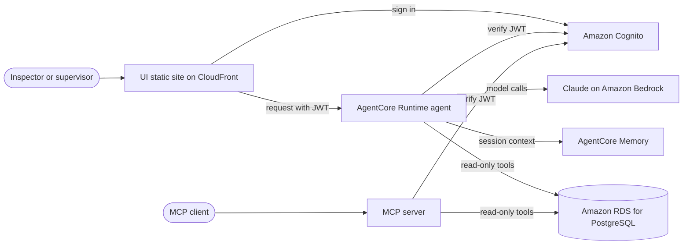

# inspection-agent

inspection-agent is a demo of an AI agent that answers questions about manufacturing inspection data. Users sign in, ask questions in natural language, and get answers limited to what their role is allowed to see. It is for developers and solution builders who want to evaluate an inspection-data agent on AWS.

## Architecture

## Demo

The demo questions are defined in [`.kiro/steering/product.md`](.kiro/steering/product.md). The synthetic stories, IDs, and expected answers behind them are in [`data/STORIES.md`](data/STORIES.md).

All data in this repository and in the demo is synthetic. It contains no real persons, customers, or inspection records.

## Prerequisites

- AWS CLI v2, installed, with credentials configured.
- Python 3.12.
- An AWS account with access to region `us-west-2`.
- Amazon Bedrock model access enabled for Claude models in `us-west-2`.
- GNU Make and bash.

Account-specific values in this repository are placeholders such as `<ACCOUNT_ID>`.

## Inputs

| Input | Default | Description |
|---|---|---|
| `ENV` | `demo` | Environment name, 1 to 10 characters, starts with a lowercase letter, lowercase letters and digits only. |
| `REGION` | `us-west-2` | AWS region used for every AWS CLI call in the run. |

Pass them to any command, for example `make deploy ENV=dev1 REGION=us-west-2`. Stacks are named `inspection-agent-<env>-<component>`.

## Deploy

`make deploy` runs all 13 steps below in order. Each step starts after the previous one completes.

1. network: `make deploy-network`
2. auth: `make deploy-auth`
3. database: `make deploy-database`
4. pre-runtime: `make deploy-pre-runtime`. It creates the artifact bucket and the execution role. The full deploy passes an empty `MemoryId` at this step.
5. package: `make package`. It builds the agent code package and uploads it to the artifact bucket.
6. runtime: `make deploy-runtime`. It creates the AgentCore runtime from the package.
7. memory: `make deploy-memory`. It publishes the memory ID as an SSM parameter.
8. pre-runtime update: the full deploy reads the memory ID produced by step 7 and updates the pre-runtime stack so `MemoryId` is that value.
9. runtime update: the full deploy updates the runtime stack so it reads the new memory ID from SSM.
10. observability: `make deploy-observability`
11. ui: `make deploy-ui`. It publishes the CloudFront callback URL and logout URL as SSM parameters.
12. auth update: the full deploy reads the callback URL and logout URL produced by step 11 and updates the auth stack with them.
13. mcp: `make deploy-mcp`

To update the agent code later, run `make package` and then `make deploy-runtime`.

### Per-component commands

Each command creates or updates one stack, or deletes it. Deleting an absent stack is skipped.

| Component | Deploy | Delete |
|---|---|---|
| network | `make deploy-network` | `make delete-network` |
| auth | `make deploy-auth` | `make delete-auth` |
| database | `make deploy-database` | `make delete-database` |
| pre-runtime | `make deploy-pre-runtime` | `make delete-pre-runtime` |
| runtime | `make deploy-runtime` (needs `make package` first) | `make delete-runtime` |
| memory | `make deploy-memory` | `make delete-memory` |
| observability | `make deploy-observability` | `make delete-observability` |
| ui | `make deploy-ui` | `make delete-ui` |
| mcp | `make deploy-mcp` | `make delete-mcp` |

## Teardown

`make teardown` deletes all 9 stacks in the order below. To delete them one at a time, run these commands in this order.

1. mcp: `make delete-mcp`
2. ui: `make delete-ui`
3. observability: `make delete-observability`
4. memory: `make delete-memory`
5. runtime: `make delete-runtime`
6. pre-runtime: `make delete-pre-runtime`. It empties the versioned artifact bucket first.
7. database: `make delete-database`
8. auth: `make delete-auth`
9. network: `make delete-network`

Run `make help` to list all targets.

## Repository layout

| Folder | Content |
|---|---|
| [`infra/`](infra/README.md) | CloudFormation templates, one per component. |
| [`src/inspection_core/`](src/inspection_core/README.md) | Shared Python package for database access, authorization, and tool functions. |
| [`src/inspection_agent/`](src/inspection_agent/README.md) | Strands agent and AgentCore entrypoint. |
| [`src/inspection_mcp/`](src/inspection_mcp/README.md) | MCP server. |
| [`data/`](data/README.md) | Database schema, data generator, seed files, and stories. |
| [`ui/`](ui/README.md) | Static site. |
| [`scripts/`](scripts/README.md) | Operational scripts. |
| [`docs/`](docs/README.md) | Project documentation. |

Further reading:

- [CloudFormation conventions](docs/cloudformation-conventions.md)
- [Kiro workflow](docs/kiro-workflow.md)

## License

This project is licensed under the MIT License. See [LICENSE](LICENSE).
